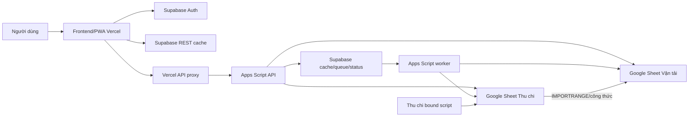
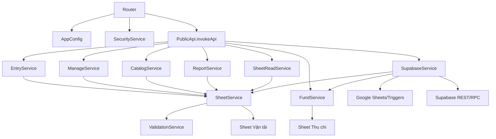
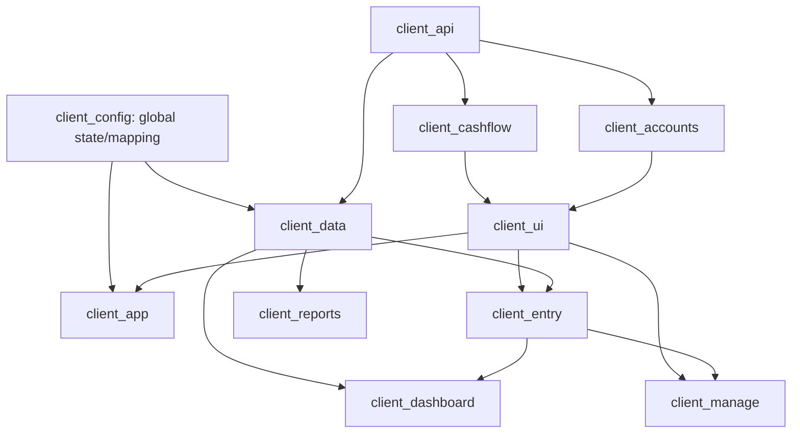

# AUDIT_REPORT

## 1. Phạm vi và phương pháp kiểm toán

Báo cáo này là kết quả Phase 2 — Technical Audit của dự án Vận tải Đông Bắc.

Phạm vi đã đọc và đối chiếu:

- toàn bộ Apps Script source ở root (`*.gs`);
- toàn bộ frontend source (`index.template.html`, `client_*.html`, `styles_*.html`);
- Vercel API proxy `api/app.js`;
- build/provision scripts;
- Supabase migrations;
- test source;
- schema snapshots của hai file Google Sheets;
- bound script snapshot của file Thu chi;
- tài liệu kiến trúc, vận hành và contract hiện có.

Không coi các nội dung sau là source tác giả cần đánh giá logic độc lập:

- `index.html`: artifact build từ template/fragments;
- ảnh/static assets;
- dependency code trong `node_modules`.

Phương pháp:

1. Lập inventory file, function và route.
2. Truy vết frontend → proxy → Apps Script → Sheet/Supabase.
3. Đo kích thước file và mật độ global functions/state.
4. Xác định ownership, side effect và platform dependency.
5. Đánh giá cohesion, coupling và Single Responsibility.
6. Đối chiếu source với schema, migrations, tests và tài liệu.
7. Đề xuất thứ tự refactor nhưng không thực hiện thay đổi.

Không có file code nào được sửa trong Phase 2.

## 2. Tóm tắt điều hành

Hệ thống hiện là một kiến trúc hybrid Google-Sheet-first:

- frontend/PWA trên Vercel;
- Supabase Auth, cache và write queue;
- Vercel serverless proxy làm lớp xác thực/RBAC;
- Apps Script độc lập làm API, worker và integration layer;
- Google Sheets giữ dữ liệu nghiệp vụ, công thức và báo cáo đối soát;
- file Thu chi còn có bound Apps Script riêng.

Kiến trúc hoạt động và đã có nhiều cơ chế giảm rủi ro thực tế: fallback đọc live, queue atomic claim, idempotency, cache audit, RBAC proxy và report preservation. Tuy nhiên source đã phát triển theo hướng tích lũy trách nhiệm vào một số “god modules”.

Các điểm kỹ thuật quan trọng nhất:

1. `SupabaseService.gs`, `SheetService.gs` và `FundService.gs` đều quá lớn và vi phạm Single Responsibility ở mức cao.
2. Các service facade mới (`EntryService`, `ManageService`, `ReportService`, `SheetReadService`) quá mỏng; chúng chưa tạo boundary implementation thật.
3. Frontend được chia file nhưng chạy trong một global scope, nên coupling vẫn cao và dependency không được khai báo.
4. `client_cashflow.html` là frontend god module rõ nhất.
5. Route, permission và API contract bị lặp ở frontend, proxy, Router và `PublicApi.invokeApi()`.
6. Business logic vẫn gắn mạnh với tên sheet, header tiếng Việt, row index và vị trí cột.
7. Test coverage hiện bảo vệ syntax và một số contract quan trọng nhưng chưa đủ cho refactor an toàn.
8. Việc chuyển ngay toàn bộ frontend sang React/Next.js là rủi ro cao; nên trích API/domain contracts và test trước, rồi migrate theo vertical slice nhỏ.

Kết luận kiến trúc: hệ thống chưa cần “đập đi xây lại”. Hướng an toàn là modularize theo seam hiện có, tạo test characterization trước, giữ Google Sheets và API behavior ổn định trong từng bước.

## 3. Kiến trúc hiện tại



### 3.1. Frontend

Kiểu kiến trúc:

- static HTML/CSS/JavaScript;
- source chia fragment;
- không dùng ES modules hoặc component framework;
- global variables/functions dùng chung;
- DOM ID là interface ngầm;
- `scripts/build.js` ghép fragment thành `index.html`.

Frontend hỗ trợ hai transport:

- `google.script.run` khi chạy trong Apps Script HtmlService;
- `fetch` qua `/api/app` khi chạy trên Vercel.

### 3.2. Vercel proxy

`api/app.js`:

- xác minh Supabase JWT;
- tra `app_users`;
- áp RBAC;
- xử lý account administration;
- forward request đến Apps Script bằng shared secret.

Proxy đang đóng đồng thời vai trò authentication gateway, authorization service, account service và Apps Script transport adapter.

### 3.3. Apps Script backend

Entry points:

- `Router.doGet()`;
- `Router.doPost()`;
- global functions trong `PublicApi.gs` cho `google.script.run`, editor, trigger và `clasp run`.

Các service nghiệp vụ:

- Vận tải chủ yếu trong `SheetService.gs`;
- Thu chi/Quỹ trong `FundService.gs`;
- cache/queue/trigger trong `SupabaseService.gs`;
- validation trong `ValidationService.gs`.

### 3.4. Google Sheets

File Vận tải chia theo:

- `NL_*`: dữ liệu nguồn;
- `DM_*`: danh mục;
- `XL_*`: xử lý;
- `BC_*`: báo cáo;
- `IMP_ThuChi` và `SYS_ReportCache`.

File Thu chi có:

- `NHAP_THUCHI`;
- `NHAP_VAY`;
- báo cáo/form/cấu hình;
- bound script positional.

### 3.5. Supabase

Vai trò:

- Auth/allowlist;
- JSON bundle cache;
- sync status;
- asynchronous write queue và logs.

Supabase chưa phải normalized operational database cho nghiệp vụ. Google Sheets vẫn là nguồn đối soát cuối cùng.

## 4. Danh sách module

### 4.1. Backend/platform

| Module | Source | Trách nhiệm hiện tại |
| --- | --- | --- |
| Runtime configuration | `AppConfig.gs` | Resolve file Vận tải theo request/năm/properties |
| HTTP router | `Router.gs` | GET/POST, render HtmlService, timing log |
| Public API/orchestration | `PublicApi.gs` | Global wrappers, API dispatch, direct/queue decision, sync wrapper |
| Security gate | `SecurityService.gs` | Proxy-secret enforcement |
| Transport core | `SheetService.gs` | Startup, catalogs, reports, write, CRUD, cache, report temp sheets |
| Transport validation | `ValidationService.gs` | Normalize/validate six form types |
| Entry facade | `EntryService.gs` | Delegate entry/CRUD/reconciliation |
| Manage facade | `ManageService.gs` | Delegate manage read |
| Catalog facade | `CatalogService.gs` | Catalog read customization/delegation |
| Report facade | `ReportService.gs` | Delegate dashboard/report reads |
| Sheet read facade | `SheetReadService.gs` | Delegate generic Sheet read |
| Fund domain | `FundService.gs` | Transactions, overview, loans, catalogs, caching/helpers |
| Supabase integration | `SupabaseService.gs` | Cache, queue, worker, trigger, audit, REST/RPC |

### 4.2. Vercel/backend edge

| Module | Source | Trách nhiệm |
| --- | --- | --- |
| API proxy | `api/app.js` | Auth, RBAC, account management, upstream forwarding |
| Admin provisioning | `scripts/provision-admin.js` | Tạo/reset admin bằng service role |

### 4.3. Frontend

| Module | Source | Trách nhiệm |
| --- | --- | --- |
| App configuration/state | `client_config.html` | Menu/form mapping, global state, utilities |
| API/Auth/cache client | `client_api.html` | Transport, Auth, Supabase REST, browser cache |
| App lifecycle | `client_app.html` | Init, navigation, render orchestration, image export |
| Data orchestration | `client_data.html` | Catalog/dashboard/report load, submit and refresh |
| Dashboard | `client_dashboard.html` | KPI/chart/latest trips/pending merge |
| Entry | `client_entry.html` | Form UI, pending transport jobs |
| Manage | `client_manage.html` | Read/filter/pagination/CRUD/optimistic rows |
| Catalog | `client_catalog.html` | Catalog filter/table/edit |
| Reports | `client_reports.html` | Report rendering/filter/export/subtotal |
| Cashflow | `client_cashflow.html` | Fund overview, transactions, loans, catalogs, queue UI |
| Accounts | `client_accounts.html` | Role UI, password, user administration |
| UI utilities/observability | `client_ui.html` | Loader, drawer, status, audit, formatting/date inputs |

### 4.4. Build/style/data support

| Module | Source |
| --- | --- |
| Static build | `scripts/build.js`, `index.template.html` |
| PWA icon generation | `scripts/generate-icons.js`, assets |
| Styling | `styles_*.html` |
| Supabase schema | `supabase/migrations/*.sql` |
| Tests | `tests/contracts.test.js`, `tests/production-rbac-smoke.js` |
| Bound Thu chi | `docs/source/thu_chi_bound_script/*` |

## 5. Quan hệ phụ thuộc giữa các module

### 5.1. Backend call graph



### 5.2. Frontend dependency graph



Đồ thị thực tế phức tạp hơn vì tất cả fragment cùng global scope; dependency không được import/declare và có thể đi hai chiều qua global state/DOM.

### 5.3. Data dependency

- `SheetService` phụ thuộc schema/tên/header Google Sheet Vận tải.
- `FundService` phụ thuộc schema/named ranges Google Sheet Thu chi.
- `SupabaseService` phụ thuộc payload shape của cả `SheetService` và `FundService`.
- frontend phụ thuộc trực tiếp payload shape của Apps Script và Supabase bundle.
- reports phụ thuộc công thức `XL_*`, `BC_*` và `IMP_ThuChi`.
- bound script Thu chi là external writer đối với web backend.

## 6. Module đang quá lớn

### 6.1. Backend

| File | Dòng | Đánh giá |
| --- | ---: | --- |
| `SupabaseService.gs` | 2.054 | Quá lớn, god service |
| `SheetService.gs` | 1.786 | Quá lớn, god service |
| `FundService.gs` | 1.706 | Quá lớn, nhiều bounded context |
| `PublicApi.gs` | 430 | Trung bình-lớn, quá nhiều orchestration/public functions |

### 6.2. Frontend JavaScript

| File | Dòng | Global declarations gần đúng | Đánh giá |
| --- | ---: | ---: | --- |
| `client_cashflow.html` | 1.838 | 368 | God frontend module |
| `client_manage.html` | 1.020 | 202 | Quá lớn |
| `client_reports.html` | 948 | 220 | Quá lớn |
| `client_ui.html` | 668 | 133 | Lẫn utility và feature |
| `client_dashboard.html` | 588 | 111 | Trung bình-lớn |
| `client_api.html` | 564 | 114 | Nhiều trách nhiệm hạ tầng |
| `client_data.html` | 552 | 80 | Orchestrator rộng |

Số global declarations là chỉ báo thô, gồm functions/variables; nó cho thấy phạm vi state/function chia sẻ lớn, không phải cyclomatic complexity chính xác.

### 6.3. CSS

| File | Dòng | Nhận xét |
| --- | ---: | --- |
| `styles_responsive.html` | 1.899 | Media-query/override tích lũy, dễ conflict |
| `styles_reports.html` | 834 | Feature CSS lớn |
| `styles_settings_modal.html` | 571 | UI-specific styles lớn |

CSS size không tự động là lỗi, nhưng override cascade làm migration component khó hơn.

## 7. Vi phạm Single Responsibility

### 7.1. `SupabaseService.gs` — mức nghiêm trọng

Trách nhiệm đang trộn:

- Supabase HTTP client/repository;
- cache serialization/upsert;
- report/startup/catalog/manage/fund sync;
- realtime tick scheduler;
- trigger installer/handler;
- write queue repository;
- worker dispatcher;
- idempotency orchestration;
- audit/hash comparison;
- sync status repository;
- feature flag parsing;
- month/date/key normalization.

Đây là vi phạm SRP rõ nhất backend. Một thay đổi REST adapter có thể ảnh hưởng worker, audit và sync nghiệp vụ.

### 7.2. `SheetService.gs` — mức nghiêm trọng

Trách nhiệm đang trộn:

- health/startup/bootstrap;
- catalog reads;
- report parsing;
- report cache trong Sheet;
- temp-sheet lifecycle;
- transport submit;
- reconciliation;
- generic Sheet CRUD;
- date/number serialization;
- runtime/chunked cache;
- format/formula preservation;
- latest trips/dashboard.

Tên `SheetService` che giấu nhiều domain khác nhau: Transport Entry, Catalog, Reporting, Manage CRUD và low-level spreadsheet adapter.

### 7.3. `FundService.gs` — mức nghiêm trọng

Trách nhiệm đang trộn:

- transaction repository;
- transaction validation/write;
- overview aggregation;
- loan domain/reconciliation;
- fund catalog management;
- named-range/native-range adapter;
- cache version/runtime cache;
- date/number/voucher/formula helpers;
- spreadsheet resolution.

Thu chi giao dịch, khoản vay và danh mục là ba bounded contexts đủ lớn để tách service.

### 7.4. `PublicApi.gs` — mức cao

Trách nhiệm:

- public function registry;
- API dispatcher;
- direct-vs-queue routing;
- sync-after-write decorator;
- trigger/admin wrappers;
- manual audit helper.

`PublicApi` vừa là controller, application service và operational command surface.

### 7.5. `api/app.js` — mức trung bình-cao

Trách nhiệm:

- request/response HTTP;
- Supabase Auth verification;
- allowlist repository;
- authorization policy;
- account CRUD;
- password service;
- Apps Script proxy transport;
- environment validation.

289 dòng vẫn quản lý được, nhưng responsibility đã tách thành ít nhất bốn logical services.

### 7.6. `client_cashflow.html` — mức nghiêm trọng

Trách nhiệm:

- tab navigation;
- fund overview/KPI/report;
- transaction form/batch/edit;
- pending fund jobs;
- fund catalog CRUD;
- loan overview/filter/history;
- loan add/payment drawers;
- date filtering/pagination;
- export/global loader.

Đây là bounded-context UI lớn nhất và dễ phát sinh regression chéo.

### 7.7. `client_ui.html` — mức cao

Trộn:

- generic loading/status/toast;
- drawers/mobile entry;
- Supabase sync status screen;
- audit controls/rendering;
- write job rendering;
- HTML escaping;
- money/date input utilities;
- native date picker.

Observability UI không nên cùng responsibility với general UI utilities.

### 7.8. `client_config.html` — mức trung bình-cao

Trộn:

- constants/config;
- form schemas;
- mapping;
- toàn bộ application mutable state;
- navigation tab helpers;
- date formatting;
- autocomplete component.

Config, state store và UI widget là ba trách nhiệm khác nhau.

### 7.9. `client_data.html` — mức cao

Trộn:

- local form row operations;
- catalog loading;
- transport submission;
- worker kick;
- reconciliation;
- dashboard loading;
- report caching/prefetch/refresh.

Đây là application orchestrator chung, coupling nhiều view.

## 8. Module có coupling cao

### 8.1. `SupabaseService` ↔ toàn backend

Coupling loại:

- gọi trực tiếp `SheetService` và `FundService`;
- hiểu payload/domain của nhiều module;
- hiểu schema/key Supabase;
- hiểu trigger/event Google Sheets;
- hiểu write semantics/idempotency;
- hiểu report/manage/fund month extraction.

Mức: rất cao.

### 8.2. `SheetService` ↔ Google Sheet schema

Coupling với:

- tên sheet;
- header text tiếng Việt;
- header row;
- column positions;
- controller/report ranges;
- formula behavior;
- CacheService/PropertiesService;
- `ValidationService`.

Mức: rất cao và khó unit test.

### 8.3. `FundService` ↔ file Thu chi

Coupling với:

- `NHAP_THUCHI`/`NHAP_VAY` positions;
- named ranges;
- formula strings;
- voucher format;
- loan reconciliation;
- runtime cache.

Mức: rất cao.

### 8.4. Frontend global scope

Coupling qua:

- mutable globals như `appData`, `activeForm`, `selectedMonth`, fund/manage states;
- functions gọi chéo không import;
- DOM IDs;
- shared pending arrays;
- shared toast/loader/role helpers;
- order include.

Mức: rất cao. File separation hiện là tổ chức vật lý, chưa phải module isolation.

### 8.5. API contract lặp

Action/permission/method xuất hiện ở:

- frontend call sites;
- `api/app.js`;
- `Router.gs`;
- `PublicApi.invokeApi()`;
- global wrappers;
- tests/docs.

Mức: cao; dễ route/permission drift.

### 8.6. Report coupling

`client_reports` ↔ backend matrix ↔ `BC_*` layout ↔ month controller ↔ Sheet cache ↔ Supabase bundle.

Mức: rất cao và business-critical.

### 8.7. Thu chi dual-writer coupling

`FundService` và bound script cùng ghi file Thu chi nhưng không chia sẻ transaction log/permission/cache hook.

Mức: cao về dữ liệu, thấp về source visibility — loại coupling nguy hiểm vì ngầm.

## 9. Facade hiện tại và boundary chưa hoàn chỉnh

| Facade | Dòng | Thực trạng |
| --- | ---: | --- |
| `EntryService.gs` | 24 | Delegate gần như toàn bộ về `SheetService` |
| `ManageService.gs` | 9 | Delegate một function |
| `ReportService.gs` | 24 | Delegate report functions |
| `SheetReadService.gs` | 9 | Delegate generic read |
| `CatalogService.gs` | 61 | Có customization nhỏ, còn phụ thuộc `SheetService` |

Đánh giá:

- Đây là seam tốt cho refactor tương lai.
- Chưa làm giảm complexity/coupling vì implementation chưa di chuyển.
- Không nên xóa facade; có thể dùng facade làm stable interface trong quá trình tách service.

## 10. Module có thể tách thành Service

Đây là đề xuất thiết kế, không phải thay đổi đã được phê duyệt.

### 10.1. Từ `SheetService.gs`

| Service đề xuất | Trách nhiệm |
| --- | --- |
| `SpreadsheetGateway` | openById, get sheet/range, serialization primitives |
| `TransportEntryService` | validate/build/append six `NL_*` forms |
| `TransportRowService` | read/update/clear/delete manage rows |
| `TransportCatalogService` | catalogs/form options/virtual `DM_ThamSo` |
| `TransportReportService` | dashboard/report bundle orchestration |
| `OverviewReportReader` | parse `BC_TongQuan`, KPI/details |
| `ReportTempSheetService` | create/cleanup temp sheets, controller month |
| `SheetReportCacheRepository` | `SYS_ReportCache` read/write/version |
| `TransportReconciliationService` | trip reconciliation |
| `RuntimeCacheService` | chunked CacheService keys/invalidation |
| `SheetWritePreserver` | segment write, formula/format/template preservation |

### 10.2. Từ `SupabaseService.gs`

| Service đề xuất | Trách nhiệm |
| --- | --- |
| `SupabaseHttpClient` | REST/RPC requests và error normalization |
| `BundleRepository` | upsert/read cache bundles |
| `SyncStatusRepository` | `sync_status` persistence |
| `ReportSyncService` | report/dashboard sync |
| `ManageSyncService` | manage recent/month sync và audit |
| `FundSyncService` | fund/cache/catalog sync |
| `StartupCatalogSyncService` | startup/catalog sync |
| `WriteJobRepository` | enqueue/read/update/retry jobs/logs |
| `WriteJobWorker` | atomic claim và job lifecycle |
| `TransportJobHandler` | execute transport actions/idempotency |
| `FundJobHandler` | execute fund batch/voucher idempotency |
| `RealtimeSyncScheduler` | tick rotation/locks |
| `TransportSheetTriggerService` | install/handle edit/change |
| `CacheAuditService` | stable hash và live/cache compare |

### 10.3. Từ `FundService.gs`

| Service đề xuất | Trách nhiệm |
| --- | --- |
| `FundSpreadsheetGateway` | resolve/open year file, header lookup |
| `FundTransactionRepository` | read/append/update/delete `NHAP_THUCHI` |
| `FundTransactionService` | validation, vouchers, batch rollback |
| `FundOverviewService` | metrics/category aggregation |
| `FundLoanRepository` | read/write `NHAP_VAY` |
| `FundLoanService` | state, payment, reconciliation |
| `FundCatalogRepository` | named/native catalog ranges |
| `FundCatalogService` | form options, fallback/CRUD rules |
| `FundCacheVersionService` | internal CacheService/version |

### 10.4. Từ Vercel proxy

| Service đề xuất | Trách nhiệm |
| --- | --- |
| `AuthService` | verify token and map auth user |
| `AppUserRepository` | allowlist CRUD |
| `AuthorizationPolicy` | role/action decisions |
| `AccountService` | create/update/password/reset |
| `AppsScriptClient` | upstream request/response normalization |

### 10.5. Từ frontend

Nếu vẫn giữ vanilla JS trước React:

- `ApiClient`;
- `AuthClient`;
- `SupabaseCacheClient`;
- `AppStateStore`;
- `TransportEntryController`;
- `ManageController`;
- `ReportController`;
- `FundTransactionController`;
- `FundLoanController`;
- `FundCatalogController`;
- `SyncStatusController`;
- shared date/money/HTML utilities.

## 11. Module có thể chuyển thành API

Phần lớn nghiệp vụ đã có API action. Câu hỏi thực tế là module nào có thể được chuẩn hóa thành resource-oriented/typed API riêng thay cho action dispatcher chung.

### 11.1. Ứng viên dễ chuẩn hóa

| Module | API resource đề xuất | Mức dễ |
| --- | --- | --- |
| Auth session/accounts | `/api/session`, `/api/users`, `/api/password` | Cao; đã xử lý tại Vercel |
| Catalog reads | `/api/catalogs/:key` | Cao; read-oriented |
| Sync status/audit | `/api/operations/sync-status`, `/api/audits/*` | Cao; tách khỏi business API |
| Write jobs | `/api/jobs/:id`, `/api/jobs/:id/retry` | Cao; lifecycle rõ |
| Dashboard/report reads | `/api/reports/:period` | Trung bình; payload lớn nhưng read-only |
| Manage reads | `/api/transport/sheets/:sheet/rows` | Trung bình |
| Fund reads | `/api/fund/:year/overview`, `/transactions`, `/loans` | Trung bình |

### 11.2. Ứng viên cần domain contract trước

| Module | Lý do |
| --- | --- |
| Transport writes | Form types và Sheet columns/công thức phụ thuộc mạnh |
| Generic `saveSheetRow/deleteSheetRow` | API quá generic, lộ row/header semantics |
| Fund transaction writes | Cần giữ voucher/idempotency/direct-vs-queue |
| Loan payments | Cần typed domain command và reconciliation rules |
| Catalog writes | Named range/virtual sheet semantics khác nhau |

### 11.3. Module không nên expose trực tiếp như public business API

- full backfill sync;
- trigger installers;
- temp sheet cleanup;
- generic arbitrary sheet read/write;
- raw Supabase service-role operations;
- `debugSheet`.

Các command vận hành này nên là internal/admin operations với authentication và audit riêng.

### 11.4. API architectural recommendation

Trước khi đổi URL/router, nên tạo internal typed command/query contracts:

- Query: read-only, no business side effect.
- Command: direct/queued result rõ.
- Operation: trigger/sync/audit/admin.

Sau đó Vercel/Next.js API có thể wrap contract mà không thay Google Sheet implementation ngay.

## 12. Khả năng chuyển sang React/Next.js

### 12.1. Điều kiện chung

Frontend hiện không thể chuyển an toàn chỉ bằng đổi JSX vì:

- state global;
- functions gọi chéo;
- DOM manipulation trực tiếp;
- HTML string rendering;
- implicit API/cache behavior;
- CSS cascade lớn;
- pending jobs dùng nhiều view.

Nên chuyển theo vertical slice và giữ Apps Script/Supabase API phía sau trong giai đoạn đầu.

### 12.2. Module dễ chuyển nhất

#### 1. Accounts/Settings account

Mức dễ: cao.

Lý do:

- API tại Vercel rõ;
- state nhỏ;
- form/table CRUD tiêu chuẩn;
- ít phụ thuộc Google Sheet payload;
- RBAC behavior xác định.

Component có thể gồm:

- `ChangePasswordForm`;
- `UserList`;
- `CreateUserForm`;
- `UserRoleEditor`;
- `TemporaryPasswordDialog`.

#### 2. Sync status/audit

Mức dễ: cao.

Lý do:

- read/action API rõ;
- cards/tables độc lập;
- không phải domain data entry chính;
- dễ giữ feature parity.

#### 3. Catalog read-only tables

Mức dễ: trung bình-cao.

Lý do:

- table/filter/pagination chuẩn;
- payload headers/rows rõ;
- có thể migrate read-only trước edit.

Khó khăn: dynamic header/virtual sheet và edit modal.

#### 4. Report viewer

Mức dễ: trung bình.

Lý do:

- chủ yếu read-only;
- backend đã trả matrix;
- tab/filter/export có thể component hóa.

Rủi ro: sticky table, subtotal, export image/CSV, exact Sheet semantics.

#### 5. Dashboard

Mức dễ: trung bình.

Lý do:

- read-oriented;
- KPI/chart/card tự nhiên cho React;
- cache query có thể dùng hook.

Rủi ro: pending trip merge và image export.

### 12.3. Module chuyển sau

#### Manage

Mức dễ: thấp-trung bình.

Lý do khó:

- dynamic headers;
- nhiều sheet/filter đặc thù;
- optimistic update;
- rowIndex/concurrency;
- pending job overlay;
- responsive table/card dual mode.

#### Entry

Mức dễ: thấp-trung bình.

Lý do khó:

- dynamic forms;
- catalog/autocomplete;
- batch rows;
- reconciliation;
- write queue/poll;
- shared state với Manage/Dashboard.

### 12.4. Module khó nhất

#### Cashflow

Mức dễ: thấp.

Lý do:

- 1.838 dòng;
- bốn subdomains trong một file;
- nhiều drawers/forms/pagination/filter;
- queue pilot;
- loan state/reconciliation;
- catalog editor;
- KPI exclusion for pending.

Nên tách domain/controller trong vanilla hoặc shared typed contracts trước khi migrate UI.

### 12.5. Next.js boundary phù hợp

Next.js có thể thay:

- static Vercel frontend;
- `api/app.js` bằng route handlers/server actions có kiểm soát;
- account/auth session APIs;
- typed proxy đến Apps Script;
- server-side environment handling.

Không nên trong bước đầu:

- chuyển business formulas khỏi Google Sheets;
- chuyển worker khỏi Apps Script;
- thay Supabase cache schema;
- đổi direct/queue semantics;
- rewrite toàn bộ UI trong một release.

### 12.6. Thứ tự migration UI đề xuất

1. Tạo typed API client/contracts và characterization tests.
2. Dựng Next.js shell/Auth/layout song song.
3. Migrate Accounts.
4. Migrate Sync Status/Audit.
5. Migrate Catalog read-only rồi edit.
6. Migrate Reports.
7. Migrate Dashboard.
8. Migrate Entry.
9. Migrate Manage.
10. Tách và migrate Cashflow theo Overview → Transactions → Loans → Catalog.

## 13. Các rủi ro kỹ thuật

### 13.1. Dữ liệu và công thức

- Ghi đè formula/helper columns.
- `rowIndex` dịch chuyển sau physical delete.
- typed column/smart chip lỗi format sau write.
- `ARRAYFORMULA` làm last row giả.
- formula người dùng trong cell nghiệp vụ bị chuyển thành value.
- danh mục lịch sử sửa đè làm thay báo cáo cũ.

### 13.2. Báo cáo

- Header matching sai.
- Frontend tự diễn giải lại bảng.
- month key `MM/YYYY`/`YYYY-MM`/`Tất cả` lẫn nhau.
- temp sheet timeout/sót.
- `IMPORTRANGE` chưa cập nhật khi sync cache.
- cached bundle stale nhưng request kỹ thuật thành công.

### 13.3. Queue và consistency

- Sheet write thành công nhưng job update lỗi.
- stale worker retry tạo duplicate nếu thiếu idempotency.
- pending row bị tính vào KPI/export.
- job synced overlay dữ liệu đã xóa.
- trigger thiếu/trùng.
- full sync timeout.

### 13.4. Security

- direct Apps Script exposure nếu enforcement tắt.
- permission drift UI/proxy/RLS.
- RLS cache chưa tách visibility theo role.
- direct Google Sheet edit ngoài web RBAC.
- bound script/bot ngoài proxy.
- secret local bị commit/copy log.

### 13.5. Maintainability

- god services;
- global frontend scope;
- route registry lặp;
- schema coupling bằng string/position;
- facade không sở hữu implementation;
- docs/source drift;
- hard-coded năm 2026;
- `node_modules` và native binary được track.

### 13.6. Testability

- Apps Script globals/platform APIs khó mock;
- domain logic lẫn I/O;
- test hiện chủ yếu syntax/regex;
- thiếu golden report fixtures;
- thiếu Sheet integration fixture;
- bound script chưa có test/version mapping.

## 14. Technical Debt

### TD-001 — God services

Files: `SupabaseService.gs`, `SheetService.gs`, `FundService.gs`.

Hậu quả: thay đổi nhỏ có blast radius lớn, khó review/test.

### TD-002 — Anemic facade layer

Các service facade tồn tại nhưng chỉ delegate. Architecture intent và implementation ownership không khớp.

### TD-003 — Global frontend application

Không có module isolation, type safety hoặc state ownership rõ.

### TD-004 — Action-based API registry phân tán

Action/method/permission/handler không có single registry executable.

### TD-005 — Generic Sheet CRUD lộ persistence semantics

`saveSheetRow/deleteSheetRow` truyền `sheetName`, `rowIndex`, `rowData`, làm UI biết chi tiết storage.

### TD-006 — Domain logic trộn với infrastructure

Validation, calculation, header lookup, Sheet I/O, caching và sync nằm chung function/file.

### TD-007 — Cache payload không version hóa rõ

Bundle JSON phụ thuộc shape service/frontend; key có version ngầm hoặc cache version riêng lẻ nhưng chưa có schema version thống nhất.

### TD-008 — Manual string/header/date normalization lặp

Các service/frontend có nhiều helper parse/normalize riêng, có nguy cơ khác behavior.

### TD-009 — Hard-coded configuration/year

Nhiều call site Thu chi truyền `2026`; migration sang năm mới chưa được abstraction hoàn chỉnh.

### TD-010 — Bound script ownership không versioned

Snapshot chưa gắn production project/version/trigger state.

### TD-011 — CSS override accumulation

Responsive/report/settings CSS lớn, phụ thuộc cascade và selector global.

### TD-012 — Build artifact committed

`index.html` cần commit để static/deploy flow hiện tại nhưng tạo nguy cơ source/artifact drift.

### TD-013 — Repository dependency hygiene

`node_modules` và native packages được Git track; thiếu dependency workflow sạch.

### TD-014 — Insufficient automated behavioral tests

Không đủ regression safety cho formula, queue, cache và reports.

### TD-015 — Operational commands cùng public surface

Trigger installers, worker, sync, audit và business API cùng nằm trong `PublicApi.gs`/global functions.

### TD-016 — Multiple cache layers không có unified observability

Browser, Apps Script cache, Sheet report cache và Supabase bundle cần chẩn đoán thủ công theo từng lớp.

### TD-017 — Shared mutable runtime config

`APP_CONFIG` là global được activate theo request/event. Trong Apps Script execution isolation thường chấp nhận được, nhưng làm dependency ẩn và khó test.

## 15. Đề xuất thứ tự Refactor

Đây là roadmap kỹ thuật đề xuất, không phải lệnh thực hiện. Mỗi phase cần phê duyệt, test và rollback riêng.

### Phase R0 — Đóng băng behavior và tạo safety net

Ưu tiên: bắt buộc trước refactor cấu trúc.

1. Chốt API/Sheet/cache/RBAC contracts.
2. Tạo golden report fixtures cho các tháng đã xác nhận.
3. Tạo Google Sheet bản sao integration fixture.
4. Thêm test row mapping/formula preservation.
5. Thêm queue idempotency/state transition tests.
6. Thêm action registry/RBAC consistency checks.
7. Xác minh bound script source live/version.

Lý do: refactor hiện tại không có đủ test để chứng minh behavior giữ nguyên.

### Phase R1 — Tách pure utilities và infrastructure adapters

Rủi ro thấp nhất nếu giữ API.

1. Chuẩn hóa date/number/month normalization.
2. Tách `SupabaseHttpClient`.
3. Tách `SpreadsheetGateway`/write-preservation helpers.
4. Tách cache key builders.
5. Tách stable stringify/hash/audit normalization.

Không đổi payload/route/Sheet structure.

### Phase R2 — Làm thật các facade Vận tải

1. Di chuyển implementation Entry từ `SheetService` sang `TransportEntryService` sau facade.
2. Di chuyển Manage read/CRUD.
3. Di chuyển Catalog.
4. Di chuyển Reconciliation.
5. Giữ `SheetService` làm compatibility facade trong giai đoạn chuyển tiếp.

Thực hiện từng vertical slice, không bulk move.

### Phase R3 — Tách report subsystem

Chỉ sau golden tests.

1. `TransportReportService`.
2. `OverviewReportReader`.
3. `ReportTempSheetService`.
4. `SheetReportCacheRepository`.
5. `DashboardService`/latest trips.

Giữ exact matrix/payload behavior.

### Phase R4 — Tách Supabase sync khỏi queue

1. `BundleRepository`/`SyncStatusRepository`.
2. Sync services theo module.
3. `WriteJobRepository`.
4. `WriteJobWorker` + action handlers.
5. Trigger/scheduler services.
6. Audit service.

Mục tiêu: queue worker không hiểu mọi cache detail; handler trả changed scopes/events để sync layer xử lý.

### Phase R5 — Tách Fund bounded contexts

1. Fund transaction repository/service.
2. Fund overview aggregation.
3. Loan repository/service.
4. Catalog repository/service.
5. Spreadsheet gateway/cache version.

Giữ voucher/reconciliation formulas nguyên.

### Phase R6 — Chuẩn hóa application/API layer

1. Tạo command/query registry duy nhất.
2. Typed request/response schemas.
3. Tách operational/admin actions.
4. Giảm duplicate Router/`invokeApi`/proxy mapping.
5. Giảm generic Sheet CRUD trong public API bằng domain commands.

Không đổi frontend trong cùng bước lớn nếu chưa có compatibility layer.

### Phase R7 — Modularize frontend vanilla

Nếu chưa chuyển React ngay:

1. Tách config khỏi mutable state.
2. Tách API/Auth/Supabase clients.
3. Tách shared utilities.
4. Tách observability khỏi `client_ui`.
5. Tách Cashflow thành bốn submodules.
6. Tách pending job store dùng chung.

Mục tiêu: tạo seam để migrate framework.

### Phase R8 — React/Next.js incremental migration

Thứ tự:

1. Shell/Auth.
2. Accounts.
3. Sync Status/Audit.
4. Catalog.
5. Reports.
6. Dashboard.
7. Entry.
8. Manage.
9. Cashflow từng subdomain.

Giữ Apps Script/Supabase contracts tương thích đến khi toàn bộ consumer chuyển xong.

### Phase R9 — Year/configuration hardening

1. Year context model chung.
2. Cutover runbook.
3. File registry/config API.
4. Cache namespace theo year/spreadsheet thống nhất.
5. Trigger installation per-year.
6. Bound script/file copy verification.

Không thực hiện chung với UI rewrite.

### Phase R10 — Repository/build hygiene

1. Quyết định bỏ tracked `node_modules`.
2. Chuẩn hóa dependency manifest/lockfile.
3. CI build/test/artifact check.
4. Secret scanning.
5. Generated artifact policy.

Đây là phase độc lập để tránh trộn diff cơ học lớn với nghiệp vụ.

## 16. Ưu tiên refactor theo rủi ro/giá trị

| Ưu tiên | Hạng mục | Giá trị | Rủi ro thực hiện |
| ---: | --- | --- | --- |
| 1 | Golden reports + Sheet write tests | Rất cao | Thấp-trung bình |
| 2 | Queue/idempotency tests | Rất cao | Trung bình |
| 3 | Supabase HTTP/repository extraction | Cao | Trung bình |
| 4 | Transport facade implementation split | Cao | Trung bình |
| 5 | Report subsystem split | Cao | Cao nếu thiếu fixture |
| 6 | Fund bounded-context split | Cao | Cao |
| 7 | API registry/typed contracts | Cao | Trung bình-cao |
| 8 | Frontend state/API modularization | Cao | Trung bình-cao |
| 9 | Incremental React/Next migration | Trung bình-cao | Cao |
| 10 | Full database-first redesign | Chưa xác định | Rất cao, ngoài mục tiêu hiện tại |

## 17. Những việc không nên làm đầu tiên

- Rewrite toàn bộ React/Next.js trong một lần.
- Chuyển source of truth sang Supabase cùng lúc refactor UI.
- Di chuyển công thức báo cáo khỏi Google Sheets khi chưa có golden tests.
- Xóa facade vì “không có logic”.
- Đổi API action và service internals cùng lúc không có compatibility layer.
- Tách file cơ học hàng nghìn dòng mà không tách dependency/test.
- Chuẩn hóa header/tên sheet bằng rename production.
- Queue mọi thao tác write, đặc biệt physical delete.
- Xóa bound script legacy khi chưa xác minh usage.
- Dọn `node_modules` trong cùng commit với business refactor.

## 18. Tiêu chí cho một refactor an toàn

Một phase refactor chỉ nên bắt đầu khi:

- phạm vi module rõ;
- behavior contract được ghi;
- test characterization tồn tại;
- không đổi schema Google Sheet ngoài migration riêng;
- không đổi API payload ngoài version/compatibility plan;
- direct/queue semantics giữ hoặc được rollout bằng flag;
- report numbers có baseline;
- RBAC regression tests có;
- rollback rõ;
- diff không trộn deploy/config/repository cleanup ngoài chủ đề.

Definition of done:

- code owner/responsibility rõ hơn;
- coupling đo được giảm;
- tests pass;
- production behavior giữ nguyên;
- không có dữ liệu/formula/cache regression;
- tài liệu module/API/data flow cập nhật.

## 19. Đánh giá mức sẵn sàng refactor hiện tại

| Khu vực | Sẵn sàng | Điều kiện thiếu chính |
| --- | --- | --- |
| Account proxy extraction | Khá | Unit/RBAC tests chi tiết hơn |
| Supabase HTTP client extraction | Khá | Response/error characterization |
| Catalog read service | Trung bình-khá | Schema drift verification |
| Transport entry split | Trung bình | Sheet formula integration tests |
| Manage split | Trung bình | Row identity/concurrency tests |
| Report split | Thấp-trung bình | Golden fixtures |
| Fund transaction split | Trung bình | Batch/voucher/rollback tests |
| Loan split | Trung bình | Full reconciliation fixture |
| Cashflow React migration | Thấp | Domain/controller split |
| Accounts React migration | Khá | Stable typed API client |
| Full Next.js migration | Thấp | Incremental architecture plan/tests |

## 20. Kết luận Phase 2

Hệ thống có kiến trúc vận hành thực tế và nhiều biện pháp bảo vệ được hình thành từ incident thật, nhưng complexity hiện tập trung ở ba backend god services và một frontend global application.

Rủi ro lớn nhất không phải là thiếu framework mới mà là thiếu isolation và behavioral safety net cho dữ liệu/công thức/báo cáo. Vì vậy thứ tự đúng là:

```text
Characterization tests
→ infrastructure adapters
→ service boundaries
→ API contracts
→ frontend modularization
→ React/Next.js incremental migration
```

Không nên bắt đầu bằng rewrite hoặc đổi source of truth.

## 21. Trạng thái báo cáo

- Phase: 2 — Technical Audit.
- Phạm vi: toàn bộ source code và execution contexts trong repository.
- Ngày kiểm toán: 2026-07-11.
- Loại thay đổi: chỉ tạo báo cáo.
- Code refactor: không thực hiện.
- Code/schema/feature changes: không thực hiện.
- Bước tiếp theo: chỉ bắt đầu refactor planning/implementation khi người dùng phê duyệt phase riêng.
