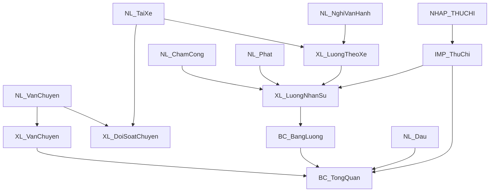

# PROJECT_SCHEMA

## 1. Vai trò của tài liệu

Đây là schema index ngắn của dự án Vận tải Đông Bắc.

File này không còn là nơi mô tả toàn bộ kiến trúc, API, frontend hoặc từng công thức. Chi tiết đã được chuyển sang các tài liệu có owner rõ trong `docs/`.

Agent dùng file này để:

- xác định đúng hai workbook nghiệp vụ;
- biết nhóm sheet và nguồn schema snapshot;
- nhận diện các invariant cấu trúc;
- tìm đúng contract chi tiết;
- biết các điểm schema drift chưa được giải quyết.

## 2. Nguồn thông tin có thẩm quyền

| Chủ đề | Tài liệu/source chính |
| --- | --- |
| Điểm bắt đầu cho Agent | `docs/ai/AI_START_HERE.md` |
| Kiến trúc hệ thống | `docs/architecture/SYSTEM_ARCHITECTURE.md` |
| Module và ownership | `docs/architecture/MODULE_MAP.md` |
| Luồng dữ liệu | `docs/architecture/DATA_FLOWS.md` |
| API | `docs/contracts/API_CONTRACTS.md` |
| Google Sheet schema/invariant | `docs/contracts/SPREADSHEET_CONTRACTS.md` |
| Supabase cache/queue | `docs/contracts/CACHE_AND_QUEUE_CONTRACTS.md` |
| Auth/RBAC | `docs/contracts/RBAC_MATRIX.md` |
| Bound script Thu chi | `docs/legacy/THU_CHI_BOUND_SCRIPT.md` |
| Schema Vận tải snapshot | `docs/schema/VanTaiDongBac_2026_schema.json` |
| Schema Thu chi snapshot | `docs/schema/thu_chi_2026_schema_raw_20260625_175010.json` |
| Supabase schema thực thi | `supabase/migrations/*.sql` |

Khi tài liệu và source/live state mâu thuẫn, ưu tiên quy tắc trong `AGENTS.md` và thứ tự xác minh tại `docs/ai/AI_START_HERE.md`.

## 3. Mô hình dữ liệu cấp cao

Hệ thống có hai module nghiệp vụ độc lập:

1. Vận tải
   - dữ liệu nằm trong Google Sheet Vận tải theo từng năm;
   - chứa dữ liệu nhập, danh mục, xử lý và báo cáo.

2. Thu chi/Quỹ
   - dữ liệu nằm trong Google Sheet Thu chi theo từng năm;
   - là module/menu riêng của web app;
   - chứa giao dịch, khoản vay và danh mục Thu chi.

Hai workbook không được gộp. File Vận tải nhận một phần dữ liệu Thu chi qua `IMP_ThuChi` bằng `IMPORTRANGE`/công thức.

Google Sheets vẫn là nguồn dữ liệu đối soát cuối cùng. Supabase là lớp Auth, cache, queue và trạng thái đồng bộ.

## 4. File Vận tải theo năm

Apps Script độc lập resolve Spreadsheet ID qua request/year/Script Properties và mở file bằng:

```javascript
SpreadsheetApp.openById(id)
```

Script Properties được hỗ trợ:

- `ACTIVE_SPREADSHEET_ID`;
- `DEFAULT_SPREADSHEET_ID`;
- `SPREADSHEET_ID_<year>`.

Không dùng `SpreadsheetApp.getActiveSpreadsheet()` làm nguồn dữ liệu chính của web app độc lập.

### 4.1. Nhóm sheet Vận tải

| Nhóm | Vai trò | Quy tắc |
| --- | --- | --- |
| `NL_*` | Dữ liệu nhập liệu/vận hành | Web app chỉ ghi cột nghiệp vụ được phép |
| `DM_*` | Danh mục/tham số | CRUD có kiểm soát, giữ lịch sử/công thức |
| `XL_*` | Xử lý/đối soát | Không ghi dữ liệu nghiệp vụ trực tiếp |
| `BC_*` | Báo cáo | Chủ yếu đọc, giữ controller/công thức |
| `IMP_ThuChi` | Import Thu chi | Không append từ web app |
| `SYS_ReportCache` | Cache báo cáo Sheet đã nghỉ | Không còn thuộc runtime; chỉ migration retirement/restore được phép truy cập |

### 4.2. Sheet nhập liệu được web app hỗ trợ

| Form | Sheet | Header row | Row builder columns |
| --- | --- | ---: | ---: |
| `vanChuyen` | `NL_VanChuyen` | 2 | 8 |
| `taiXe` | `NL_TaiXe` | 1 | 7 |
| `dau` | `NL_Dau` | 2 | 10 |
| `chamCong` | `NL_ChamCong` | 1 | 11 |
| `phat` | `NL_Phat` | 1 | 7 |
| `nghiVanHanh` | `NL_NghiVanHanh` | 1 | 10 |
| — | `NL_PhanCongLai` | 1 | 4 cột nhập + 1 cột kiểm tra |

Số cột row builder không bằng tổng số cột vật lý trong mọi sheet. Các cột vật lý phía sau có thể là formula/helper; không được mở rộng write range chỉ dựa vào `getLastColumn()`.

Live audit ngày 2026-08-10 và đối chiếu bổ sung ngày 2026-08-28 xác nhận:

- `NL_VanChuyen` có thêm cột H `Khối lượng thực tế (m³)`; cột này là input tùy chọn.
- Từ ngày 2026-08-29, header cột C của `NL_VanChuyen` là `Biển số`; backend chấp nhận thêm alias legacy `Biển số xe` tại đúng vị trí để retry job cũ an toàn.
- `NL_TaiXe` dùng cột D `Nhóm vận hành`, tự xác định theo `DM_PhanCongXe` và ngày hiệu lực; web app không cho ghi một dự án chi tiết vào cột này.
- `NL_Dau` có 10 cột; `Thành tiền` và `Công ty sở hữu` là cột công thức, `Ghi Chú` ở cột J là input.
- `NL_NghiVanHanh` có 10 cột và dùng Nhóm vận hành/`TẤT CẢ XE`; các cột KPI/kiểm tra do Sheet tính.
- `NL_PhanCongLai` là sheet nhập/đối soát mới gồm `Tháng, Tài xế, Công ty, Ghi chú, Kiểm tra`; web app hiện chỉ cho xem/sửa dòng có sẵn, chưa có form append riêng.
- Nhiều `DM_*` chứa bảng phụ/helper ở bên phải bảng chính, được ngăn bằng cột header trống. Tab Danh mục web chỉ được đọc/ghi/clear bảng chính liên tục từ cột A đến trước header trống đầu tiên.

### 4.3. Sheet xử lý và báo cáo chính

Snapshot hiện có:

- `XL_DoiSoatChuyen`;
- `XL_VanChuyen`;
- `XL_LuongTheoXe`;
- `XL_LuongNhanSu`;
- `XL_ThuongQuanLy`;
- `BC_TongQuan`;
- `BC_BangLuong`;
- `BC_TongHopXe`.

Live workbook ngày 2026-08-28 bổ sung:

- `SYS_AggLuongThangXe`: helper phân bổ tổng lương tài xế theo `Tháng + Tài xế + Biển số`, không phải vùng nhập liệu;
- `BC_TongHopDuAn`: gồm hai bảng đọc độc lập, `A:G` tổng hợp theo nhóm và `I:O` chi tiết theo dự án;
- `BC_TongHopXe` mở rộng thành 14 cột, thêm `Chi phí lương lái` và `Lãi sau lương` trước `Ghi chú`;
- `BC_BangLuong` dùng đủ 16 cột, gồm `BHXH`, `Công ty` và `Ghi chú` theo header live.

Webapp đọc các bảng báo cáo này theo đúng vùng cố định, không ghi vào `BC_*`/`SYS_*`. Bundle Supabase và fingerprint freshness phải chứa cả hai bảng của `BC_TongHopDuAn`.

`BC_TongQuan!B1` là controller tháng. Web app không được đổi controller trên sheet gốc để đọc kỳ khác; implementation dùng sheet tạm, ưu tiên cache Supabase và tính trực tiếp khi cache miss. `SYS_ReportCache` không còn tham gia runtime.

### 4.4. Danh mục chính

Snapshot hiện có:

- `DM_DuAn`;
- `DM_Xe`;
- `DM_NhanSu`;
- `DM_ThamSo`;
- `DM_LuongChuyen`;
- `DM_DonGiaVanChuyen`;
- `DM_ThuongQuanLy`;
- `DM_PhatNoiBo`.

Live workbook còn có các danh mục nghiệp vụ đã được web app hỗ trợ:

- `DM_CheDoLuong`;
- `DM_GiaDau`;
- `DM_PhanCongXe`;
- `DM_UuDaiNoiBo`.

`DM_ThamSo_TS` là tên hiển thị frontend map về `DM_ThamSo`. Lịch sử giá dầu hiện dùng sheet vật lý `DM_GiaDau`; virtual catalog cũ `DM_ThamSo_GD` đã nghỉ.
Cột C `Ghi chú` của `DM_GiaDau` là cột công thức chênh lệch giá từ dòng 3; webapp chỉ được sửa A:B.

## 5. File Thu chi theo năm

`FundService` resolve và mở file Thu chi riêng theo `year`. Không dùng Spreadsheet ID Vận tải làm file Thu chi.

### 5.1. Sheet chính

| Sheet | Vai trò |
| --- | --- |
| `NHAP_THUCHI` | Dữ liệu giao dịch Thu/Chi |
| `NHAP_VAY` | Dữ liệu vay/trả/lãi |
| `BC_THUCHI` | Dashboard/form trực tiếp trong Sheet |
| `BC_VAY` | Dashboard/form khoản vay |
| `CAIDAT` | Danh mục, số dư và named ranges |
| `INPHIEU` | Template phiếu Thu/Chi |
| `BOT_USERS` | User model bot legacy |
| `BOT_MEDIA` | Media metadata bot legacy |
| `BOT_LOG` | Log bot legacy |
| `PHANBO_VAY` | Bảng công thức lập phương án phân bổ trả nợ nhiều khoản; không phải nguồn giao dịch và web app không ghi vào sheet này |

### 5.2. `NHAP_THUCHI`

Header row 1. Các cột chính:

- A `Số phiếu`;
- B `Ngày`;
- C `MỤC THU`;
- D `MỤC CHI`;
- E `Hình thức`: cột vật lý legacy đã ẩn/ngừng dùng; web app ghi rỗng cho giao dịch mới và bảo toàn giá trị lịch sử khi sửa;
- F `Số tiền`;
- G `Người Thu/ Chi`;
- H `Đối tác`;
- I `Nội dung`;
- J `Công nợ`;
- K là helper legacy phải bảo toàn;
- L `Cấn trừ`: checkbox chỉ áp dụng cho giao dịch `Chi`; vẫn tính vào chi phí/báo cáo Vận tải nhưng không làm thay đổi số dư Quỹ;
- M `Công nợ còn lại` là cột công thức chỉ đọc;
- N `Lọc` là helper/filter phải bảo toàn.

Web app đọc cột M `Công nợ còn lại` cho màn hình Công nợ nhưng không ghi trực tiếp vào cột công thức này.

Voucher là identity/idempotency quan trọng cho queued add transaction.

### 5.3. `NHAP_VAY`

Header row 1. Các cột chính:

- A `Mã`;
- B `Ngày`;
- C `Loại`;
- D `Hình thức`: cột vật lý legacy đã ẩn/ngừng dùng; web app ghi rỗng cho dòng mới và không còn hiển thị trường này trên form;
- E `Đối tác`;
- F `Số tiền`;
- G–J điều khoản vay;
- K `Nội dung`;
- L–M là helper/reserved phải bảo toàn; N là helper filter do một `ARRAYFORMULA` tại `N2` quản lý và writer không được ghi trực tiếp vào `N3:N`.

Không thay đổi mã vay hoặc reconciliation rule khi chưa có đối soát/migration riêng.

### 5.4. Named ranges

Named ranges quan trọng trong snapshot:

- `MUCTHU`;
- `MUCCHI`;
- `HINHTHUC`;
- `TM`;
- `TK`;
- `TMDK`;
- `TKDK`;
- `NGAYNHAPLIEU`;
- `NGAYTINHVAY`;
- `NOPTIEN`;
- `RUTTIEN`.

Không đổi tên hoặc di chuyển range nếu chưa cập nhật cả `FundService`, formula, validation và bound script.

Admin/operator web app chỉ được cập nhật giá trị của `TMDK`, `TKDK`, `NGAYNHAPLIEU`, `NGAYTINHVAY`; không tạo hoặc di chuyển named range.

## 6. Bound script Thu chi

Source snapshot nằm tại:

```text
docs/source/thu_chi_bound_script/
```

Đây là Apps Script gắn với file Thu chi, khác Apps Script backend độc lập của web app.

Bound script:

- dùng active spreadsheet/cell;
- xử lý menu, macro, cell buttons và `onEdit`;
- có thể ghi `NHAP_THUCHI`/`NHAP_VAY` trực tiếp;
- phụ thuộc tọa độ cố định trong `BC_THUCHI`, `BC_VAY`, `INPHIEU`;
- nằm ngoài Vercel proxy, web RBAC và write queue.

Theo quyết định người dùng ngày 2026-08-10, web app không triển khai luồng in phiếu/`INPHIEU`; đây không phải phần parity bắt buộc.

Source trong repository là reference snapshot, chưa mặc nhiên đồng bộ production live. Xem `docs/legacy/THU_CHI_BOUND_SCRIPT.md` trước mọi thay đổi.

## 7. Dependency dữ liệu chính



Chi tiết dependency đầy đủ nằm trong `docs/contracts/SPREADSHEET_CONTRACTS.md`.

## 8. Invariant cấu trúc

Không được tự ý:

- đổi tên sheet;
- đổi thứ tự hoặc chèn cột;
- xóa/ghi đè formula;
- sửa protected/calculated sheet như dữ liệu nguồn;
- gộp hai workbook;
- thay `IMPORTRANGE` bằng copy values;
- sửa named ranges;
- coi virtual sheet là physical sheet;
- dùng Supabase cache để sửa ngược Google Sheet;
- sửa cấu trúc production mà không có migration riêng.

Append/update phải giữ:

- formula/helper columns;
- format;
- validation;
- date value thực;
- row identity/idempotency metadata;
- report/controller contract.

## 9. Schema drift đã biết

### 9.1. `DM_PhanCongLaiXe` và `XL_NgoaiLe`

Tài liệu/schema cũ từng nhắc:

- `DM_PhanCongLaiXe`;
- `XL_NgoaiLe`.

Snapshot Vận tải chuẩn hóa hiện không liệt kê hai sheet này và ghi nhận formula hiện tại không còn tham chiếu chúng. Source/frontend có thể vẫn còn mapping liên quan.

Quy tắc:

- không tự tạo lại;
- không tự xóa reference code;
- kiểm tra production live và call sites khi tác vụ liên quan.

### 9.2. Số cột vật lý khác row builder

Một số `NL_*` có nhiều cột vật lý hơn số cột nghiệp vụ. Không ghi toàn row theo physical column count.

### 9.3. Bound script timezone

Manifest snapshot Thu chi dùng `America/New_York`, trong khi hệ thống chính dùng `Asia/Saigon`. Trạng thái live chưa được xác minh; không tự đổi.

### 9.4. Snapshot có thể cũ hơn production

Schema JSON là bằng chứng tại thời điểm export. Khi thay đổi cấu trúc, phải kiểm tra live Sheet rồi tạo snapshot mới; không sửa tay snapshot cũ.

## 10. Routing tài liệu theo tác vụ

| Tác vụ | Đọc thêm |
| --- | --- |
| Hiểu kiến trúc/module | `SYSTEM_ARCHITECTURE.md`, `MODULE_MAP.md` |
| API/frontend-backend | `API_CONTRACTS.md`, source call sites |
| Đọc/ghi Google Sheet | `SPREADSHEET_CONTRACTS.md` |
| Supabase/cache/queue | `CACHE_AND_QUEUE_CONTRACTS.md`, `SUPABASE_SCHEMA.md`, migrations |
| Auth/role | `RBAC_MATRIX.md` |
| Thu chi bound behavior | `THU_CHI_BOUND_SCRIPT.md`, source snapshot |
| Kiểm thử | `TEST_STRATEGY.md` |
| Rủi ro/refactor | `KNOWN_RISKS.md`, `AUDIT_REPORT.md` |
| Deploy/rollback | `WORKFLOW.md`, `ROLLBACK.md` |

Agent không cần đọc tất cả tài liệu trong mọi tác vụ. Thứ tự chọn tài liệu nằm trong `docs/ai/AI_START_HERE.md`.

## 11. Trạng thái tài liệu

- Loại tài liệu: schema index.
- Phạm vi: hai workbook Google Sheets và đường dẫn đến contract/schema chi tiết.
- Nguồn kiểm chứng: source, schema snapshots và bộ tài liệu contract Phase 1.
- Ngày xác nhận gần nhất: 2026-08-10 theo source/schema contract hiện có; live workbook vẫn phải được audit read-only trước migration cấu trúc.
- Nội dung lịch sử chi tiết trước đây đã được thay bằng các owner docs trong `docs/` để tránh trùng lặp và stale.
- Cần cập nhật khi: workbook/sheet/named range/source snapshot hoặc schema owner thay đổi.
