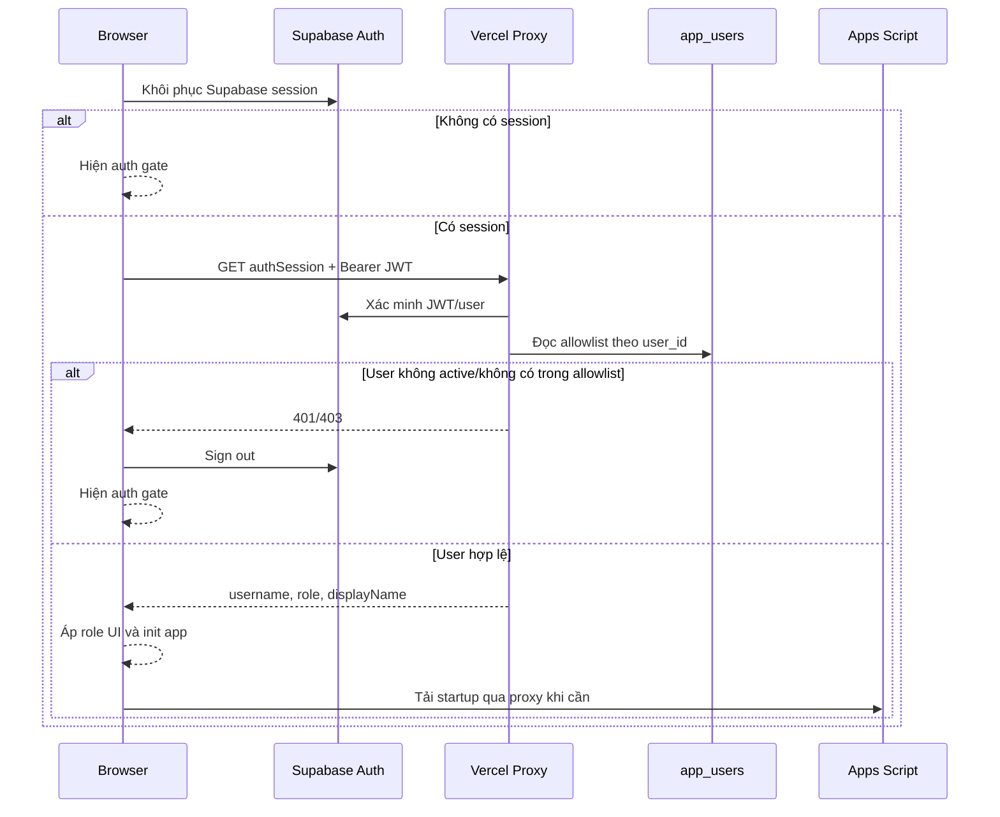
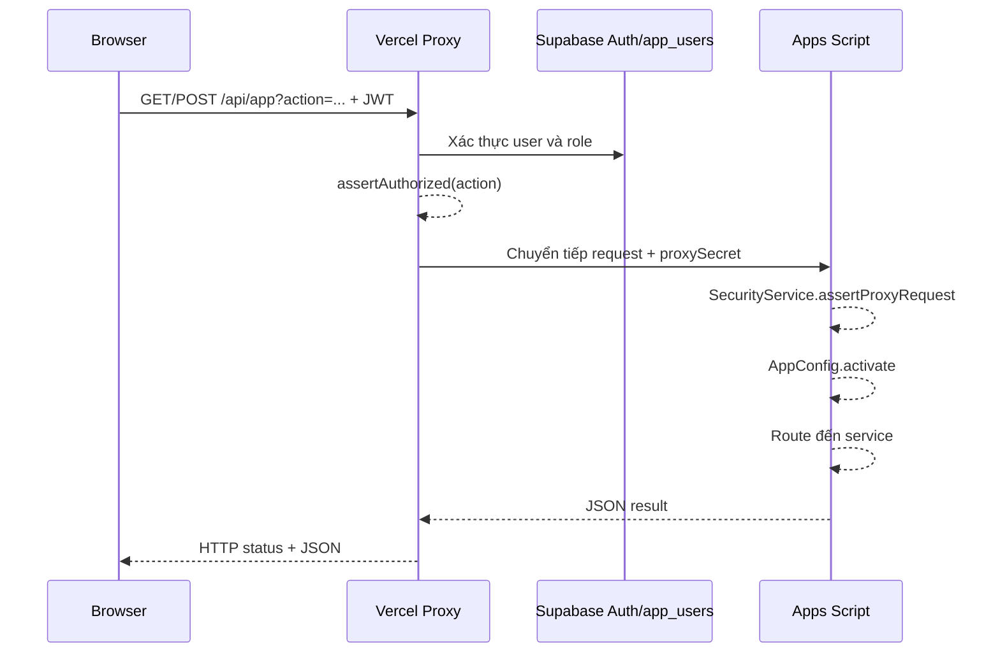
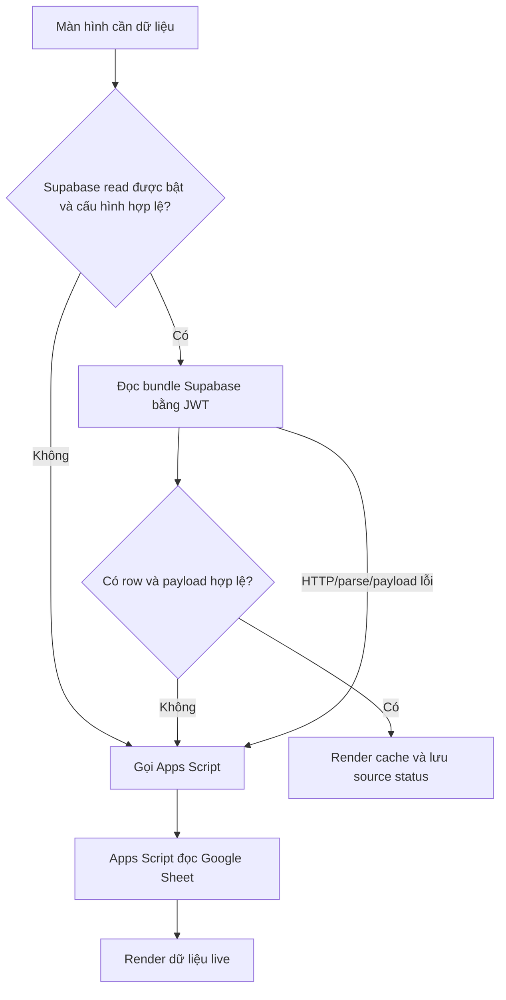
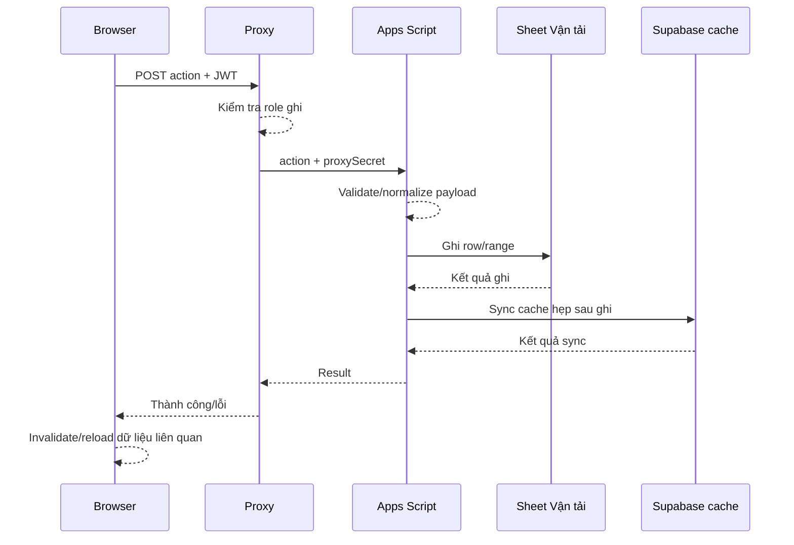
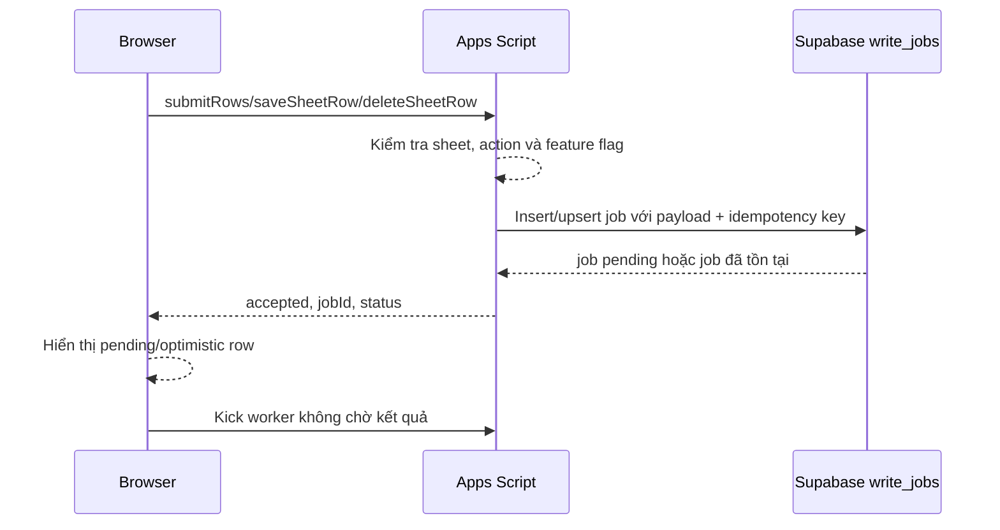
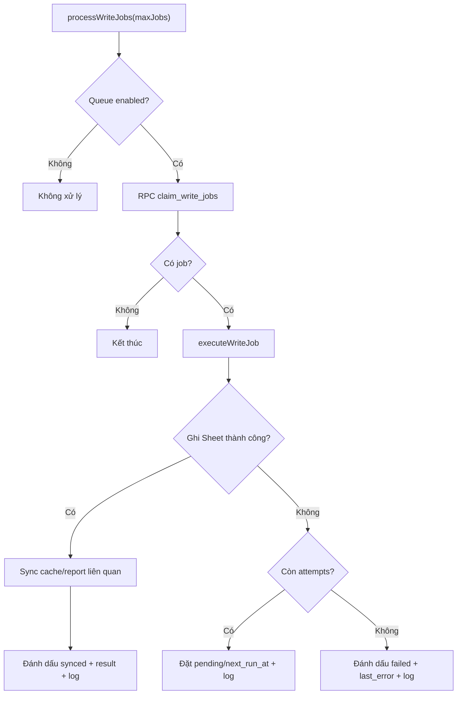
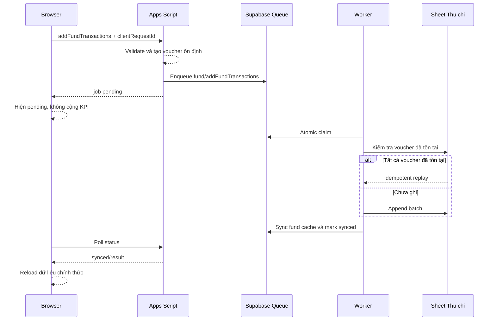
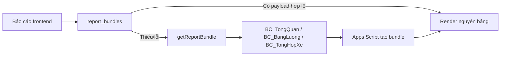
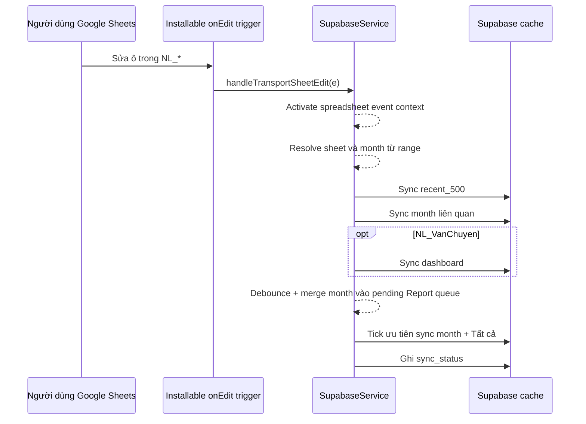
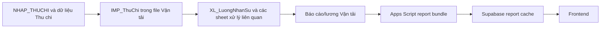

# DATA_FLOWS

## 1. Mục đích và phạm vi

Tài liệu này mô tả cách dữ liệu di chuyển qua hệ thống Vận tải Đông Bắc ở trạng thái hiện tại.

Phạm vi gồm:

- khởi động ứng dụng và xác thực;
- đọc dữ liệu từ Supabase cache và fallback Apps Script;
- ghi trực tiếp vào Google Sheets;
- ghi bất đồng bộ qua Supabase write queue;
- đồng bộ Google Sheet → Supabase;
- luồng báo cáo;
- luồng Thu chi/Quỹ;
- liên kết Thu chi → Vận tải;
- cache phía browser;
- trạng thái lỗi, retry và nhất quán cuối cùng.

Tài liệu này không thay thế API contract hoặc spreadsheet contract chi tiết. Tên payload và cột chỉ được nêu khi cần giải thích luồng.

## 2. Ký hiệu và nguồn dữ liệu

### 2.1. Thành phần

| Ký hiệu | Thành phần |
| --- | --- |
| Browser | Frontend/PWA trong trình duyệt |
| Proxy | Vercel serverless function `api/app.js` |
| Auth | Supabase Auth và `app_users` |
| Apps Script | Backend Apps Script độc lập |
| Worker | Apps Script worker xử lý `write_jobs` |
| Supabase | Cache, queue, log và trạng thái đồng bộ |
| Sheet Vận tải | File Google Sheet Vận tải theo năm |
| Sheet Thu chi | File Google Sheet Thu chi theo năm |
| Bound script | Apps Script gắn trực tiếp với Sheet Thu chi |

### 2.2. Phân loại dữ liệu

- Dữ liệu chuẩn: dữ liệu và công thức trong Google Sheets dùng để đối soát cuối cùng.
- Cache server: các bundle JSON trong Supabase.
- Cache Sheet lịch sử: `SYS_ReportCache` đã nghỉ khỏi runtime và chờ migration retirement.
- Cache runtime: Apps Script `CacheService`/Script Properties cache.
- Cache browser: state trong Client Component; session xác thực nằm trong HttpOnly cookie phía Next boundary.
- Write intent: job trong `write_jobs`, chưa đồng nghĩa đã ghi vào Sheet.
- Optimistic row: dòng frontend hiển thị tạm trước khi worker xác nhận.

## 3. Nguyên tắc điều phối dữ liệu

1. Google Sheets vẫn là nguồn đối soát cuối cùng.
2. Frontend ưu tiên cache Supabase khi feature flag và cấu hình cho phép.
3. Cache thiếu hoặc lỗi phải fallback Apps Script nếu chức năng hỗ trợ fallback.
4. Không chạy full cache backfill trong request tương tác của người dùng.
5. Một số thao tác ghi phản hồi sau khi enqueue, trước khi Google Sheet được cập nhật.
6. Trạng thái queue phải được phân biệt với trạng thái dữ liệu trong Sheet.
7. Sau ghi, chỉ đồng bộ các cache liên quan theo module/sheet/tháng khi có thể.
8. Trigger xử lý chỉnh sửa trực tiếp trong Sheet theo mô hình gần realtime, không phải realtime tuyệt đối.
9. Báo cáo ưu tiên dữ liệu và ý nghĩa từ Google Sheet, không tự dựng lại công thức nghiệp vụ ở frontend.

## 4. Luồng khởi động và xác thực

### 4.1. Khởi động production có Auth

Điểm kiểm soát:

- Supabase Auth xác minh danh tính.
- `app_users` xác định tài khoản được phép dùng ứng dụng và role.
- Browser lưu Supabase session theo cơ chế của SDK; mật khẩu không được lưu thô trong code.
- Username được nhớ riêng trong `localStorage` để hỗ trợ form đăng nhập.
- Proxy là điểm enforce permission cho API từ Vercel.

### 4.2. Apps Script root sau D1

Apps Script không còn khởi động giao diện. Request không có `action` nhận JSON hướng dẫn mở ứng dụng Next; request API hợp lệ tiếp tục qua proxy-secret gate và service hiện hữu.

### 4.3. Dữ liệu startup

Frontend cố lấy startup bundle gồm dữ liệu cần cho màn hình đầu. Đường ưu tiên:

1. `startup_bundles` trong Supabase;
2. Apps Script `getStartupData`;
3. render state và tiếp tục tải các phần còn lại.

Startup không đồng nghĩa đã tải toàn bộ danh mục, báo cáo hoặc dữ liệu Vận hành.

## 5. Luồng API từ Browser đến Apps Script

### 5.1. Qua Vercel proxy

Proxy không trực tiếp đọc/ghi Google Sheet. Nó xác thực, phân quyền và chuyển tiếp action nghiệp vụ.

### 5.2. Trong Apps Script

Đường xử lý phổ biến:

`Router.doGet/doPost -> PublicApi.invokeApi hoặc service -> facade -> implementation -> Google Sheet/Supabase`

Đối với POST HTTP:

1. `Router.doPost()` parse body.
2. Activate Spreadsheet context.
3. Kiểm tra proxy secret.
4. Chuẩn hóa method, params và body.
5. Chuyển về `invokeApi()`.

Đối với GET HTTP, một số action được route trực tiếp trong `Router.doGet()`. Vì vậy khi thay đổi action phải đối chiếu cả Router, `invokeApi()` và proxy permission.

## 6. Luồng đọc Supabase-first

### 6.1. Luồng tổng quát

Frontend phải reject bundle có payload nghiệp vụ `ok: false`; không được coi đó là cache thành công.

### 6.2. Các nhóm cache đọc

| Màn hình/chức năng | Bảng Supabase | Key chính |
| --- | --- | --- |
| Startup | `startup_bundles` | `form_type` |
| Danh mục dùng cho form | `catalog_bundles` | `catalog_key` theo form |
| Bảng Danh mục | `catalog_bundles` | `catalog_key` theo display sheet |
| Dashboard | `report_bundles` | `report_month=__dashboard_latest__` + `spreadsheet_id` |
| Báo cáo | `report_bundles` | `report_month` + `spreadsheet_id` |
| Vận hành gần nhất | `manage_data_bundles` | `sheet_name`, `filter_key=recent_500` |
| Vận hành theo tháng | `manage_data_bundles` | `sheet_name`, `filter_key=month:YYYY-MM` |
| Tổng quan Thu chi | `fund_overview_bundles` | `year`, `month_key` |
| Giao dịch Thu chi gần nhất | `fund_transaction_bundles` | `year`, `filter_key=recent_500` |
| Giao dịch Thu chi theo tháng | `fund_transaction_bundles` | `year`, `filter_key=month:YYYY-MM` |
| Khoản vay | `fund_loan_bundles` | `year`, `month_key` |
| Form/danh mục Thu chi | `catalog_bundles` | key riêng theo year/group |
| Trạng thái sync | `sync_status` | `sync_key`/module |
| Trạng thái ghi | `write_jobs` | `id`, module/action |

### 6.3. Đọc khoảng thời gian nhiều tháng

Vận hành và giao dịch Thu chi có thể chia khoảng ngày thành các month key:

1. frontend xác định danh sách `YYYY-MM` phủ khoảng thời gian;
2. đọc bundle từng tháng;
3. hợp nhất payload;
4. lọc chính xác lại theo ngày;
5. dedupe/pagination theo logic màn hình;
6. fallback Apps Script nếu cache không đáp ứng.

Không được giả định một bundle tháng tự chứa dữ liệu ngoài tháng đó.

## 7. Cache phía Browser

### 7.1. Các tầng

Frontend Next có thể giữ dữ liệu trong state của Client Component. Session server dùng HttpOnly cookie; `localStorage` chỉ dùng cho preference không nhạy cảm như theme.

### 7.2. Invalidation

Sau thao tác ghi hoặc force refresh, frontend có thể:

- tăng epoch/xóa report session cache;
- xóa cache theo prefix;
- bỏ sheet data cache tương ứng;
- đọc Apps Script trực tiếp một lần;
- reload bundle sau khi job synced.

Khi dữ liệu hiển thị cũ, phải kiểm tra browser cache trước khi kết luận Supabase hoặc Google Sheet sai.

### 7.3. Dữ liệu lỗi trong cache

Response chứa `ok: false` không được lưu hoặc tái sử dụng như dữ liệu thành công. Khi phát hiện cache browser kiểu này, frontend xóa entry và fallback nguồn live.

## 8. Luồng ghi trực tiếp Vận tải

### 8.1. Luồng tổng quát

Đường trực tiếp được dùng khi action không được queue hoặc queue flag không bật.

### 8.2. Thêm dòng

`ValidationService` chuyển object frontend thành row theo form. `SheetService`:

- xác định header row và append row;
- bảo toàn các cột cần bỏ qua;
- copy format/công thức từ dòng trước;
- ghi các segment dữ liệu;
- clear runtime cache.

Không được set format rộng sau ghi nếu có thể đụng typed column/smart chip của Google Sheets.

### 8.3. Sửa dòng

Frontend gửi `sheetName`, `rowIndex` và `rowData`. Backend:

- xác định sheet thật;
- đọc header và dòng hiện tại;
- bỏ qua cột công thức/không được ghi;
- ghi các segment cho phép;
- sync cache liên quan.

Khi có `expectedRowData`, backend có thể từ chối nếu dòng hiện tại đã khác dữ liệu cũ.

### 8.4. Xóa dòng hoặc clear cột

Có hai ý nghĩa khác nhau:

- `columnsToClear` có giá trị: clear các cột nghiệp vụ được chỉ định, giữ cấu trúc dòng;
- không có `columnsToClear`: physical `deleteRow()`.

Physical delete làm dịch chuyển `rowIndex`; vì vậy không được retry bất đồng bộ theo chỉ số dòng cũ.

## 9. Luồng ghi Vận tải qua write queue

### 9.1. Enqueue

Điều kiện queue Vận tải hiện tập trung cho sheet `NL_*` và action được allowlist.

### 9.2. Pending state ở frontend

Frontend lưu job gần đây và dùng chúng cho:

- nhật ký giao dịch vừa thực hiện;
- dòng tạm trong bảng Vận hành;
- dữ liệu chuyến gần nhất trên Tổng quan;
- optimistic update hoặc ẩn dòng khi sửa/xóa.

Chỉ job `pending`, `processing` hoặc `failed` được overlay vào dữ liệu nghiệp vụ. Job `synced` chỉ giữ trong nhật ký để tránh làm sống lại dòng đã bị xóa trực tiếp trong Sheet.

### 9.3. Worker claim và thực thi

RPC claim dùng row lock và `skip locked` để nhiều worker không nhận cùng một job. Job `processing` quá stale có thể được claim lại.

### 9.4. Idempotency append Vận tải

Khi worker append:

- payload mang `jobId`/idempotency context;
- backend tìm range đã được đánh Developer Metadata `WRITE_JOB_ID`;
- nếu đã tồn tại, trả kết quả replay thay vì append lại;
- nếu chưa tồn tại, ghi row rồi gắn metadata.

Metadata gắn write intent với vùng đã ghi trong Sheet.

### 9.5. Sửa/xóa qua queue

Queued save mang:

- `sheetName`;
- `rowIndex`;
- `rowData` mới;
- `previousRowData`.

Worker so sánh dòng hiện tại với `previousRowData` trước khi ghi để tránh sửa nhầm khi Sheet đã thay đổi.

Queued delete chỉ được phép khi có `columnsToClear`. Worker từ chối physical delete trong queue.

### 9.6. Hoàn tất ở frontend

Browser poll `getWriteJobStatus(jobId)`:

- `pending`: tiếp tục chờ;
- `processing`: tiếp tục chờ;
- `synced`: bỏ optimistic overlay, invalidate cache và reload nguồn thật;
- `failed`: giữ trạng thái lỗi và cung cấp retry nếu được phép.

## 10. Luồng nhập giao dịch Thu chi

### 10.1. Ghi trực tiếp

Khi queue Thu chi không bật:

1. frontend validate các dòng;
2. gửi `addFundTransactions`;
3. Apps Script mở file Thu chi theo năm;
4. tạo voucher cho từng dòng;
5. append batch vào `NHAP_THUCHI`;
6. copy/bảo toàn công thức cần thiết;
7. nếu lỗi giữa batch, rollback vùng vừa ghi;
8. sync fund overview và transaction bundles;
9. trả spreadsheet/sheet/khoảng dòng để truy vết.

### 10.2. Ghi qua queue pilot

`clientRequestId` tạo idempotency key phía queue. Voucher ổn định bảo vệ thêm một lớp tại Google Sheet.

### 10.3. Sửa/xóa giao dịch

Sửa và xóa Thu chi hiện chủ yếu đi theo đường ghi trực tiếp:

- update row theo `rowIndex`;
- delete/clear row theo logic `FundService`;
- bump fund data version;
- sync fund bundles liên quan.

Không được suy ra rằng queue add đã bao phủ update/delete.

## 11. Luồng tổng quan Thu chi

### 11.1. Nguồn đọc

`FundService.getFundOverview()` đọc giao dịch trong file Thu chi, sau đó:

- phân loại Thu/Chi;
- áp dụng filter tháng;
- tính metric trong kỳ;
- tính số liệu lũy kế/đến hiện tại khi cần;
- nhóm category và chi tiết;
- tạo danh sách tháng.

### 11.2. Cache

Apps Script ghi kết quả vào `fund_overview_bundles` theo:

- `year`;
- `month_key=''` cho latest/all context;
- `month_key=YYYY-MM` cho tháng cụ thể.

Sau giao dịch mới, sync hẹp gồm overview latest và các tháng lấy từ payload. Pending job chưa synced không được cộng vào KPI frontend.

## 12. Luồng khoản vay

### 12.1. Ghi dữ liệu vay/trả

Các action chính:

- thêm khoản vay;
- trả nợ;
- trả lãi;
- tất toán hoặc trả một phần.

`FundService` tạo row phù hợp trong `NHAP_VAY`, giữ công thức dư nợ/bộ lọc và bump cache version.

### 12.2. Đọc và tổng hợp

`FundService.getFundLoanOverview()`:

1. đọc các dòng vay/trả;
2. chuẩn hóa loại giao dịch;
3. resolve mã thanh toán;
4. nhóm theo khoản vay;
5. tính borrowed, principal paid và outstanding;
6. tạo lịch sử và metric theo filter;
7. trả `loanKey`/dữ liệu truy vết nội bộ.

### 12.3. Đối soát mã thanh toán sai

Luồng đối soát:

1. ưu tiên ghép chính xác mã vay;
2. nếu mã trả không tồn tại, tìm khoản vay cùng đối tác phát sinh trước ngày trả;
3. chỉ tự đối soát khi có đúng một ứng viên;
4. số dư ứng viên phải khớp hoàn toàn số tiền trả;
5. giữ `reconciledFromCode` để truy vết mã gốc.

Nếu điều kiện không duy nhất hoặc không khớp số dư, không tự ghép.

### 12.4. Cache

Kết quả được ghi vào `fund_loan_bundles` theo `year` và `month_key`. Sau write liên quan, sync latest và tháng có trong payload; nếu không xác định được tháng thì dùng fallback các tháng gần nhất.

## 13. Luồng danh mục

### 13.1. Danh mục Vận tải

Đọc:

`Browser -> catalog_bundles -> fallback CatalogService/SheetService -> DM_*`

Ghi:

`Browser -> save/deleteSheetRow -> DM_* -> sync startup + catalog bundles`

`DM_ThamSo_TS` và `DM_ThamSo_GD` là display sheet ảo. Backend map chúng về các vùng trong `DM_ThamSo`.

### 13.2. Danh mục Thu chi

Nguồn có thể gồm:

- named range;
- cột native trong sheet cấu hình;
- catalog hỗ trợ;
- fallback từ giá trị đã có trong giao dịch.

Ghi chỉ được thực hiện trong vùng/group đã resolve. Sau ghi, sync fund form options và fund catalog bundles.

## 14. Luồng Báo cáo Vận tải

### 14.1. Đọc báo cáo latest/Tất cả

Frontend render bảng tổng quan/chi tiết từ payload backend. Không tự đặt lại tên danh mục hoặc xây công thức KPI mới nếu Sheet đã cung cấp dữ liệu chuẩn.

### 14.2. Đọc chi tiết một tháng

`BC_TongQuan!B1` điều khiển tháng báo cáo. Backend không thay đổi controller trên sheet gốc trong request đọc.

Luồng hiện tại:

1. kiểm tra chi tiết đúng `cache_version` + `source_data_version` trong Supabase;
2. nếu cache hợp lệ, trả chi tiết đã cache;
3. nếu thiếu/lỗi, cleanup sheet tạm cũ;
4. copy `BC_TongQuan` thành sheet tạm;
5. đổi tên sheet tạm;
6. đặt controller tháng trên bản tạm;
7. flush và đọc kết quả công thức;
8. giữ kết quả trong memory của execution và upsert full `report_bundles`;
9. xóa sheet tạm trong `finally`;
10. trả bundle. Không đọc, ghi hoặc tái tạo `SYS_ReportCache`.

Nếu execution timeout trước cleanup, lần chạy sau và hàm cleanup thủ công xử lý cả tên `_TMP_BC_TongQuan_*`, `Bản sao của BC_TongQuan...` và `Copy of BC_TongQuan...`.

### 14.3. Báo cáo `Tất cả`

Chi tiết `Tất cả` được tổng hợp từ các ma trận tháng active. Backend cố giữ format/ý nghĩa cell theo template thay vì yêu cầu Google Sheet đổi controller nhiều lần trên sheet gốc.

### 14.4. Sync báo cáo sau ghi

Sau write Vận tải:

1. trích month key từ các field ngày trong payload;
2. sync report bundle từng tháng liên quan;
3. có thể sync thêm `Tất cả`;
4. nếu không tìm được tháng, fallback các tháng báo cáo gần nhất.

Dashboard/chuyến gần nhất có đường sync riêng.

## 15. Luồng chỉnh sửa trực tiếp trong Sheet Vận tải

### 15.1. Edit event

### 15.2. Change/delete row event

`onChange` có thể không cung cấp active sheet đáng tin cậy. Khi biết sheet, hệ thống sync recent bundle, tháng gần nhất và dashboard nếu cần.

Khi không biết sheet, Manage/dashboard fallback hiện tập trung hẹp vào `NL_VanChuyen` và hai tháng gần nhất. Riêng Report queue được nâng thành `full=true`, vì row đã xóa hoặc structural event không còn đủ dữ liệu để suy ra tháng an toàn.

### 15.3. Giới hạn

- trigger có thể trễ hoặc thất bại;
- không phải mọi thay đổi công thức lan truyền đều phát ra event phù hợp;
- Apps Script có execution limit;
- cache vẫn có thể tạm thời cũ;
- mục tiêu edit thông thường là cache mới trong khoảng tối đa 2 phút; full structural refresh có thể lâu hơn;
- trigger trực tiếp hiện chỉ cài trên workbook Vận tải; thay đổi thủ công ở workbook Thu chi/công thức lan truyền không tự động có cùng SLA;
- `sync_status` và audit dùng để quan sát, không phải transaction guarantee.

## 16. Luồng liên kết Thu chi → Vận tải

Liên kết được thực hiện bằng công thức Google Sheets như `IMPORTRANGE` và công thức phân loại. Vì vậy:

- ghi Thu chi có thể gián tiếp thay đổi báo cáo Vận tải;
- thay đổi này không nhất thiết đi qua API Vận tải;
- cache báo cáo Vận tải có thể cần sync sau khi công thức đã cập nhật;
- không được gộp hai file hoặc thay liên kết bằng copy dữ liệu nếu chưa có yêu cầu kiến trúc riêng.

## 17. Luồng bound script Thu chi

Bound script chạy khi người dùng thao tác trực tiếp trong file Thu chi.

Các luồng quan sát được:

- `onEdit` phản ứng với checkbox/form trong `BC_THUCHI` và `BC_VAY`;
- tạo giao dịch vay/trả vào `NHAP_VAY`;
- chuẩn bị dữ liệu phiếu in trong `INPHIEU`;
- macro điều hướng/lọc báo cáo;
- cell button và menu thao tác;
- theme thay đổi giao diện cell;
- hàm đọc số thành chữ.

Bound script có thể thay đổi cùng dữ liệu mà web app đọc nhưng không đi qua Vercel proxy, `PublicApi` hoặc write queue. Vì vậy các thay đổi từ bound script phụ thuộc cơ chế sync/refresh khác để xuất hiện trên frontend.

Trạng thái source trong repository là reference snapshot. Trước khi sửa phải xác nhận nó còn khớp bound project đang chạy.

## 18. Luồng đồng bộ định kỳ và full backfill

### 18.1. Tick gần realtime

`syncRealtimeCache()`:

- dùng lock/cache guard để tránh chạy chồng;
- chọn một bước từ danh sách luân phiên;
- có thể sync dashboard, report gần nhất, fund gần nhất, catalog/startup hoặc một sheet Vận hành;
- cập nhật trạng thái;
- kết thúc trong phạm vi nhỏ.

### 18.2. Full backfill

`syncFullRealtimeCache()` gọi các nhóm lớn:

- startup/catalog;
- dashboard;
- toàn bộ report bundle;
- toàn bộ fund bundle;
- toàn bộ manage data bundle.

Full backfill là thao tác vận hành thủ công, có thể mất nhiều phút và không được đặt trong request người dùng hoặc trigger tick ngắn.

### 18.3. Sync hẹp thủ công

Các function public cho phép sync:

- một report month;
- một manage sheet hoặc month;
- dashboard;
- startup/catalog;
- fund overview/transactions/loans theo year/month.

Khi sửa cache sai, ưu tiên sync hẹp đúng phạm vi trước khi chạy full backfill.

## 19. Trạng thái nhất quán và lỗi

### 19.1. Mô hình nhất quán

Hệ thống dùng eventual consistency giữa Google Sheets và Supabase.

Các trạng thái có thể xảy ra:

| Trạng thái | Google Sheet | Supabase cache | `write_jobs` | Frontend |
| --- | --- | --- | --- | --- |
| Chưa gửi | Chưa đổi | Chưa đổi | Không có | Form local |
| Pending | Chưa đổi | Chưa đổi | `pending` | Optimistic row |
| Processing | Có thể đang ghi | Có thể cũ | `processing` | Optimistic row/spinner |
| Sheet đã ghi, cache đang sync | Đã đổi | Có thể cũ | `processing` | Vẫn pending |
| Synced | Đã đổi | Đã sync phạm vi liên quan | `synced` | Reload dữ liệu thật |
| Failed trước ghi | Chưa đổi | Chưa đổi | `failed`/retry | Hiện lỗi |
| Failed sau ghi, trước cache | Đã đổi | Có thể cũ | Có thể retry/failed | Cần idempotency + audit |
| Sửa trực tiếp Sheet | Đã đổi | Cũ đến khi trigger/tick | Không có | Có thể thấy dữ liệu cũ |

### 19.2. Lỗi sau khi Sheet đã ghi

Đây là tình huống quan trọng nhất:

1. worker ghi Google Sheet thành công;
2. sync cache hoặc update job thất bại;
3. retry có thể chạy lại.

Idempotency ở Sheet và queue phải nhận biết write đã thực hiện. Không được mặc định lỗi response nghĩa là Sheet chưa đổi.

### 19.3. Cache sai hoặc cũ

Trình tự chẩn đoán:

1. kiểm tra optimistic/pending overlay;
2. kiểm tra browser/session cache;
3. kiểm tra job status;
4. kiểm tra `sync_status`;
5. chạy audit phù hợp;
6. đọc live qua Apps Script;
7. đối chiếu Google Sheet;
8. sync hẹp lại bundle;
9. chỉ full backfill khi cần.

Không sửa Google Sheet theo dữ liệu cache Supabase.

### 19.4. Timeout

Các thao tác rủi ro timeout:

- full sync nhiều bundle;
- tính report chi tiết qua sheet tạm;
- đọc/ghi phạm vi Sheet lớn;
- trigger xử lý quá nhiều sheet/tháng.

Thiết kế hiện tại giảm rủi ro bằng sync hẹp, tick luân phiên, cleanup sheet tạm và worker batch giới hạn.

## 20. Luồng audit và quan sát

### 20.1. Sync status

Apps Script ghi `sync_status` với:

- `sync_key`;
- module;
- status;
- message;
- `synced_at`.

Frontend Cài đặt đọc và nhóm trạng thái cache/worker.

### 20.2. Write job log

Mỗi job có:

- status hiện tại;
- attempts/max attempts;
- last error;
- claimed/locked/synced timestamps;
- result;
- các dòng `write_job_logs`.

### 20.3. Cache audit

Report audit:

- tạo bundle live từ Google Sheet;
- loại trừ trường volatile;
- hash/so sánh với Supabase payload.

Manage audit:

- đọc live các dòng gần nhất;
- chuẩn hóa payload theo limit;
- so sánh với `recent_500` cache;
- hỗ trợ kiểm tra nhanh hoặc sâu.

Audit không tự quyết định Google Sheet sai; nó chỉ phát hiện cache khác nguồn live.

## 21. Ma trận side effect theo nhóm thao tác

| Thao tác | Sheet chính | Queue | Cache cần xét | Side effect khác |
| --- | --- | --- | --- | --- |
| Thêm Vận tải | `NL_*` | Có thể | manage recent/month, dashboard/report tùy sheet | Pending overlay, reconciliation |
| Sửa Vận tải | `NL_*` | Có thể | manage recent/month, dashboard/report | Optimistic replace |
| Clear cột Vận tải | `NL_*` | Có thể | manage recent/month, dashboard/report | Optimistic hide/update |
| Xóa nguyên dòng Vận tải | `NL_*` | Không queue | manage recent/month, dashboard/report | Row index dịch chuyển |
| Sửa danh mục Vận tải | `DM_*` | Không | startup/catalog | Công thức `XL_*` có thể đổi |
| Thêm Thu chi | `NHAP_THUCHI` | Pilot | fund overview/transactions month/latest | Voucher, pending không vào KPI |
| Sửa/xóa Thu chi | `NHAP_THUCHI` | Hiện trực tiếp | fund overview/transactions | Có thể ảnh hưởng `IMP_ThuChi` |
| Thêm/trả khoản vay | `NHAP_VAY` | Hiện trực tiếp | fund loans/overview liên quan | Loan reconciliation |
| Sửa danh mục Thu chi | named range/config/catalog | Không | fund form/catalog | Validation/form options |
| Sửa tay `NL_*` | `NL_*` | Không | trigger sync manage/report/dashboard | Không có write job |
| Sửa qua bound script Thu chi | Sheet Thu chi | Không | fund/report cache có thể trễ | Bypass web API/proxy |

## 22. Checklist phân tích một luồng dữ liệu

Trước khi thay đổi hành vi đọc/ghi:

1. Xác định màn hình và action khởi phát.
2. Xác định user role cần thiết.
3. Xác định endpoint Next same-origin/Vercel proxy và Apps Script action hoặc Supabase repository phía server.
4. Xác định source được ưu tiên và fallback.
5. Xác định Spreadsheet ID/year resolution.
6. Xác định sheet, header row, cột và công thức.
7. Xác định direct write hay queued write.
8. Xác định idempotency/concurrency guard.
9. Xác định optimistic state ở frontend.
10. Xác định cache table, key và tháng liên quan.
11. Xác định trigger hoặc bound script có thể tạo cùng thay đổi.
12. Xác định báo cáo/công thức downstream.
13. Xác định cách audit, test và rollback.

## 23. Trạng thái tài liệu

- Loại tài liệu: luồng dữ liệu hiện trạng.
- Phạm vi: browser, Vercel proxy, Apps Script, Supabase, Google Sheets và bound script Thu chi.
- Nguồn kiểm chứng: source repository, migration Supabase, schema snapshots và tài liệu vận hành.
- Ngày xác nhận gần nhất: 2026-07-11.
- Cần cập nhật khi: đổi source of truth, thay đổi đường đọc/fallback, thêm queue action, đổi cache key, trigger, report controller hoặc liên kết Thu chi–Vận tải.
