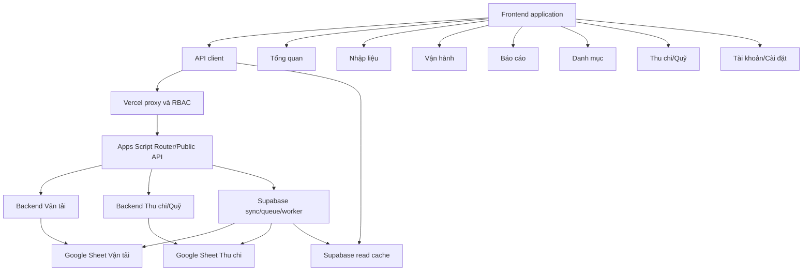

# MODULE_MAP

## 1. Mục đích và phạm vi

Tài liệu này là bản đồ module hiện trạng của dự án Vận tải Đông Bắc. Mục tiêu là giúp người phát triển và Coding Agent xác định đúng:

- chức năng thuộc module nào;
- source file nào sở hữu giao diện, orchestration và implementation;
- module đọc/ghi dữ liệu nào;
- dependency trực tiếp và ảnh hưởng gián tiếp;
- phần nào là facade, implementation dùng chung, artifact build hoặc legacy/bound script.

Tài liệu mô tả cấu trúc đang tồn tại, không đề xuất di chuyển code hoặc thay đổi boundary.

## 2. Quy ước phân loại

### 2.1. Loại module

- Nghiệp vụ: thể hiện một khu vực người dùng hoặc quy tắc kinh doanh.
- Nền tảng: cung cấp API, cấu hình, bảo mật, cache, queue hoặc build.
- Giao diện: render và điều phối trải nghiệm trong browser.
- Dữ liệu: Google Sheet, Supabase table hoặc schema contract.
- Legacy/bound: mã chạy trong execution context khác hoặc được lưu để đối chiếu.

### 2.2. Vai trò source file

- Entry point: điểm nhận request, event hoặc khởi động ứng dụng.
- Orchestrator: điều phối nhiều service và side effect.
- Facade: tạo boundary theo tên module nhưng chuyển tiếp phần lớn xử lý xuống implementation khác.
- Implementation: chứa logic thực thi chính.
- Contract/config: mapping, schema, validation hoặc permission.
- Artifact: file sinh tự động từ source khác.
- Reference: snapshot hoặc source lưu để khảo sát, không mặc nhiên thuộc deployment web app độc lập.

## 3. Sơ đồ module cấp cao

## 4. Danh mục module tổng hợp

| Mã module | Tên module | Loại | Source chính | Dữ liệu chính |
| --- | --- | --- | --- | --- |
| `PLATFORM_CONFIG` | Cấu hình runtime/file theo năm | Nền tảng | `AppConfig.gs` | Script Properties, Spreadsheet ID |
| `PLATFORM_ROUTING` | HTTP routing và public API | Nền tảng | `Router.gs`, `PublicApi.gs` | API request/response |
| `PLATFORM_SECURITY` | Auth, proxy và RBAC | Nền tảng | `SecurityService.gs`, `api/app.js` | Supabase Auth, `app_users` |
| `PLATFORM_SUPABASE` | Cache, sync, queue và worker | Nền tảng | `SupabaseService.gs` | Supabase bundle/queue tables |
| `PLATFORM_SHEET_INFRA` | Runtime cache và bảo toàn ghi Sheet | Nền tảng | `RuntimeCacheService.gs`, `SheetWritePreserver.gs` | Apps Script CacheService, Google Sheet ranges |
| `TRANSPORT_ENTRY` | Nhập liệu Vận tải | Nghiệp vụ | `EntryService.gs`, `SheetService.gs`, `ValidationService.gs` | `NL_*` |
| `TRANSPORT_MANAGE` | Vận hành và CRUD dữ liệu | Nghiệp vụ | `ManageService.gs`, `SheetReadService.gs`, `EntryService.gs`, `SheetService.gs` | `NL_*` |
| `TRANSPORT_CATALOG` | Danh mục Vận tải | Nghiệp vụ | `CatalogService.gs`; cache compatibility trong `SheetService.gs` | `DM_*` |
| `TRANSPORT_REPORT` | Tổng quan và Báo cáo | Nghiệp vụ | `ReportService.gs`, `DashboardService.gs`, `ReportTableService.gs`, `SheetService.gs`, `ReportTempSheetService.gs`, `SheetReportCacheRepository.gs` | `BC_*`, `XL_*`, `SYS_ReportCache` |
| `TRANSPORT_RECONCILIATION` | Đối soát chuyến | Nghiệp vụ | `TransportReconciliationService.gs`; facade `EntryService.gs` | `NL_VanChuyen`, `NL_TaiXe`, `XL_DoiSoatChuyen` |
| `FUND_TRANSACTIONS` | Giao dịch Thu chi | Nghiệp vụ | `FundService.gs` | `NHAP_THUCHI` |
| `FUND_OVERVIEW` | Tổng quan Thu chi | Nghiệp vụ | `FundService.gs` | `NHAP_THUCHI`, cấu hình Thu chi |
| `FUND_LOANS` | Vay nợ và đối soát khoản vay | Nghiệp vụ | `FundService.gs` | `NHAP_VAY` |
| `FUND_CATALOG` | Danh mục Thu chi | Nghiệp vụ | `FundService.gs` | named ranges, `CAIDAT`, catalog hỗ trợ |
| `FRONTEND_CORE` | App shell, state và navigation | Giao diện | `index.template.html`, `client_config.html`, `client_app.html` | Browser global state, DOM |
| `FRONTEND_API` | API/Auth/Supabase client | Giao diện | `client_api.html` | HTTP, Supabase REST/Auth, session cache |
| `FRONTEND_TRANSPORT` | UI Vận tải | Giao diện | `client_dashboard.html`, `client_entry.html`, `client_manage.html`, `client_catalog.html`, `client_reports.html`, `client_data.html` | API payload, bundle cache |
| `FRONTEND_FUND` | UI Thu chi/Quỹ | Giao diện | `client_cashflow.html` | Fund API/cache payload |
| `FRONTEND_ACCOUNTS` | UI tài khoản và role | Giao diện | `client_accounts.html`, `client_ui.html` | Auth user, account API |
| `BUILD_STATIC` | Build frontend/PWA | Nền tảng | `scripts/build.js`, `manifest.json` | `index.html`, static assets |
| `LEGACY_FUND_BOUND` | Bound script Thu chi | Legacy/bound | `docs/source/thu_chi_bound_script/` | Active Thu chi spreadsheet |
| `SCHEMA_REFERENCE` | Snapshot/schema vận hành | Dữ liệu | `docs/schema/*.json`, `PROJECT_SCHEMA.md` | Google Sheet schema |

## 5. Module nền tảng

### 5.1. `PLATFORM_CONFIG` — Cấu hình runtime

Trách nhiệm:

- resolve file Vận tải theo request, năm hoặc Script Properties;
- khởi tạo `APP_CONFIG` cho request hiện tại;
- giữ mapping form Vận tải sang tên sheet, header row và số cột;
- cung cấp timezone Apps Script dùng trong xử lý dữ liệu.

Source:

- implementation/config: `AppConfig.gs`;
- call sites: `Router.gs`, `PublicApi.gs`, event activation trong `SupabaseService.gs`.

Đầu vào:

- `spreadsheetId`, `ssId`, `year`;
- `ACTIVE_SPREADSHEET_ID`;
- `DEFAULT_SPREADSHEET_ID`;
- `SPREADSHEET_ID_<year>`.

Đầu ra:

- global `APP_CONFIG` chứa `spreadsheetId`, timezone và mapping `sheets`.

Ranh giới quan trọng:

- config chính hiện tập trung cho file Vận tải;
- file Thu chi có resolver riêng trong `FundService.gs`;
- mọi entry point đổi context file phải activate config trước khi đọc/ghi.

### 5.2. `PLATFORM_ROUTING` — HTTP và public API

Trách nhiệm:

- nhận GET/POST từ HTTP;
- render HtmlService khi không có action;
- dispatch action đọc/ghi;
- chuẩn hóa response JSON và ghi timing log;
- cung cấp global function cho `google.script.run`, Apps Script editor và `clasp run`;
- điều phối sync hoặc queue sau thao tác ghi.

Source:

- HTTP entry point: `Router.gs`;
- global wrapper/orchestrator: `PublicApi.gs`;
- service đích: các file `*Service.gs`.

Dependency:

- `AppConfig`;
- `SecurityService`;
- toàn bộ service nghiệp vụ;
- `SupabaseService`.

Ranh giới quan trọng:

- action routing xuất hiện trong cả `Router.doGet()` và `PublicApi.invokeApi()`;
- POST HTTP được đưa về `invokeApi()`;
- action GET cần được đối chiếu ở cả đường HtmlService và Vercel proxy;
- đây là boundary orchestration, không phải nơi đặt công thức nghiệp vụ mới.

### 5.3. `PLATFORM_SECURITY` — Auth và RBAC

Trách nhiệm:

- đăng nhập người dùng qua Supabase Auth;
- kiểm tra allowlist `app_users`;
- xác định role và trạng thái active;
- chặn action không phù hợp role;
- quản trị tài khoản nội bộ;
- bảo vệ Apps Script bằng shared proxy secret.

Source:

- Vercel proxy/RBAC/account API: `api/app.js`;
- Apps Script secret enforcement: `SecurityService.gs`;
- frontend Auth client: `client_api.html`;
- frontend role/account UI: `client_accounts.html`;
- schema: migrations `007`, `008`, `009`.

Role hiện tại:

- `admin`;
- `operator`;
- `shareholder`.

Ranh giới quan trọng:

- frontend chỉ cung cấp UX, không phải enforcement cuối cùng;
- proxy enforce role theo action;
- Supabase RLS enforce quyền đọc cache cho authenticated active user;
- Apps Script kiểm tra proxy secret khi `AUTH_ENFORCEMENT_ENABLED=true`.

### 5.4. `PLATFORM_SUPABASE` — Cache, sync và queue

Trách nhiệm:

- tạo/upsert/read bundle cache;
- đồng bộ cache theo module/tháng;
- chạy tick gần realtime và full backfill;
- cài/nhận trigger thay đổi file Vận tải;
- enqueue và claim write job;
- thực thi worker và retry;
- ghi `sync_status` và `write_job_logs`;
- audit cache Vận hành/Báo cáo.

Source:

- startup/catalog sync implementation: `StartupCatalogSyncService.gs`;
- facade, realtime orchestration và các sync implementation còn lại: `SupabaseService.gs`;
- public wrapper: `PublicApi.gs`;
- database contract: `supabase/migrations/*.sql`;
- frontend reader: `client_api.html`;
- frontend trạng thái/audit: `client_ui.html`;
- frontend pending jobs: `client_entry.html`, `client_manage.html`, `client_dashboard.html`, `client_cashflow.html`.

Dependency:

- `SheetService` và các service nghiệp vụ để tạo payload live;
- Supabase REST/RPC;
- Script Properties chứa URL/service role key/feature flags;
- Apps Script trigger và lock/cache services.

Ranh giới quan trọng:

- module này không sở hữu source of truth nghiệp vụ;
- full sync không được chạy trong request tương tác thông thường;
- queue chỉ áp dụng cho action được allowlist và feature flag cho phép;
- physical row delete không được queue.

### 5.5. `PLATFORM_SHEET_INFRA` — Cache runtime và bảo toàn ghi

Trách nhiệm:

- chunked runtime cache, cache-key assembly và batch invalidation;
- ghi row segment, bảo toàn/copy formula và format;
- mở rộng row và tìm dòng cuối theo cột.

Source:

- runtime cache: `RuntimeCacheService.gs`;
- low-level Sheet write preservation: `SheetWritePreserver.gs`;
- compatibility wrappers/call sites: `SheetService.gs`.

Ranh giới quan trọng:

- không sở hữu mapping nghiệp vụ hoặc cache key domain;
- không đổi TTL/version/formula semantics tại utility layer;
- write range vẫn do service nghiệp vụ quyết định.

## 6. Module nghiệp vụ Vận tải

### 6.1. `TRANSPORT_ENTRY` — Nhập liệu

Phạm vi form:

- `vanChuyen` → `NL_VanChuyen`;
- `taiXe` → `NL_TaiXe`;
- `dau` → `NL_Dau`;
- `chamCong` → `NL_ChamCong`;
- `phat` → `NL_Phat`;
- `nghiVanHanh` → `NL_NghiVanHanh`.

Trách nhiệm:

- load danh mục cần cho từng form;
- validate payload;
- chuyển object frontend thành row đúng schema;
- bỏ qua cột công thức khi ghi;
- copy format/công thức dòng trước khi append;
- hỗ trợ idempotent append từ write job;
- clear cache và kích hoạt sync sau ghi.

Source:

- facade và submit implementation: `EntryService.gs`;
- validation/row builder: `ValidationService.gs`;
- submit/reconciliation compatibility adapters và generic CRUD chưa tách: `SheetService.gs`;
- API orchestration/queue selection: `PublicApi.gs`, `SupabaseService.gs`;
- frontend: `client_entry.html`, `client_data.html`, `client_config.html`.

Dependency dữ liệu:

- các sheet `DM_*` dùng làm option/validation;
- `APP_CONFIG.sheets`;
- công thức và định dạng sẵn có trong `NL_*`.

Ranh giới quan trọng:

- không được ghi đè cột công thức;
- form schema frontend, validation backend và sheet column order phải đồng bộ;
- response có thể là kết quả ghi trực tiếp hoặc job pending.

### 6.2. `TRANSPORT_MANAGE` — Vận hành và CRUD

Phạm vi sheet:

- `NL_VanChuyen`;
- `NL_TaiXe`;
- `NL_Dau`;
- `NL_ChamCong`;
- `NL_Phat`;
- `NL_NghiVanHanh`.

Trách nhiệm:

- đọc recent rows hoặc khoảng ngày;
- filter, search và pagination ở frontend;
- thêm/sửa/xóa dữ liệu từ màn hình Vận hành;
- hiển thị optimistic rows khi job đang chờ;
- khóa thao tác trên row chưa có `rowIndex` thật;
- reload dữ liệu live/cache sau job synced.

Source:

- manage facade: `ManageService.gs`;
- generic/manage read implementation: `SheetReadService.gs`;
- CRUD facade: `EntryService.gs`;
- read compatibility adapter và CRUD implementation chưa tách: `SheetService.gs`;
- queue/sync: `SupabaseService.gs`;
- frontend: `client_manage.html`, `client_entry.html`, `client_dashboard.html`.

Cache:

- `manage_data_bundles.recent_500`;
- `manage_data_bundles.month:YYYY-MM`.

Ranh giới quan trọng:

- `rowIndex` là chỉ số dòng Google Sheet và có thể thay đổi sau physical delete;
- queued update/delete cần dữ liệu cũ để tránh ghi nhầm;
- `NL_Dau` có UI và filter đặc thù;
- pending rows không phải dữ liệu đã được xác nhận trong Sheet.

### 6.3. `TRANSPORT_CATALOG` — Danh mục

Phạm vi:

- `DM_NhanSu`;
- `DM_Xe`;
- `DM_DuAn`;
- `DM_PhanCongLaiXe`;
- `DM_LuongChuyen`;
- `DM_ThamSo_TS` và `DM_ThamSo_GD` là view ảo trên `DM_ThamSo`;
- `DM_DonGiaVanChuyen`;
- `DM_ThuongQuanLy`;
- `DM_PhatNoiBo`.

Trách nhiệm:

- đọc danh mục dùng cho form và màn hình quản trị;
- map tab ảo về sheet/vùng dữ liệu thật;
- CRUD danh mục;
- giữ cột công thức và layout;
- đồng bộ startup/catalog cache sau ghi.

Source:

- facade và implementation đọc catalog/form/display customization: `CatalogService.gs`;
- runtime cache compatibility và generic CRUD chưa tách: `SheetService.gs`;
- sync: `SupabaseService.gs`;
- frontend: `client_catalog.html`, `client_config.html`, `client_data.html`.

Cache:

- `catalog_bundles` theo form và display sheet;
- `startup_bundles` khi danh mục ảnh hưởng màn hình đầu.

Ranh giới quan trọng:

- hai tab `DM_ThamSo_TS/GD` không phải sheet vật lý;
- thay đổi danh mục có thể tác động công thức `XL_*` và báo cáo dù API chỉ ghi một row;
- không đổi tên sheet/header hoặc thứ tự cột.

### 6.4. `TRANSPORT_REPORT` — Tổng quan và Báo cáo

Phạm vi:

- dashboard KPI;
- dữ liệu chuyến gần nhất;
- báo cáo tổng quan;
- báo cáo chi tiết;
- bảng lương;
- tổng hợp xe;
- report bundle theo tháng và `Tất cả`.

Source:

- facade: `ReportService.gs`;
- month resolution, KPI/detail aggregation, latest-trips read và dashboard payload assembly: `DashboardService.gs`;
- report table read/filter: `ReportTableService.gs`;
- cache orchestration, report links và remaining overview/input Sheet adapters: `SheetService.gs`;
- temp-sheet lifecycle: `ReportTempSheetService.gs`;
- `SYS_ReportCache` version/read/write: `SheetReportCacheRepository.gs`;
- Supabase bundle sync/audit: `SupabaseService.gs`;
- frontend: `client_dashboard.html`, `client_reports.html`, `client_data.html`.

Google Sheet dependency:

- `BC_TongQuan`;
- `BC_BangLuong`;
- `BC_TongHopXe`;
- các sheet `XL_*` cung cấp công thức nguồn;
- `SYS_ReportCache`;
- `NL_VanChuyen` cho dữ liệu chuyến gần nhất.

Supabase cache:

- `report_bundles`;
- dashboard dùng report month đặc biệt `__dashboard_latest__`.

Ranh giới quan trọng:

- phải giữ nguyên ý nghĩa bảng gốc từ Sheet;
- không tự đặt lại danh mục báo cáo ở frontend;
- controller tháng `BC_TongQuan!B1` không được làm thay đổi sheet gốc trong request đọc;
- chi tiết tháng được tính qua sheet tạm và cache;
- tính đúng số liệu ưu tiên hơn tốc độ.

### 6.5. `TRANSPORT_RECONCILIATION` — Đối soát chuyến

Trách nhiệm:

- so sánh dữ liệu chuyến được nhập từ các nguồn;
- cảnh báo sau submit khi số chuyến không khớp;
- cung cấp dữ liệu cho sheet xử lý đối soát.

Source:

- implementation: `TransportReconciliationService.gs`;
- public facade: `EntryService.gs`;
- compatibility adapter: `SheetService.gs`;
- frontend call: `client_data.html`;
- công thức/đối soát Sheet: `XL_DoiSoatChuyen`.

Dependency:

- `NL_VanChuyen`;
- `NL_TaiXe`;
- cặp ngày/biển số xe/số chuyến.

Ranh giới quan trọng:

- đối soát từ API và đối soát bằng công thức Sheet là hai lớp liên quan nhưng không đồng nhất;
- cảnh báo không được tự ý sửa dữ liệu nguồn.

## 7. Module nghiệp vụ Thu chi/Quỹ

### 7.1. `FUND_TRANSACTIONS` — Giao dịch Thu chi

Trách nhiệm:

- đọc giao dịch theo năm/tháng/giới hạn;
- chuẩn hóa cột Thu/Chi;
- thêm một hoặc nhiều giao dịch;
- cập nhật/xóa giao dịch;
- validate batch và rollback phần vừa ghi khi lỗi;
- tạo voucher duy nhất;
- hỗ trợ idempotent replay khi thêm qua queue.

Source:

- backend implementation: `FundService.gs`;
- API orchestration: `PublicApi.gs`;
- queue/sync: `SupabaseService.gs`;
- frontend: `client_cashflow.html`;
- cache reader: `client_api.html`.

Google Sheet dependency:

- `NHAP_THUCHI`;
- cấu hình/named ranges từ file Thu chi;
- công thức và validation trên dòng dữ liệu.

Cache:

- `fund_transaction_bundles.recent_500`;
- `fund_transaction_bundles.month:YYYY-MM`.

Ranh giới quan trọng:

- queue chỉ áp dụng cho thêm giao dịch khi feature flag bật;
- sửa/xóa hiện không mặc nhiên đi qua queue;
- pending transaction không được cộng vào KPI trước khi Sheet xác nhận;
- voucher là khóa truy vết/idempotency quan trọng.

### 7.2. `FUND_OVERVIEW` — Tổng quan Thu chi

Trách nhiệm:

- tổng hợp thu, chi, số dư và các nhóm danh mục;
- tính số liệu theo kỳ và đến ngày hiện tại;
- cung cấp chi tiết category;
- cung cấp danh sách tháng cho bộ lọc;
- tạo dữ liệu báo cáo tài chính hiển thị trên frontend.

Source:

- backend: `FundService.getFundOverview()` và helper liên quan;
- frontend: phần overview/report trong `client_cashflow.html`;
- sync: `SupabaseService.syncFundOverview()`.

Cache:

- `fund_overview_bundles` theo `year` và `month_key`.

Dependency:

- dữ liệu `NHAP_THUCHI`;
- setting/named range trong file Thu chi;
- mapping category và transaction type.

Ranh giới quan trọng:

- số liệu filtered period và số liệu lũy kế đến hiện tại có ý nghĩa khác nhau;
- pending queued transaction không phải số liệu chính thức;
- cache phải được sync cho cả latest và tháng liên quan sau ghi.

### 7.3. `FUND_LOANS` — Khoản vay

Trách nhiệm:

- đọc lịch sử vay, trả nợ và trả lãi;
- tổng hợp tiền vay, đã trả và dư nợ;
- thêm khoản vay và thanh toán;
- đối soát mã trả nợ bị ghi sai trong trường hợp an toàn;
- trình bày trạng thái tất toán theo thời điểm xem.

Source:

- backend: `FundService.gs`;
- frontend: phần loan trong `client_cashflow.html`;
- sync: `SupabaseService.syncFundLoanOverview()`;
- contract test: `tests/contracts.test.js`.

Google Sheet dependency:

- `NHAP_VAY`;
- danh sách đối tác/named range;
- công thức dư nợ và bộ lọc.

Cache:

- `fund_loan_bundles` theo `year` và `month_key`.

Ranh giới quan trọng:

- ưu tiên ghép đúng mã vay;
- chỉ đối soát mã không tồn tại khi có duy nhất một khoản cùng đối tác, có trước ngày trả và số dư khớp hoàn toàn;
- `loanKey` và `reconciledFromCode` là dữ liệu truy vết nội bộ dù UI không hiện cột mã;
- không cho thanh toán lặp khoản đã tất toán.

### 7.4. `FUND_CATALOG` — Danh mục Thu chi

Trách nhiệm:

- cung cấp nhóm thu, nhóm chi, người thực hiện, đối tác, đối tác vay và phương thức;
- đọc từ named ranges, cột native hoặc catalog hỗ trợ;
- thêm/sửa/xóa mục danh mục trong vùng cho phép;
- fallback từ dữ liệu giao dịch nếu nguồn cấu hình thiếu;
- đồng bộ catalog cache sau ghi.

Source:

- backend: `FundService.gs`;
- frontend: phần catalog trong `client_cashflow.html`;
- cache/sync: `SupabaseService.gs`, `client_api.html`.

Ranh giới quan trọng:

- một số catalog dùng row index mã hóa cả group và dòng;
- phải kiểm tra giới hạn vùng trước khi ghi;
- không được mở rộng hoặc di chuyển named range ngoài migration được duyệt.

## 8. Module frontend

### 8.1. `FRONTEND_CORE` — App shell và state

Trách nhiệm:

- HTML shell, loader, auth gate, sidebar/topbar và view container;
- global state của ứng dụng;
- menu, form schema và mapping;
- bootstrap và navigation;
- chọn view, active form/tab/month;
- export card thành ảnh.

Source:

- shell/template: `index.template.html`;
- state/config: `client_config.html`;
- lifecycle/navigation: `client_app.html`;
- utility UI: `client_ui.html`.

Dependency:

- mọi fragment frontend;
- DOM ID trong template;
- thứ tự include do `client.html` và build script quyết định.

Ranh giới quan trọng:

- state là global, không có module isolation;
- đổi tên function/variable/DOM ID có thể ảnh hưởng nhiều fragment;
- `index.html` chỉ là artifact build.

### 8.2. `FRONTEND_API` — API, Supabase và Auth client

Trách nhiệm:

- phát hiện môi trường HtmlService hoặc static hosting;
- gọi `google.script.run` hoặc `fetch`;
- chọn Apps Script URL hay `/api/app`;
- lấy Supabase access token;
- đăng nhập/đăng xuất/bootstrap session;
- đọc các bảng bundle qua Supabase REST;
- quản lý session cache và fallback.

Source:

- `client_api.html`.

Dependency:

- Supabase browser library;
- build-time config trong `index.template.html`/`scripts/build.js`;
- global UI/account helpers;
- API contract của proxy và Apps Script.

Ranh giới quan trọng:

- payload `ok: false` phải bị reject;
- Auth enablement ảnh hưởng endpoint được chọn;
- anon key là public config nhưng service role/proxy secret không được xuất hiện trong frontend.

### 8.3. `FRONTEND_TRANSPORT` — UI Vận tải

Các submodule:

- Tổng quan: `client_dashboard.html`;
- Nhập liệu: `client_entry.html`;
- Vận hành: `client_manage.html`;
- Danh mục: `client_catalog.html`;
- Báo cáo: `client_reports.html`;
- load/submit dùng chung: `client_data.html`.

Dependency chéo đáng chú ý:

- pending write jobs được dùng ở Nhập liệu, Vận hành và Tổng quan;
- catalog state được dùng để render form, filter và label;
- selected month ảnh hưởng dashboard/report bundle;
- role helper quyết định quyền ghi;
- API loader quyết định Supabase-first hay Apps Script fallback.

Ranh giới quan trọng:

- không đánh đồng optimistic row với row đã có trong Sheet;
- báo cáo phải render dữ liệu chuẩn từ backend/Sheet;
- thay đổi mapping header phải đối chiếu schema Sheet.

### 8.4. `FRONTEND_FUND` — UI Thu chi/Quỹ

Trách nhiệm:

- tab tổng quan, nhập giao dịch, danh sách giao dịch, khoản vay và danh mục;
- filter tháng/khoảng ngày;
- form batch Thu chi;
- theo dõi queued add transaction;
- modal/drawer chi tiết, thanh toán và thêm khoản vay;
- pagination và export báo cáo Thu chi.

Source:

- `client_cashflow.html`;
- API/cache helper trong `client_api.html`.

Ranh giới quan trọng:

- file có nhiều trách nhiệm và chia sẻ state global;
- pending fund job không được tính vào KPI;
- year hiện được truyền phổ biến là `2026`, phải phân biệt cấu hình theo năm với giá trị hard-coded ở call site.

### 8.5. `FRONTEND_ACCOUNTS` — Tài khoản và trạng thái hệ thống

Trách nhiệm:

- xác định role hiện tại và khả năng ghi;
- áp dụng role lên UI;
- đổi mật khẩu;
- quản trị user dành cho admin;
- hiển thị trạng thái sync, write jobs và audit.

Source:

- tài khoản/role UI: `client_accounts.html`;
- trạng thái/audit: `client_ui.html`;
- Auth transport: `client_api.html`;
- server enforcement: `api/app.js`.

Ranh giới quan trọng:

- UI permission phải khớp proxy permission;
- account administration chỉ dành cho admin;
- shareholder là read-only ở API, không chỉ trong UI.

## 9. Module build và asset

### 9.1. `BUILD_STATIC` — Build frontend

Trách nhiệm:

- thay Apps Script-style include bằng nội dung fragment;
- inject URL/config build-time;
- tạo `index.html` self-contained cho Vercel;
- sinh icon PWA từ ảnh nguồn.

Source:

- frontend build: `scripts/build.js`;
- icon build: `scripts/generate-icons.js`;
- PWA config: `manifest.json`;
- Vercel config: `vercel.json`;
- source icon: `assets/app-icon/`;
- static output: `public/static/assets/`.

Artifact:

- `index.html`;
- các icon kích thước đích.

Ranh giới quan trọng:

- build frontend ghi lại `index.html`;
- generate icon có tạo backup asset;
- không chỉnh sửa artifact thay cho source.

## 10. Module legacy và reference

### 10.1. `LEGACY_FUND_BOUND` — Apps Script gắn file Thu chi

Source:

- `docs/source/thu_chi_bound_script/menu.js`;
- `cellButtons.js`;
- `macro.js`;
- `docso.js`;
- `onEdit.js`;
- `theme.js`;
- `appsscript.json`.

Trách nhiệm quan sát được:

- menu và macro Google Sheets;
- điều hướng/vùng lọc báo cáo;
- nút thao tác trong cell;
- onEdit form Thu chi và vay;
- tạo dòng vay/trả nợ/trả lãi;
- chuẩn bị phiếu in;
- theme trực tiếp trong Google Sheets;
- đọc số thành chữ.

Ranh giới quan trọng:

- đây là bound script nên dùng active spreadsheet;
- không thuộc deployment Apps Script độc lập của web app;
- hành vi có thể tác động cùng dữ liệu mà web app đọc;
- repository hiện lưu source để khảo sát/đối chiếu, nhưng tình trạng đồng bộ chính xác với bound project production phải được xác nhận trước khi sửa.

### 10.2. `SCHEMA_REFERENCE` — Schema snapshot

Source:

- `docs/schema/VanTaiDongBac_2026_schema.json`;
- `docs/schema/thu_chi_2026_schema_raw_20260625_175010.json`;
- `PROJECT_SCHEMA.md`.

Vai trò:

- mô tả sheet, header, công thức, validation, protection và dependency;
- hỗ trợ Agent phân tích mà không cần đọc live spreadsheet trong mọi tác vụ;
- làm baseline kiểm tra thay đổi cấu trúc.

Ranh giới quan trọng:

- snapshot có thời điểm xuất cụ thể và có thể cũ hơn production;
- khi snapshot, tài liệu và source mâu thuẫn, phải xác minh trước khi thay đổi cấu trúc;
- không sửa snapshot để giả lập migration đã diễn ra.

## 11. Ma trận ảnh hưởng theo thay đổi

| Loại thay đổi | Module phải kiểm tra tối thiểu |
| --- | --- |
| Thêm/sửa field form Vận tải | `FRONTEND_CORE`, `TRANSPORT_ENTRY`, `ValidationService`, schema `NL_*`, `TRANSPORT_MANAGE`, cache sync |
| Sửa CRUD Vận hành | `FRONTEND_TRANSPORT`, `PLATFORM_ROUTING`, `TRANSPORT_MANAGE`, queue, optimistic UI, cache/audit |
| Sửa danh mục Vận tải | `TRANSPORT_CATALOG`, form option, công thức `XL_*`, startup/catalog cache |
| Sửa báo cáo | `TRANSPORT_REPORT`, `BC_*`, `XL_*`, report cache trong Sheet, Supabase bundle, frontend renderer |
| Sửa giao dịch Thu chi | `FUND_TRANSACTIONS`, queue flag, voucher, `FUND_OVERVIEW`, fund cache |
| Sửa khoản vay | `FUND_LOANS`, reconciliation, loan cache, bound script Thu chi nếu cùng hành vi |
| Thêm API action | frontend call site, `api/app.js`, `Router.gs`, `PublicApi.invokeApi`, service, RBAC tests |
| Đổi role/quyền | migration `app_users`, proxy permission, frontend role UI, RLS, smoke test |
| Đổi cache key/payload | `SupabaseService`, migration/schema doc, `client_api`, consumer UI, fallback và audit |
| Đổi queue action | enqueue, allowlist flag, job payload, worker execute, idempotency, pending UI, retry và sync |
| Đổi file theo năm | `AppConfig`, Fund resolver, request year, cache key, schema snapshot, Script Properties |
| Đổi frontend source | fragment liên quan, global dependency, template DOM, build `index.html`, contract test |

## 12. Dependency và ownership chưa tách hoàn toàn

Các điểm dưới đây phải được xem là thuộc tính kiến trúc hiện tại:

- `SheetService.gs` là implementation dùng chung cho nhiều module Vận tải.
- `SupabaseService.gs` vừa là persistence adapter, sync orchestrator, trigger manager, queue repository và worker.
- `PublicApi.gs` vừa cung cấp wrapper thủ công vừa dispatch API và quyết định direct/queued write.
- `client_data.html` điều phối dữ liệu cho nhiều view, không chỉ một module.
- `client_ui.html` chứa cả utility UI và màn hình quan sát sync/audit.
- `client_config.html` chứa cả config, mapping và application state.
- `client_cashflow.html` chứa nhiều submodule Thu chi trong cùng file.
- API và permission contract được lặp lại giữa nhiều lớp thay vì có một registry duy nhất.

Vì vậy, “file ownership” trong tài liệu này có nghĩa là điểm bắt đầu truy vết, không có nghĩa thay đổi chỉ ảnh hưởng một file.

## 13. Checklist xác định module trước khi sửa

1. Xác định màn hình hoặc action người dùng đang thao tác.
2. Tìm call site frontend và global state liên quan.
3. Xác định Vercel proxy permission cho action.
4. Xác định route trong `Router.gs`/`PublicApi.invokeApi()`.
5. Theo facade tới implementation thật.
6. Xác định file Google Sheet, sheet, header row và cột.
7. Xác định direct write hay queued write.
8. Xác định cache bundle/key và sync sau ghi.
9. Xác định công thức/báo cáo/module khác tiêu thụ dữ liệu.
10. Kiểm tra bound script nếu thao tác có thể xảy ra trực tiếp trong file Thu chi.

## 14. Trạng thái tài liệu

- Loại tài liệu: bản đồ module hiện trạng.
- Phạm vi: frontend, Vercel proxy, Apps Script, Supabase, Google Sheets và bound script Thu chi.
- Nguồn kiểm chứng: source repository, schema snapshots, migrations và contract tests.
- Ngày xác nhận gần nhất: 2026-07-11.
- Cần cập nhật khi: thêm/bỏ module, chuyển ownership, thay đổi facade/implementation, thêm execution context hoặc thay đổi dependency dữ liệu.
