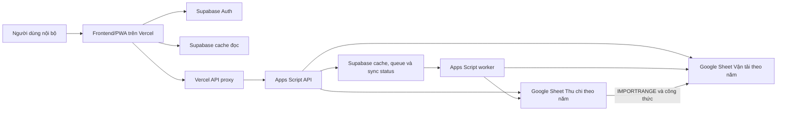

# SYSTEM_ARCHITECTURE

## 1. Mục đích và phạm vi

Tài liệu này mô tả kiến trúc hiện trạng của hệ thống Vận tải Đông Bắc tại thời điểm khảo sát. Đây là bản đồ thành phần và ranh giới kỹ thuật dành cho người phát triển và Coding Agent.

Tài liệu trả lời các câu hỏi:

- hệ thống gồm những thành phần triển khai nào;
- mỗi thành phần chịu trách nhiệm gì;
- dữ liệu đi qua các thành phần theo đường nào;
- đâu là nguồn dữ liệu chuẩn;
- các cơ chế cache, queue, trigger, xác thực và fallback phối hợp ra sao;
- giới hạn kiến trúc hiện tại nằm ở đâu.

Tài liệu không phải đề xuất refactor, không thay thế schema chi tiết và không mô tả đầy đủ từng API action.

## 2. Tóm tắt kiến trúc

Hệ thống hiện là kiến trúc hybrid gồm bốn nền tảng:

1. Vercel phục vụ frontend/PWA và API proxy.
2. Supabase cung cấp Auth, allowlist người dùng, cache đọc, write queue và trạng thái đồng bộ.
3. Apps Script độc lập cung cấp API nghiệp vụ, worker, trigger và cầu nối dữ liệu.
4. Google Sheets lưu dữ liệu nghiệp vụ, công thức xử lý và báo cáo đối soát.

Google Sheets vẫn là nguồn dữ liệu đối soát cuối cùng. Supabase giúp tăng tốc độ đọc và tiếp nhận một số ý định ghi, nhưng chưa thay thế Google Sheets làm source of truth.

## 3. Các nguyên tắc kiến trúc đang có hiệu lực

### 3.1. Web app độc lập với file dữ liệu

Apps Script backend là project độc lập trong My projects tại `script.google.com`. Backend không được copy vào từng Google Sheet theo năm và không được giả định active spreadsheet là file dữ liệu chính.

File dữ liệu được chọn bằng Spreadsheet ID, ưu tiên theo thứ tự:

1. `spreadsheetId` hoặc `ssId` trong request;
2. Script Property `SPREADSHEET_ID_<year>`;
3. `ACTIVE_SPREADSHEET_ID`;
4. `DEFAULT_SPREADSHEET_ID`;
5. ID mặc định trong `AppConfig.gs`.

Các thao tác dữ liệu chính mở file bằng `SpreadsheetApp.openById(id)`.

### 3.2. Hai module nghiệp vụ không bị gộp

Hệ thống có hai module nghiệp vụ chính:

- Vận tải;
- Thu chi/Quỹ.

Mỗi module có file Google Sheet theo năm và vòng đời nghiệp vụ riêng. Việc file Vận tải nhận một phần dữ liệu Thu chi qua công thức không làm Thu chi trở thành module phụ hoặc nguồn import đơn thuần.

### 3.3. Google Sheets là nguồn đối soát cuối cùng

Google Sheets hiện giữ:

- dữ liệu nghiệp vụ đã ghi;
- công thức xử lý;
- danh mục;
- báo cáo kế toán/vận hành;
- nơi người dùng có thể kiểm tra và chỉnh sửa trực tiếp;
- dữ liệu phục hồi khi Supabase cache bị xóa hoặc sai.

Khi Supabase và Google Sheet khác nhau, không được tự động coi Supabase là đúng hơn. Phải đối chiếu Google Sheet và đường đồng bộ liên quan.

### 3.4. Supabase là lớp tăng tốc và điều phối

Supabase hiện có ba vai trò độc lập:

- xác thực người dùng nội bộ bằng Supabase Auth và bảng `app_users`;
- lưu cache đọc để frontend phản hồi nhanh;
- lưu ý định ghi bất đồng bộ, trạng thái và log trong `write_jobs`/`write_job_logs`.

Service role key chỉ tồn tại ở môi trường server như Vercel serverless function và Apps Script Properties. Frontend chỉ nhận anon/publishable key và JWT người dùng.

## 4. Mô hình triển khai

### 4.1. Frontend Vercel

Frontend là ứng dụng HTML/CSS/JavaScript không dùng framework module runtime.

Source tác giả gồm:

- `index.template.html`;
- `client_*.html`;
- `styles_*.html`.

`scripts/build.js` ghép các include và cấu hình build-time để tạo `index.html`. Vercel phục vụ repository như static site và dùng `api/app.js` làm serverless API proxy.

`index.html` là artifact build được commit, không phải nơi chỉnh sửa logic gốc.

### 4.2. Vercel API proxy

`api/app.js` là boundary composition/dispatch giữa browser và Apps Script khi Auth được bật. Việc xác thực Supabase session được delegate cho `api/services/auth-service.js`, `app_users` persistence cho `api/repositories/app-user-repository.js`, policy role cho `api/services/authorization-policy.js`, và account CRUD/password cho `api/services/account-service.js`.

Proxy chịu trách nhiệm:

- đọc Bearer token;
- xác minh session với Supabase Auth;
- đối chiếu người dùng trong `app_users`;
- kiểm tra tài khoản còn active;
- áp dụng quyền theo role và API action;
- xử lý API quản trị tài khoản;
- chuyển tiếp action nghiệp vụ đến Apps Script;
- đính kèm `APP_PROXY_SECRET` ở phía server.

Việc frontend ẩn nút theo role chỉ là lớp UX. Proxy là điểm enforce quyền bắt buộc đối với request từ Vercel frontend.

### 4.3. Apps Script độc lập

Apps Script gồm các lớp trách nhiệm chính:

- `Router.gs`: HTTP entry point và render giao diện Apps Script-hosted.
- `PublicApi.gs`: public wrapper, action dispatch và orchestration sau ghi.
- `SecurityService.gs`: xác minh proxy secret khi enforcement được bật.
- các service nghiệp vụ: Sheet, báo cáo, danh mục, nhập liệu, Vận hành và Thu chi.
- `SupabaseService.gs`: cache sync, queue, worker, trigger và audit.

Apps Script chạy với quyền của tài khoản deploy và có OAuth scope cho Google Sheets, external request và ScriptApp trigger.

### 4.4. Google Sheets

#### File Vận tải

File Vận tải chứa bốn lớp sheet:

- `NL_*`: dữ liệu nhập liệu/vận hành;
- `DM_*`: danh mục và tham số;
- `XL_*`: xử lý, đối soát và tính toán;
- `BC_*`: báo cáo cho người dùng và web app.

Ngoài ra có:

- `IMP_ThuChi`: dữ liệu liên kết từ file Thu chi;
- `SYS_ReportCache`: cache chi tiết báo cáo nằm trong Sheet.

#### File Thu chi

File Thu chi chứa dữ liệu giao dịch, vay nợ, báo cáo, cấu hình và các sheet hỗ trợ. File này còn có Apps Script bound riêng để xử lý thao tác trực tiếp trong giao diện Google Sheets.

Backend web app mở file Thu chi bằng ID theo năm. Mã bound script và backend web app là hai execution context khác nhau.

### 4.5. Supabase

Supabase schema hiện chia thành các nhóm:

- cache báo cáo và dashboard;
- cache startup và danh mục;
- cache Vận hành;
- cache Thu chi/Quỹ;
- trạng thái đồng bộ;
- write queue và log;
- allowlist người dùng.

Các migration trong `supabase/migrations/` phản ánh thứ tự phát triển từ cache đọc, queue đến hardening và Auth/RBAC.

## 5. Kiến trúc frontend

Frontend được chia theo fragment nhưng cùng chạy trong một global browser scope.

Các nhóm chính:

- `client_utils.html`: pure HTML escaping, text normalization, locale-number và date conversion dùng chung;
- `client_config.html`: cấu hình menu, form, mapping và global state;
- `client_api.html`: Apps Script API, Vercel proxy, Supabase client, Auth và cache phía browser;
- `client_app.html`: bootstrap, navigation và app lifecycle;
- `client_data.html`: điều phối load dữ liệu, submit và report bundle;
- `client_dashboard.html`: Tổng quan;
- `client_entry.html`: Nhập liệu;
- `client_manage.html`: Vận hành;
- `client_catalog.html`: Danh mục;
- `client_reports.html`: Báo cáo;
- `client_cashflow.html`: Thu chi/Quỹ;
- `client_accounts.html`: tài khoản và role UI;
- `client_ui.html`: drawer, trạng thái, loader, audit và utility UI.

Các fragment phụ thuộc vào thứ tự include, global variables, global functions và DOM ID. Không có import graph hoặc type system kiểm tra dependency giữa chúng.

Frontend hỗ trợ hai môi trường gọi backend:

1. Khi chạy trong HtmlService, dùng `google.script.run` gọi `invokeApi`.
2. Khi chạy static trên Vercel, dùng `fetch`; nếu Auth bật thì gọi `/api/app`, nếu không thì có thể gọi Apps Script URL trực tiếp.

Production hiện hướng tới Vercel proxy có Auth.

## 6. Kiến trúc Apps Script backend

### 6.1. Entry points

`Router.doGet()` và `Router.doPost()` là HTTP entry point.

- GET phục vụ các action đọc và một số action vận hành/audit.
- POST parse payload rồi chuyển về `invokeApi()`.
- `SecurityService.assertProxyRequest()` bảo vệ action khi auth enforcement được bật.
- response được ghi timing log cùng action, thời gian và Spreadsheet ID.

Các function global trong `PublicApi.gs` còn phục vụ `google.script.run`, Apps Script editor và `clasp run`.

### 6.2. Service boundaries

Boundary theo tên file hiện có:

- `EntryService`: nhập, sửa, xóa và đối soát;
- `ManageService`: đọc dữ liệu Vận hành;
- `CatalogService`: đọc danh mục;
- `ReportService`: dashboard và báo cáo;
- `SheetReadService`: đọc sheet tổng quát;
- `FundService`: toàn bộ nghiệp vụ Thu chi/Quỹ;
- `SupabaseService`: sync/cache/queue;
- `ValidationService`: chuẩn hóa và validate form Vận tải.

Tuy nhiên, nhiều implementation Vận tải vẫn nằm trong `SheetService.gs`; một số service trên là facade mỏng. Khi phân tích ảnh hưởng phải theo call chain tới implementation thực tế, không chỉ dừng ở tên service.

### 6.3. Cấu hình runtime

`AppConfig.activate()` thiết lập biến global `APP_CONFIG` cho request hiện tại. Config chứa Spreadsheet ID, timezone và mapping form Vận tải sang sheet/header row/số cột.

Mọi entry point nhận `year` hoặc Spreadsheet ID phải kích hoạt config trước khi truy cập dữ liệu.

## 7. Kiến trúc dữ liệu đọc

### 7.1. Đọc ưu tiên Supabase

Khi `VITE_SUPABASE_REPORTS_ENABLED` và cấu hình Supabase hợp lệ, frontend ưu tiên đọc cache cho:

- startup;
- danh mục;
- dashboard;
- báo cáo;
- danh sách Vận hành;
- tổng quan, giao dịch, khoản vay và danh mục Thu chi.

Frontend gửi JWT người dùng khi Auth được bật. RLS chỉ cho người dùng active trong `app_users` đọc các bảng cache/queue.

### 7.2. Fallback Apps Script

Nếu cache thiếu, payload lỗi, request Supabase thất bại hoặc chức năng không có cache phù hợp, frontend gọi Apps Script qua proxy.

Apps Script đọc Google Sheet, serialize dữ liệu và trả response. Một số response sau đó được Apps Script đồng bộ trở lại Supabase bằng tiến trình riêng.

### 7.3. Cache phía browser

Frontend còn dùng memory state và `sessionStorage` cho một số dữ liệu. Cache response có `ok: false` phải bị loại bỏ để không che mất fallback live.

Do tồn tại nhiều tầng cache, khi chẩn đoán dữ liệu cũ phải phân biệt:

1. state đang giữ trong trang;
2. session cache trong browser;
3. bundle Supabase;
4. cache Apps Script/Script Properties;
5. `SYS_ReportCache` trong Google Sheet;
6. dữ liệu/công thức live trong Google Sheet.

## 8. Kiến trúc dữ liệu ghi

### 8.1. Ghi trực tiếp

Đường ghi trực tiếp tổng quát:

`Frontend -> Vercel proxy -> Apps Script -> service -> Google Sheet -> sync cache liên quan -> response`

Đường này vẫn được dùng cho các thao tác không thuộc queue, một số thao tác Thu chi/danh mục và các trường hợp được chủ động giữ đồng bộ.

### 8.2. Ghi bất đồng bộ qua queue

Đường queue tổng quát:

`Frontend -> proxy -> Apps Script enqueue -> Supabase write_jobs -> response pending -> worker -> Google Sheet -> cache sync -> job synced`

Frontend:

- nhận `jobId`;
- hiển thị optimistic/pending row;
- khôi phục job gần đây sau reload;
- poll trạng thái;
- reload nguồn thật khi job `synced`;
- cho retry khi job `failed`.

Worker Apps Script:

- claim job atomically bằng RPC `claim_write_jobs`;
- dùng worker ID, attempt và stale timeout;
- thực hiện action tương ứng;
- ghi result/log;
- đồng bộ cache liên quan;
- đánh dấu `synced` hoặc lập lịch retry/`failed`.

### 8.3. Phạm vi queue hiện tại

Queue Vận tải áp dụng có điều kiện cho:

- thêm dòng `NL_*`;
- sửa dòng `NL_*`;
- xóa theo danh sách cột cần clear.

Xóa vật lý nguyên dòng không chạy bất đồng bộ để tránh retry xóa nhầm dòng đã dịch chuyển.

Queue Thu chi hiện là pilot cho thêm giao dịch và được điều khiển bằng feature flag. Voucher được tạo ổn định trong payload/job để retry không sinh giao dịch trùng.

Các action khác có thể vẫn ghi trực tiếp. Không được giả định toàn hệ thống đã chuyển sang queue.

### 8.4. Idempotency và optimistic concurrency

Queue dùng idempotency key và atomic claim để giảm xử lý trùng.

Vận tải append có thể dùng Developer Metadata `WRITE_JOB_ID` để nhận biết job đã ghi. Sửa/xóa queued mang theo dữ liệu trước đó để kiểm tra dòng không bị người khác thay đổi ngoài dự kiến.

Thu chi dùng voucher ổn định và đối chiếu voucher đã tồn tại trước khi append lại.

## 9. Đồng bộ Google Sheet và Supabase

### 9.1. Đồng bộ sau ghi

Sau khi ghi thành công, Apps Script chọn phạm vi cache hẹp theo module, sheet và tháng, ví dụ:

- `manage_data_bundles.recent_500`;
- bundle tháng của sheet Vận hành;
- dashboard và chuyến gần nhất;
- report bundle tháng liên quan và `Tất cả`;
- fund overview/transaction/loan bundle theo tháng;
- startup/catalog bundle khi danh mục đổi.

Mục tiêu là không chạy full backfill trong request người dùng.

### 9.2. Trigger luân phiên

`syncRealtimeCache()` là tick nhỏ chạy định kỳ. Mỗi tick chỉ đồng bộ một nhóm để tránh Apps Script timeout. `syncFullRealtimeCache()` là full backfill thủ công, không dùng như trigger ngắn.

### 9.3. Trigger theo file Vận tải

Installable edit/change trigger trên file Vận tải theo dõi các sheet `NL_*`:

- edit có thể xác định sheet và tháng từ range;
- change/xóa dòng có thể không xác định đủ context và phải dùng fallback hẹp;
- thay đổi `NL_VanChuyen` còn kéo theo dashboard.

Trigger giúp giảm độ trễ khi người dùng sửa trực tiếp trong Google Sheet nhưng không bảo đảm realtime tuyệt đối.

### 9.4. Audit

Hệ thống có audit so sánh payload cache với dữ liệu live cho:

- Báo cáo;
- Vận hành, với chế độ kiểm tra nhanh hoặc sâu tới phạm vi `recent_500`.

Audit là công cụ quan sát/chẩn đoán, không thay đổi source of truth.

## 10. Kiến trúc xác thực và phân quyền

### 10.1. Danh tính

Người dùng đăng nhập bằng username/password. Frontend chuyển username thành email kỹ thuật dạng `<username>@dongbac.internal` để dùng Supabase Auth.

`app_users` là allowlist chứa trạng thái active và role nghiệp vụ.

### 10.2. Role

Các role hiện có:

- `admin`: thao tác nghiệp vụ và quản trị tài khoản;
- `operator`: đọc/ghi nghiệp vụ, không quản trị tài khoản;
- `shareholder`: chỉ đọc các màn hình được cho phép.

### 10.3. Các lớp bảo vệ

Hệ thống dùng nhiều lớp:

1. frontend ẩn/khóa thao tác theo role;
2. Vercel proxy kiểm tra action theo role;
3. Supabase RLS chỉ cho authenticated active app user đọc cache;
4. Apps Script kiểm tra `APP_PROXY_SECRET` khi enforcement bật.

Lớp frontend không được xem là lớp bảo mật. Permission phải được enforce tại proxy/backend.

## 11. Công thức và báo cáo

Phần lớn tính toán nghiệp vụ quan trọng vẫn nằm trong Google Sheets, đặc biệt ở `XL_*` và `BC_*`.

Web app phải ưu tiên đọc và trình bày bảng/công thức chuẩn thay vì tự suy diễn lại ý nghĩa báo cáo ở frontend.

`BC_TongQuan!B1` là controller tháng. Để đọc chi tiết tháng mà không làm thay đổi sheet báo cáo gốc, backend tạo sheet tạm từ `BC_TongQuan`, thay controller trên bản tạm, đọc kết quả rồi xóa bản tạm. Cleanup xử lý cả tên sheet tạm chủ động và tên copy mặc định còn sót khi timeout.

`SYS_ReportCache` giữ chi tiết báo cáo theo tháng trong file Vận tải. Supabase `report_bundles` là một lớp cache khác ở ngoài Google Sheet.

Mọi thay đổi báo cáo phải ưu tiên tính đúng số liệu hơn tốc độ.

## 12. Ranh giới lỗi và khả năng phục hồi

Các cơ chế phục hồi hiện có:

- Supabase read lỗi thì fallback Apps Script;
- cache sai có thể xóa và backfill lại từ Google Sheet;
- queue có retry, max attempts và log;
- stale processing job có thể được claim lại;
- queued write có idempotency guard;
- frontend giữ optimistic row khi job chưa xong;
- audit phát hiện một số cache lệch;
- feature flag có thể tắt Supabase read hoặc queue pilot;
- Auth/proxy có quy trình rollback riêng.

Các boundary không có transaction phân tán thực sự. Một thao tác có thể ghi Sheet thành công nhưng sync cache thất bại, hoặc enqueue thành công nhưng worker chưa xử lý. Vì vậy trạng thái `pending`, `processing`, `synced`, `failed` và audit là một phần của mô hình nhất quán cuối cùng.

## 13. Đặc điểm và giới hạn kiến trúc hiện tại

Đây là các đặc điểm cần hiểu khi bảo trì, không phải chỉ dẫn refactor:

- `SheetService.gs` và `SupabaseService.gs` chứa nhiều trách nhiệm và là điểm ảnh hưởng rộng.
- Frontend dùng global scope và dependency theo thứ tự include.
- API action được khai báo/kiểm tra ở nhiều lớp.
- Hệ thống đồng thời có ghi trực tiếp và ghi qua queue.
- Có nhiều tầng cache với thời điểm làm mới khác nhau.
- Schema Google Sheets phụ thuộc tên sheet, header, vị trí cột, vùng báo cáo và công thức.
- Bound script Thu chi có thể tạo thay đổi ngoài đường API web app.
- Apps Script có giới hạn thời gian chạy và trigger không phải realtime tuyệt đối.
- Supabase cache sử dụng JSON bundle thay vì mô hình hóa toàn bộ dữ liệu nghiệp vụ thành bảng chuẩn hóa.
- Báo cáo đúng phụ thuộc cả dữ liệu nguồn, công thức Sheet, controller tháng và cache.

Mọi thay đổi tương lai phải xác định rõ nó tác động đến boundary nào và có làm thay đổi source of truth hay không.

## 14. Source map

| Thành phần | Source chính |
| --- | --- |
| Cấu hình file theo năm | `AppConfig.gs` |
| HTTP entry point | `Router.gs` |
| API dispatch/orchestration | `PublicApi.gs` |
| Bảo vệ Apps Script | `SecurityService.gs` |
| Nghiệp vụ Vận tải cốt lõi | `SheetService.gs`, `ValidationService.gs` |
| Service facade Vận tải | `EntryService.gs`, `ManageService.gs`, `CatalogService.gs`, `ReportService.gs`, `SheetReadService.gs` |
| Nghiệp vụ Thu chi/Quỹ | `FundService.gs` |
| Cache, queue, worker, trigger | `SupabaseService.gs` |
| Vercel proxy và RBAC | `api/app.js`, `api/services/apps-script-client.js`, `api/services/auth-service.js`, `api/services/authorization-policy.js`, `api/services/account-service.js`, `api/repositories/app-user-repository.js` |
| Frontend source | `index.template.html`, `client_*.html`, `styles_*.html` |
| Frontend artifact | `index.html` |
| Supabase schema | `supabase/migrations/*.sql`, `SUPABASE_SCHEMA.md` |
| Schema Google Sheets | `docs/schema/*.json`, `PROJECT_SCHEMA.md` |
| Bound script Thu chi | `docs/source/thu_chi_bound_script/` |
| Build frontend | `scripts/build.js` |
| Contract test | `tests/contracts.test.js` |
| Production RBAC smoke test | `tests/production-rbac-smoke.js` |

## 15. Trạng thái tài liệu

- Loại tài liệu: kiến trúc hiện trạng.
- Phạm vi: toàn hệ thống.
- Nguồn kiểm chứng: source repository, schema snapshots, Supabase migrations và tài liệu vận hành.
- Ngày xác nhận gần nhất: 2026-07-11.
- Cần cập nhật khi: source of truth, thành phần triển khai, đường đọc/ghi, mô hình Auth/RBAC, queue, cache hoặc ranh giới hai module thay đổi.
