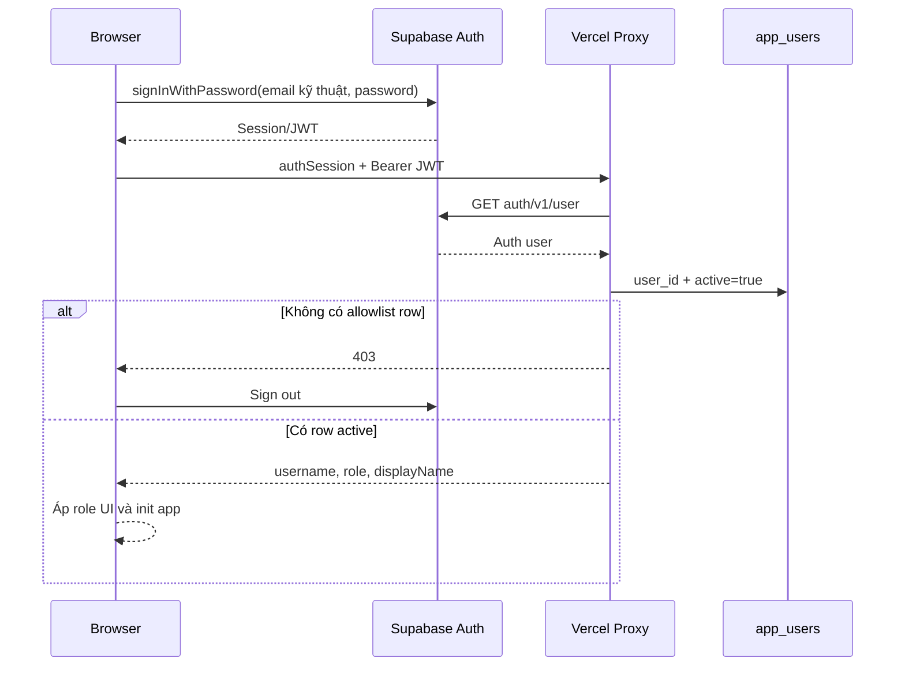

# RBAC_MATRIX

## 1. Mục đích và phạm vi

Tài liệu này định nghĩa mô hình xác thực và phân quyền hiện trạng của hệ thống Vận tải Đông Bắc.

Phạm vi gồm:

- Supabase Auth và allowlist `app_users`;
- các role `admin`, `operator`, `shareholder`;
- quyền theo màn hình và API action;
- vị trí enforce quyền ở frontend, Vercel proxy, Supabase RLS và Apps Script;
- quyền quản trị tài khoản;
- hành vi khi tài khoản bị khóa hoặc session hết hạn;
- yêu cầu kiểm thử khi thay đổi quyền.

Tài liệu mô tả contract đang chạy. Nó không cấp thêm quyền mới và không thay thế policy SQL hoặc source permission map.

## 2. Nguyên tắc bảo mật

1. Ẩn nút ở frontend không phải biện pháp bảo mật đầy đủ.
2. Vercel proxy là điểm enforce role bắt buộc cho API từ production frontend.
3. Supabase RLS chỉ cho authenticated active app user đọc cache/queue.
4. Apps Script kiểm tra shared proxy secret khi enforcement được bật.
5. Browser không được giữ service role key hoặc proxy secret.
6. Tài khoản có Supabase Auth user nhưng không có row active trong `app_users` không được vào ứng dụng.
7. `shareholder` là role chỉ đọc; mọi write phải bị chặn ở proxy, không chỉ trong UI.
8. Account administration chỉ dành cho `admin`.
9. `operator` có quyền ghi nghiệp vụ nhưng không quản trị tài khoản.
10. Không dùng user model `BOT_USERS` trong file Thu chi thay cho `app_users`.

## 3. Mô hình danh tính

### 3.1. Username và email kỹ thuật

Người dùng đăng nhập bằng username. Frontend chuyển username thành email kỹ thuật:

```text
<username>@dongbac.internal
```

Supabase Auth xác thực email kỹ thuật và password. Giao diện không yêu cầu người dùng biết email này.

### 3.2. Username contract

Username:

- dài 3–40 ký tự;
- chỉ gồm chữ thường `a-z`, số, dấu `.`, `_`, `-`;
- được normalize lowercase;
- unique không phân biệt hoa/thường qua index `lower(username)`.

### 3.3. Password contract

- tối thiểu 6 ký tự;
- không bắt buộc chữ hoa hoặc ký tự đặc biệt;
- đổi mật khẩu cá nhân yêu cầu mật khẩu hiện tại;
- mật khẩu mới phải khác mật khẩu hiện tại;
- admin có thể đặt lại mật khẩu tạm;
- password không được commit, log hoặc lưu thô trong frontend.

### 3.4. Allowlist

`app_users` chứa:

- `user_id` tham chiếu `auth.users`;
- `username`;
- `email`;
- `role`;
- `active`;
- `display_name`;
- timestamps.

Điều kiện truy cập ứng dụng:

```text
Supabase session hợp lệ
AND có app_users.user_id khớp
AND app_users.active = true
```

## 4. Role definitions

### 4.1. `admin`

Mục đích: quản trị hệ thống và thao tác nghiệp vụ đầy đủ.

Quyền:

- đọc toàn bộ màn hình nghiệp vụ hiện được expose;
- thêm/sửa/xóa dữ liệu Vận tải và Thu chi;
- xem trạng thái sync/queue và chạy audit;
- retry/kick worker qua API;
- tạo, sửa, khóa tài khoản;
- đổi role;
- đặt lại mật khẩu người khác;
- đổi mật khẩu của chính mình.

Giới hạn:

- không được tự hạ role hoặc vô hiệu hóa chính tài khoản admin đang đăng nhập;
- không được bypass spreadsheet/secret/migration invariant.

### 4.2. `operator`

Mục đích: người vận hành nghiệp vụ hằng ngày.

Quyền:

- đọc các màn hình nghiệp vụ;
- thêm/sửa/xóa dữ liệu Vận tải;
- thêm/sửa/xóa giao dịch Thu chi;
- thao tác khoản vay và danh mục;
- xem sync/write jobs/audit;
- retry/kick worker;
- đổi mật khẩu của chính mình.

Không có quyền:

- xem danh sách tài khoản qua account admin API;
- tạo user;
- đổi role/trạng thái user;
- reset password user khác.

### 4.3. `shareholder`

Mục đích: cổ đông/chủ sở hữu chỉ xem dữ liệu được cho phép.

Quyền hiện tại:

- đăng nhập và xem session;
- đọc `runtimeContext` đã được resolve từ allowlist server;
- đổi mật khẩu cá nhân;
- đọc startup;
- xem Tổng quan và Báo cáo;
- xem bảng trong menu Vận hành qua `readManageData`;
- đọc catalog tối thiểu cần cho màn hình qua `getCatalogs`;
- xem giao dịch Thu chi, tổng quan Thu chi và khoản vay;
- đọc fund form options;
- gọi kiểm tra đối soát chuyến read-only.

Không có quyền:

- thêm/sửa/xóa dữ liệu;
- mở API bảng Danh mục quản trị (`readCatalogData`, `getFundCatalog`);
- xem/retry write jobs;
- chạy worker;
- xem sync status/audit qua API;
- quản trị tài khoản;
- invalidate cache.

## 5. Các lớp enforcement

### 5.1. Frontend UI

Source:

- `next-shell/components/platform/AppShell.tsx`;
- `next-shell/components/settings/SettingsModule.tsx`;
- các module Next có role-dependent navigation/button markup.

Trách nhiệm:

- ẩn hoặc khóa nút thêm/sửa/xóa;
- ẩn khu vực account administration với non-admin;
- tránh mở drawer/form ghi với shareholder;
- hiển thị role hiện tại.

Đây chỉ là UX layer. Người dùng có thể sửa DOM hoặc tự gửi HTTP request.

### 5.2. Vercel proxy

Source: `api/app.js`.

Trách nhiệm:

- xác minh Bearer token;
- đọc `app_users` bằng service role;
- kiểm tra active/role;
- chạy `AuthorizationPolicy.assertAuthorized(user, action)`;
- chạy `AuthorizationPolicy.assertAdmin(user)` cho account admin actions;
- chỉ sau đó mới forward Apps Script.

Đây là role enforcement chính cho frontend Vercel.

### 5.3. Supabase RLS

Source:

- migration `007_auth_hardening.sql`;
- migration `008_authenticated_read_cutover.sql`;
- migration `009_shareholder_role.sql`.

RLS dùng `public.is_active_app_user()` để cho authenticated active user đọc cache/queue tables.

RLS hiện không phân biệt `admin`, `operator`, `shareholder` khi đọc các bảng cache/queue. Sự khác biệt role cho API action được enforce tại proxy. Vì browser có thể đọc bảng Supabase được grant select nếu biết endpoint/key, dữ liệu nhạy cảm không được đặt trong cache chỉ dựa vào UI menu visibility.

### 5.4. Apps Script proxy secret

Source: `SecurityService.gs`.

Khi `AUTH_ENFORCEMENT_ENABLED=true`:

- request phải mang đúng `APP_PROXY_SECRET`;
- secret được proxy thêm server-side;
- direct browser call đến Apps Script không có secret bị chặn.

Đây là xác minh nguồn proxy, không phải role-specific authorization. Apps Script hiện dựa vào proxy đã kiểm tra role.

### 5.5. Google Sheets

Google Sheets protections và sharing permissions là lớp riêng. Người dùng có quyền mở Sheet trực tiếp có thể thực hiện thao tác ngoài web app/proxy.

RBAC web app không tự động hạn chế quyền chỉnh sửa trực tiếp trong Google Sheets. Việc chia sẻ/protection Sheet phải được quản trị riêng.

## 6. Luồng xác thực



## 7. Ma trận màn hình

Ký hiệu:

- `R`: xem/đọc;
- `W`: thêm/sửa/xóa nghiệp vụ;
- `A`: quản trị;
- `—`: không được cấp quyền qua UI/API contract hiện tại.

| Màn hình/khu vực | Admin | Operator | Shareholder | Ghi chú |
| --- | --- | --- | --- | --- |
| Đăng nhập | R | R | R | Supabase Auth + allowlist |
| Tổng quan | R | R | R | Dashboard/report cache hoặc fallback |
| Nhập liệu Vận tải | R/W | R/W | — | Shareholder không submit |
| Vận hành `NL_*` | R/W | R/W | R | Shareholder chỉ `readManageData` |
| Báo cáo | R | R | R | Không có write nghiệp vụ |
| Danh mục Vận tải | R/W | R/W | — | `readCatalogData` không nằm trong shareholder allowlist |
| Thu chi tổng quan | R | R | R | Pending không vào KPI |
| Giao dịch Thu chi | R/W | R/W | R | Shareholder không add/update/delete |
| Khoản vay | R/W | R/W | R | Nút thanh toán/add bị khóa/ẩn |
| Danh mục Thu chi | R/W | R/W | — | `getFundCatalog` không cho shareholder |
| Trạng thái đồng bộ | R/A | R/A | — | Operator được audit/retry theo proxy hiện tại |
| Đổi mật khẩu cá nhân | W | W | W | Mọi user active |
| Quản lý tài khoản | A | — | — | Admin-only tại proxy |

`R/W` ở UI phải khớp API action. Nếu một card/nút bị ẩn nhưng API vẫn cho phép role không phù hợp, đó là lỗi bảo mật.

## 8. Ma trận API Auth và account

| Action | Method | Admin | Operator | Shareholder | Enforcement |
| --- | --- | --- | --- | --- | --- |
| `health` | GET | R | R | R | Không yêu cầu Auth tại proxy |
| `authSession` | GET | R | R | R | Session + allowlist |
| `runtimeContext` | GET | R | R | R | Session + allowlist workbook server |
| `changeOwnPassword` | POST | W | W | W | Proxy account handler |
| `listUsers` | GET | A | — | — | `assertAdmin` |
| `createUser` | POST | A | — | — | `assertAdmin` |
| `updateUser` | POST | A | — | — | `assertAdmin` |
| `resetUserPassword` | POST | A | — | — | `assertAdmin` |

## 9. Ma trận API đọc Vận tải

| Action | Admin | Operator | Shareholder | Ghi chú |
| --- | --- | --- | --- | --- |
| `getBootstrap` | R | R | — | Không trong shareholder allowlist |
| `getStartupData` | R | R | R | Startup chính |
| `getInitialData` | R | R | — | API initial legacy/rộng |
| `getCatalogs` | R | R | R | Catalog tối thiểu cho form/render |
| `getDashboard` | R | R | R | Tổng quan |
| `getReports` | R | R | R | Report collection |
| `getReport` | R | R | R | Có thể ghi technical report cache |
| `getReportBundle` | R | R | R | Báo cáo chính |
| `readSheetData` | R | R | — | Generic read không expose shareholder |
| `readManageData` | R | R | R | Bảng Vận hành read-only với shareholder |
| `readCatalogData` | R | R | — | Danh mục quản trị |
| `checkTripReconciliation` | R | R | R | Read-only reconciliation |

## 10. Ma trận API ghi Vận tải

| Action | Admin | Operator | Shareholder | Side effect |
| --- | --- | --- | --- | --- |
| `submitRows` | W | W | — | Enqueue/ghi `NL_*` |
| `saveSheetRow` | W | W | — | Queue `NL_*`, direct sheet khác |
| `deleteSheetRow` | W | W | — | Queue clear hoặc direct delete |
| `invalidateCaches` | A | A | — | Xóa/tăng cache version |

Proxy hiện không phân biệt admin/operator cho cache invalidation hoặc nghiệp vụ ghi. Nếu cần hạn chế operator trong tương lai phải thay permission contract rõ ràng.

## 11. Ma trận API Thu chi

| Action | Admin | Operator | Shareholder | Ghi chú |
| --- | --- | --- | --- | --- |
| `getFundTransactions` | R | R | R | Chi tiết giao dịch |
| `getFundOverview` | R | R | R | KPI/tổng quan |
| `getFundLoanOverview` | R | R | R | Khoản vay/lịch sử |
| `getFundFormOptions` | R | R | R | Option cần để render/filter |
| `getFundCatalog` | R | R | — | Danh mục quản trị |
| `addFundTransaction` | W | W | — | Direct |
| `addFundTransactions` | W | W | — | Queue có điều kiện/direct |
| `updateFundTransaction` | W | W | — | Direct |
| `deleteFundTransaction` | W | W | — | Direct |
| `addFundLoan` | W | W | — | Direct |
| `addFundLoanPayment` | W | W | — | Direct |
| `saveFundCatalogItem` | W | W | — | Direct |
| `deleteFundCatalogItem` | W | W | — | Direct |

## 12. Ma trận queue, sync và audit

| Action | Admin | Operator | Shareholder | Ghi chú |
| --- | --- | --- | --- | --- |
| `getWriteJobStatus` | R | R | — | Job detail |
| `getRecentWriteJobs` | R | R | — | Nhật ký/pending restore |
| `retryWriteJob` | A | A | — | Thay trạng thái job |
| `processWriteJobs` | A | A | — | Worker có thể ghi Sheet |
| `getSupabaseSyncStatus` | R | R | — | Quick status |
| `getReportCacheAudit` | A | A | — | Heavy live/cache compare |
| `getManageCacheAudit` | A | A | — | Quick/deep compare |

`operator` hiện được phép gọi các action vận hành này vì proxy chỉ có restriction riêng cho shareholder và account admin. Đây là contract hiện tại, không phải suy luận theo tên role.

## 13. Shareholder allowlist là deny-by-default

Proxy thực hiện:

```text
if role == shareholder AND action không nằm trong SHAREHOLDER_ACTIONS
then HTTP 403
```

Hệ quả:

- action mới mặc định bị chặn với shareholder;
- muốn cấp quyền read action mới phải thêm rõ vào allowlist;
- không thêm write action vào shareholder allowlist;
- action có vẻ read-only vẫn bị chặn nếu chưa được review, ví dụ `readCatalogData`;
- permission tài liệu phải khớp chính xác source allowlist.

## 14. Admin-only account operations

### 14.1. Tạo user

Admin có thể:

- chọn username;
- display name;
- role;
- password hoặc để hệ thống sinh password tạm.

Proxy tạo Auth user rồi tạo `app_users`. Nếu bước profile lỗi, proxy cố rollback Auth user.

### 14.2. Cập nhật user

Admin có thể đổi:

- display name;
- role;
- active status.

Guard:

- admin hiện tại không được tự đổi role khỏi admin;
- admin hiện tại không được tự set `active=false`.

### 14.3. Reset password

Admin có thể đặt password cụ thể hoặc nhận password tạm được sinh.

Password tạm:

- chỉ trả trong response;
- chỉ hiển thị cho admin;
- không được lưu vào log/browser storage lâu dài;
- nên được chuyển cho người dùng qua kênh riêng.

### 14.4. Khóa tài khoản

`active=false` trong `app_users` làm:

- proxy từ chối session/action tiếp theo;
- `is_active_app_user()` trả false;
- RLS không cho đọc cache.

Auth user có thể vẫn tồn tại trong Supabase Auth. Khóa allowlist là cơ chế vô hiệu hóa ứng dụng.

## 15. Supabase RLS matrix

### 15.1. Cache/queue tables

Các bảng được migration authenticated cutover áp dụng:

- `report_bundles`;
- `fund_overview_bundles`;
- `fund_transaction_bundles`;
- `fund_loan_bundles`;
- `sync_status`;
- `startup_bundles`;
- `catalog_bundles`;
- `manage_data_bundles`;
- `write_jobs`;
- `write_job_logs`.

| Database role/context | Select | Insert/update/delete |
| --- | --- | --- |
| `anon` | Không | Không |
| `authenticated` + active `app_users` | Có | Không qua browser grant/policy hiện tại |
| `authenticated` nhưng inactive/không allowlist | Không | Không |
| `service_role` | Có | Có, bypass RLS theo Supabase semantics |

### 15.2. `app_users`

Authenticated active user chỉ được select row của chính mình theo policy:

```text
user_id = auth.uid() AND active = true
```

Account administration dùng service role tại proxy, không cấp update trực tiếp cho browser user.

### 15.3. Role-level limitation

RLS helper chỉ kiểm tra active membership, không kiểm tra `role='shareholder'` cho từng bảng. Vì vậy:

- không dựa vào RLS hiện tại để ẩn dữ liệu cache khác nhau giữa role;
- proxy kiểm soát action, nhưng direct Supabase REST select của active user có thể đọc bảng đã grant select;
- payload cache không được chứa secret hoặc dữ liệu mà một active role tuyệt đối không được phép thấy nếu policy chưa tách theo role.

## 16. Apps Script enforcement matrix

### 16.1. `AUTH_ENFORCEMENT_ENABLED=false`

`SecurityService.assertProxyRequest()` không bắt buộc proxy secret. Đây là chế độ rollout/rollback, giảm lớp bảo vệ direct API.

### 16.2. `AUTH_ENFORCEMENT_ENABLED=true`

Request action phải có `APP_PROXY_SECRET` khớp Script Property.

Comparison dùng safe equality để giảm timing leak đơn giản.

### 16.3. Giới hạn

Apps Script hiện không tự tra `app_users`/JWT và không tự enforce từng role. Nó tin proxy đã xác thực request dựa trên shared secret.

Vì vậy:

- proxy secret phải được giữ kín;
- rotate ở cả Vercel và Apps Script nếu nghi bị lộ;
- không expose direct Apps Script URL như đường production khi enforcement bật;
- không thêm đường server khác có secret nhưng bỏ qua role check.

## 17. UI enforcement contract

### 17.1. Helpers

Frontend có các helper:

- `getCurrentRole()`;
- `isAdminUser()`;
- `isShareholderUser()`;
- `canWriteData()`;
- `applyRoleUi()`;
- `requireWritePermission()`.

### 17.2. Write controls

Mọi entry point ghi cần một trong:

- bị loại khỏi DOM/hidden theo role;
- disabled;
- gọi `requireWritePermission()` trước thao tác;
- và luôn bị proxy chặn nếu user không đủ quyền.

Không chỉ bảo vệ nút chính. Phải kiểm tra:

- keyboard shortcut;
- row action icon;
- drawer submit;
- retry link;
- bulk action;
- inline handler;
- direct function call từ console không thể vượt proxy.

### 17.3. Read-only rendering

Shareholder vẫn cần:

- catalog label đủ để render dữ liệu;
- navigation đến màn hình được phép;
- filter/search/export read-only;
- không thấy empty state sai chỉ vì write controls bị ẩn.

`applyRoleUi()` không được ẩn cả bảng chỉ vì bảng có nút ghi.

## 18. Session lifecycle

### 18.1. Session hợp lệ

Browser dùng Supabase SDK với:

- `persistSession=true`;
- `autoRefreshToken=true`;
- `detectSessionInUrl=true`.

Mỗi proxy API call vẫn xác minh token với Supabase Auth và allowlist active.

### 18.2. Session hết hạn

Khi API trả 401:

- frontend sign out Supabase;
- clear `sessionStorage`;
- hiện auth gate;
- yêu cầu đăng nhập lại.

### 18.3. Role/status thay đổi giữa session

Proxy đọc `app_users` mỗi request nên:

- khóa user có hiệu lực ở request tiếp theo;
- đổi role có hiệu lực ở request tiếp theo;
- frontend UI có thể vẫn hiển thị role cũ đến khi reload/authSession lại, nhưng proxy dùng role mới.

Không dựa vào role cached trong browser để cấp quyền server.

## 19. Direct Supabase access từ frontend

Frontend đọc cache Supabase trực tiếp bằng:

- Supabase URL;
- anon key trong header `apikey`;
- user JWT trong `Authorization`.

RLS quyết định quyền đọc. Proxy không nằm trên đường này.

Do đó khi thay đổi RLS phải test riêng:

- anon request;
- authenticated active admin;
- authenticated active operator;
- authenticated active shareholder;
- authenticated inactive user.

## 20. Direct Apps Script và vận hành nội bộ

### 20.1. Direct HTTP

Khi enforcement bật, direct request không có proxy secret phải bị từ chối dù có biết deployment URL.

### 20.2. Apps Script root sau D1

Apps Script không còn render UI. Request root trả JSON hướng người dùng sang Next; mọi action production vẫn phải đi qua Vercel proxy và shared secret.

### 20.3. `clasp run`/Apps Script editor

Global functions phục vụ vận hành có thể chạy dưới quyền tài khoản Apps Script, ngoài proxy RBAC. Quyền chạy project/deployment phải được quản trị ở Google Apps Script/Google account.

## 21. Google Sheets direct access

Người có quyền edit file Google Sheet có thể:

- sửa/xóa row trực tiếp;
- kích hoạt bound script/onEdit;
- thay formula nếu protection cho phép;
- bypass web app RBAC và write queue.

Vì vậy security model đầy đủ còn phụ thuộc:

- Google Drive sharing;
- protected sheets/ranges;
- quyền Apps Script bound project;
- installable trigger owner.

Tài khoản shareholder trên web app không tự động đồng nghĩa chỉ-view trong Google Drive. Phải quản trị sharing riêng.

## 22. Permission drift risks

Các nơi có thể drift:

- `SHAREHOLDER_ACTIONS` trong proxy;
- frontend `canWriteData()` và role-dependent selectors;
- menu/navigation visibility;
- API action mới trong `PublicApi.invokeApi()`;
- Supabase RLS policies;
- database role constraint;
- account role options;
- tests regex/smoke;
- Google Sheet sharing/protections.

Một action mới được backend support nhưng không review permission sẽ:

- mặc định mở cho admin/operator;
- mặc định chặn shareholder;
- có thể không có UI;
- có thể bypass intended admin-only boundary nếu lẽ ra chỉ admin được gọi.

## 23. Quy tắc thêm role mới

Không thêm role chỉ bằng cách sửa dropdown frontend.

Phải cập nhật:

1. migration constraint `app_users.role`;
2. proxy `ROLES`;
3. permission policy/allowlist;
4. account create/update validation;
5. frontend role label;
6. UI navigation/write guards;
7. Supabase RLS nếu role cần data visibility khác;
8. API contract và ma trận màn hình;
9. production RBAC smoke tests;
10. existing user migration/rollback.

Phải định nghĩa deny-by-default cho role mới.

## 24. Quy tắc thêm API action

Mỗi action mới phải được phân loại:

- unauthenticated health-only;
- authenticated read;
- authenticated write;
- operator/admin;
- admin-only;
- shareholder read-only hoặc blocked.

Checklist:

1. Action có đọc dữ liệu nhạy cảm không?
2. Action có side effect kỹ thuật dù dùng GET không?
3. Action có ghi Sheet/Supabase/trigger không?
4. Operator có thực sự cần quyền không?
5. Shareholder có cần xem không?
6. Proxy permission được cập nhật chưa?
7. Frontend guard được cập nhật chưa?
8. Apps Script có phụ thuộc `requestUser` không?
9. RLS có cho direct cache read rộng hơn API không?
10. Test 401/403/success đã có chưa?

## 25. Quy tắc least privilege

- Chỉ `health` được unauthenticated.
- Chỉ admin quản trị tài khoản.
- Shareholder chỉ action explicit allowlist.
- Browser chỉ select cache qua RLS, không write.
- RPC claim chỉ service role.
- Service role/proxy secret chỉ server-side.
- Direct Sheet edit chỉ cấp cho người thực sự cần.
- Trigger/service account chỉ có scope cần thiết.
- Không dùng admin account cho thao tác hằng ngày nếu operator đủ quyền, khi quy trình tài khoản cho phép.

## 26. Kiểm thử RBAC bắt buộc

### 26.1. Unauthenticated

- `health` thành công;
- `authSession` không token trả 401;
- read/write business action không token trả 401;
- direct Supabase anon select cache trả 401/permission denied;
- direct Apps Script không secret bị chặn khi enforcement bật.

### 26.2. User ngoài allowlist/inactive

- Supabase Auth có thể đăng nhập;
- proxy trả 403;
- RLS không cho đọc cache;
- frontend sign out/không init app.

### 26.3. Shareholder

Test success:

- `authSession`;
- `getStartupData`;
- `getDashboard`;
- `getReportBundle`;
- `readManageData`;
- `getFundTransactions`;
- `getFundOverview`;
- `getFundLoanOverview`;
- đổi mật khẩu cá nhân.

Test 403 tối thiểu:

- `submitRows`;
- `saveSheetRow`;
- `deleteSheetRow`;
- `addFundTransactions`;
- `addFundLoanPayment`;
- `readCatalogData`;
- `getFundCatalog`;
- `retryWriteJob`;
- `getSupabaseSyncStatus`;
- `listUsers`.

Không chỉ kiểm tra nút bị ẩn.

### 26.4. Operator

Test success:

- một read Vận tải;
- một write Vận tải;
- một read Thu chi;
- một write Thu chi;
- queue status/retry theo contract;
- đổi mật khẩu cá nhân.

Test 403:

- `listUsers`;
- `createUser`;
- `updateUser`;
- `resetUserPassword`.

### 26.5. Admin

Test:

- toàn bộ nghiệp vụ operator;
- list/create/update/reset user;
- không tự hạ quyền/vô hiệu hóa chính mình;
- tạo shareholder rồi xác minh read-only.

## 27. Production smoke test

`tests/production-rbac-smoke.js` được dùng để kiểm tra production RBAC với credential/config ngoài repository.

Nguyên tắc:

- không commit password/token;
- không chạy write destructive ngoài dữ liệu test được phê duyệt;
- test cả HTTP status và payload;
- xóa/khóa account test sau khi hoàn tất nếu được tạo tạm;
- không log access token/service role key.

Contract test local trong `tests/contracts.test.js` hiện kiểm tra:

- shareholder role có trong migration;
- proxy có allowlist read-only;
- account administration giữ admin-only;
- frontend có role helpers.

Regex contract test không thay thế runtime smoke test.

## 28. Incident response

### 28.1. Nghi lộ proxy secret

1. Rotate `APP_PROXY_SECRET` ở Vercel và Apps Script.
2. Deploy/config hai phía theo thứ tự tránh mismatch kéo dài.
3. Kiểm tra direct Apps Script call bị chặn.
4. Kiểm tra log request bất thường.

### 28.2. Nghi lộ service role key

1. Rotate/revoke key trong Supabase.
2. Cập nhật Vercel và Apps Script server config.
3. Kiểm tra database/Auth admin logs.
4. Không đưa key cũ vào issue/tài liệu.

### 28.3. User cần khóa ngay

1. Đặt `app_users.active=false` bằng admin UI/server operation.
2. Xác minh proxy trả 403.
3. Xác minh RLS select bị chặn.
4. Nếu cần, revoke/delete Supabase Auth sessions/user theo quy trình riêng.
5. Kiểm tra Google Drive sharing độc lập.

### 28.4. Proxy/Auth lỗi diện rộng

Rollback theo `ROLLBACK.md`. Không tắt Auth enforcement mà không hiểu direct Apps Script exposure. Nếu buộc rollback, ghi rõ cửa sổ giảm bảo mật và khôi phục sớm.

## 29. Điểm yếu hiện tại cần biết

- Apps Script không tự enforce role, phụ thuộc proxy secret.
- RLS cache kiểm tra active user nhưng chưa tách visibility theo role.
- Operator được phép gọi audit/worker actions giống admin, trừ account administration.
- Một số read action hợp lý với shareholder vẫn bị chặn do allowlist chưa bao gồm; đây là deny-by-default, không phải lỗi nếu UI không cần.
- Google Sheet direct access nằm ngoài web RBAC.
- Bound script Thu chi nằm ngoài proxy RBAC.
- Source frontend legacy/HtmlService đã bị loại bỏ; deployment C2 chỉ còn là rollback presentation bất biến.
- Permission definitions phân tán giữa proxy, frontend, SQL migration và test.

Các điểm này là mô tả hiện trạng, không phải phê duyệt thay đổi.

## 30. Checklist review thay đổi quyền

- Role constraint database có khớp proxy/frontend không?
- User active/inactive được enforce ở proxy và RLS không?
- Action mới mặc định deny với shareholder không?
- Admin-only operation có `assertAdmin()` không?
- Operator có được cấp quá rộng không?
- UI có ẩn/khóa đúng nhưng vẫn render read-only content không?
- Direct API request có bị chặn đúng dù sửa DOM không?
- RLS có lộ dữ liệu rộng hơn menu/API không?
- Apps Script secret enforcement có bật và secret khớp không?
- Service role key có chỉ ở server không?
- Google Sheet sharing/protection có phù hợp vai trò thực tế không?
- Test 401, 403 và success đã chạy đủ role chưa?
- Rollback có làm mở direct API hoặc anon read không?

## 31. Trạng thái tài liệu

- Loại tài liệu: Auth/RBAC contract hiện trạng.
- Phạm vi: Supabase Auth, `app_users`, frontend role UX, Vercel proxy permissions, Supabase RLS và Apps Script proxy-secret enforcement.
- Nguồn kiểm chứng: `api/app.js`, `next-shell/components/`, `next-shell/lib/platform/`, migrations `007`–`009`, `SecurityService.gs` và RBAC tests.
- Ngày xác nhận gần nhất: 2026-07-13 (D1).
- Cần cập nhật khi: thêm/đổi role, action permission, account operation, RLS policy, Auth flow, proxy secret enforcement hoặc Google Sheet access model.
