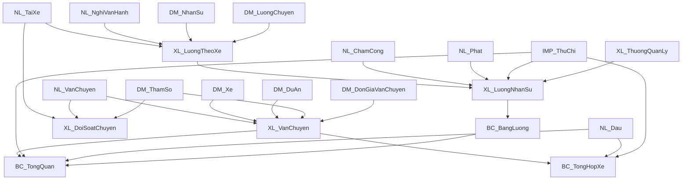

# SPREADSHEET_CONTRACTS

## 1. Mục đích và phạm vi

Tài liệu này định nghĩa hợp đồng cấu trúc Google Sheets mà web app Vận tải Đông Bắc đang phụ thuộc.

Phạm vi gồm:

- cách chọn file theo năm;
- danh sách và vai trò các sheet;
- header row và các cột nghiệp vụ chính;
- cột/vùng công thức phải bảo toàn;
- virtual sheet và named range;
- dependency giữa sheet;
- liên kết file Thu chi với file Vận tải;
- quy tắc đọc/ghi/migration an toàn;
- các điểm không đồng bộ đã phát hiện giữa source và snapshot.

Tài liệu này là contract bảo vệ cấu trúc, không phải yêu cầu thay đổi Google Sheet. Khi tài liệu, snapshot và file production mâu thuẫn, phải kiểm tra file production trước khi ghi hoặc migration.

## 2. Nguồn kiểm chứng và giới hạn

Tài liệu được tổng hợp từ:

- `AppConfig.gs`;
- `SheetService.gs`;
- `ValidationService.gs`;
- `FundService.gs`;
- `PROJECT_SCHEMA.md`;
- `docs/schema/VanTaiDongBac_2026_schema.json`;
- `docs/schema/thu_chi_2026_schema_raw_20260625_175010.json`;
- `docs/source/thu_chi_bound_script/`.

Ngày snapshot:

- Vận tải: schema chuẩn hóa từ trạng thái năm 2026, có metadata cleanup gần nhất trong file JSON;
- Thu chi: export ngày 2026-06-25.

Snapshot không tự động cập nhật theo production. Không dùng số `row_count`, `lastRow` hoặc sample row trong snapshot như giới hạn cố định để ghi.

## 3. Invariant bắt buộc

Không được tự ý:

- đổi tên sheet;
- đổi thứ tự cột;
- chèn thêm cột vào giữa cấu trúc hiện có;
- xóa hoặc ghi đè công thức;
- thay header bằng tên gần nghĩa;
- gộp file Vận tải và Thu chi;
- đổi named range hoặc vùng named range;
- chuyển sheet ẩn thành nguồn nhập liệu mới;
- ghi vào sheet `XL_*` hoặc `BC_*` như dữ liệu nguồn;
- sửa trực tiếp cấu trúc production mà không có hàm/migration riêng;
- dùng Supabase cache để tái tạo ngược Google Sheet;
- dùng `getActiveSpreadsheet()` làm file dữ liệu chính trong Apps Script web app độc lập.

Mọi thay đổi cấu trúc phải:

1. được người dùng phê duyệt;
2. có migration riêng;
3. kiểm tra công thức, validation, protection và named range;
4. có backup/rollback;
5. cập nhật schema snapshot và tài liệu contract;
6. test trên bản sao trước production.

## 4. File resolution theo năm

### 4.1. File Vận tải

Apps Script độc lập resolve Spreadsheet ID theo thứ tự:

1. request `spreadsheetId` hoặc `ssId`;
2. Script Property `SPREADSHEET_ID_<year>`;
3. `ACTIVE_SPREADSHEET_ID`;
4. `DEFAULT_SPREADSHEET_ID`;
5. ID mặc định trong `AppConfig.gs`.

File 2026 trong snapshot:

- tên: `VanTaiDongBac_2026`;
- timezone: `Asia/Saigon`;
- locale: `vi_VN`.

Code phải mở bằng:

```javascript
SpreadsheetApp.openById(id)
```

### 4.2. File Thu chi

`FundService` resolve file Thu chi bằng:

- Script Property theo năm;
- cấu hình/fallback hiện có trong service.

File 2026 trong raw snapshot có Spreadsheet ID riêng và không phải file Vận tải.

### 4.3. Context không được trộn

- `APP_CONFIG.spreadsheetId` đại diện context file Vận tải của request.
- `FundService.getFundSpreadsheet_(year)` mở file Thu chi.
- Không truyền ID file Thu chi vào API Vận tải chỉ vì cùng năm.
- Cache Vận tải và Thu chi dùng key khác nhau; không dùng Spreadsheet ID Vận tải làm khóa thay cho `year` của fund bundle.

## 5. Phân lớp sheet Vận tải

| Prefix/tên | Vai trò | Quy tắc ghi |
| --- | --- | --- |
| `NL_*` | Nhập liệu/vận hành | Web app được ghi các cột nghiệp vụ cho phép |
| `DM_*` | Danh mục/tham số | CRUD có kiểm soát, giữ header/công thức/vùng lịch sử |
| `XL_*` | Xử lý và đối soát | Không ghi dữ liệu nghiệp vụ trực tiếp |
| `BC_*` | Báo cáo | Chủ yếu đọc; chỉ controller/cache tạm theo contract đặc biệt |
| `IMP_ThuChi` | Import từ file Thu chi | Không ghi tay từ web app |
| `SYS_ReportCache` | Cache hệ thống trong Sheet | Chỉ `SheetReportCacheRepository` qua report service quản lý |

## 6. Danh mục sheet Vận tải hiện có trong snapshot

Snapshot chuẩn hóa hiện liệt kê 24 sheet:

| Sheet | Vai trò | Hidden trong snapshot |
| --- | --- | --- |
| `NL_VanChuyen` | Dữ liệu chuyến vận tải | Không |
| `NL_TaiXe` | Dữ liệu chuyến theo tài xế | Không |
| `NL_Dau` | Dữ liệu dầu | Không |
| `NL_ChamCong` | Chấm công/nghỉ | Không |
| `NL_Phat` | Phạt nội bộ | Không |
| `NL_NghiVanHanh` | Nghỉ/dừng vận hành | Không |
| `XL_DoiSoatChuyen` | Đối soát chuyến/cảnh báo | Không |
| `XL_VanChuyen` | Xử lý doanh thu vận tải | Không |
| `XL_LuongTheoXe` | Tính lương chuyến theo xe | Không |
| `XL_LuongNhanSu` | Tính lương nhân sự | Không |
| `XL_ThuongQuanLy` | Tính thưởng quản lý | Không |
| `BC_TongQuan` | Báo cáo tổng quan/lợi nhuận | Không |
| `BC_BangLuong` | Báo cáo lương | Không |
| `BC_TongHopXe` | Báo cáo tổng hợp xe | Không |
| `DM_DuAn` | Danh mục dự án/tuyến | Có |
| `DM_Xe` | Danh mục xe | Có |
| `DM_NhanSu` | Danh mục nhân sự | Không theo metadata snapshot |
| `DM_ThamSo` | Tham số/lịch sử giá dầu | Có |
| `DM_LuongChuyen` | Bậc lương chuyến | Có |
| `DM_DonGiaVanChuyen` | Quy tắc đơn giá vận chuyển | Có |
| `DM_ThuongQuanLy` | Quy tắc thưởng quản lý | Có |
| `DM_PhatNoiBo` | Quy tắc phạt nội bộ | Có |
| `IMP_ThuChi` | Import từ file Thu chi | Có |
| `SYS_ReportCache` | Cache report của web app | Có |

Không dùng trạng thái hidden làm permission. Code mở sheet theo tên dù sheet đang ẩn.

## 7. Contract các sheet nhập liệu Vận tải

### 7.1. Mapping trong `AppConfig.gs`

| Form type | Sheet | Header row | Số cột row builder |
| --- | --- | ---: | ---: |
| `vanChuyen` | `NL_VanChuyen` | 2 | 8 |
| `taiXe` | `NL_TaiXe` | 1 | 7 |
| `dau` | `NL_Dau` | 2 | 10 |
| `chamCong` | `NL_ChamCong` | 1 | 11 |
| `phat` | `NL_Phat` | 1 | 7 |
| `nghiVanHanh` | `NL_NghiVanHanh` | 1 | 10 |
| — | `NL_PhanCongLai` | 1 | 4 cột nhập + 1 cột kiểm tra |

Số cột row builder không nhất thiết bằng tổng số cột vật lý của sheet. Snapshot cho thấy một số sheet có nhiều cột helper/formula ở phía sau. Chỉ ghi các segment nghiệp vụ được service cho phép.

### 7.2. `NL_VanChuyen`

Contract:

- header row: 2;
- frozen rows: 2;
- frozen columns: 3;
- row builder: 8 giá trị.

Cột nghiệp vụ logic:

1. Ngày;
2. Tháng;
3. Biển số;
4. Dự án;
5. Số chuyến;
6. Số phiếu;
7. Ghi chú.
8. Khối lượng thực tế (m³), input tùy chọn.

Quy tắc:

- cột Tháng được suy ra từ Ngày bằng công thức/hệ thống Sheet;
- header live cột C là `Biển số`; write path vẫn chấp nhận alias legacy `Biển số xe` đúng tại cột C để các job đang chờ và rollback workbook không bị kẹt, nhưng không chấp nhận tên tùy ý hoặc đổi vị trí cột;
- giữ subtotal/công thức ở vùng đầu sheet;
- app không ghi đè công thức tháng;
- append phải copy format/công thức dòng trước;
- Developer Metadata `WRITE_JOB_ID` có thể được gắn vào range để chống ghi trùng queued append.

Downstream:

- `XL_DoiSoatChuyen`;
- `XL_VanChuyen`;
- dashboard/latest trips;
- báo cáo và manage cache.

### 7.3. `NL_TaiXe`

Contract:

- header row: 1;
- row builder: 7 giá trị.
- snapshot có vùng cột vật lý mở rộng cho helper/formula.

Cột nghiệp vụ logic:

1. Ngày;
2. Tháng;
3. Biển số xe;
4. Nhóm vận hành;
5. Tài xế;
6. Số chuyến;
7. Ghi chú.

Quy tắc:

- Tháng lấy từ Ngày;
- `Nhóm vận hành` ở cột D được suy ra từ một phân công xe hiệu lực duy nhất trong `DM_PhanCongXe`; thiếu hoặc chồng lấn phân công thì backend fail-closed;
- không ghi vào các cột helper phía sau;
- dữ liệu dùng để đối soát `NL_VanChuyen` và tính lương chuyến.

Downstream:

- `XL_DoiSoatChuyen`;
- `XL_LuongTheoXe`;
- `XL_ThuongQuanLy`.

### 7.8. `NL_PhanCongLai`

Live schema ngày 2026-07-24:

1. Tháng;
2. Tài xế;
3. Công ty;
4. Ghi chú;
5. Kiểm tra.

Quy tắc:

- cột `Kiểm tra` là helper/formula, không sửa từ web app;
- tab Vận hành cho phép đọc và sửa bốn cột nghiệp vụ của dòng hiện có;
- chưa có contract append riêng, vì vậy web app không hiển thị nút `Nhập mới` khi đang ở tab này;
- dữ liệu tháng phải giữ dạng Date/tháng của Sheet, không chuyển thành text tùy ý.

### 7.4. `NL_Dau`

Contract:

- header row: 2;
- frozen rows: 2;
- frozen columns: 3;
- row builder: 10 giá trị;
- snapshot có nhiều cột helper/formula sau vùng nghiệp vụ.

Cột nghiệp vụ logic:

1. Ngày;
2. Tháng;
3. Biển số xe;
4. Nguồn dầu;
5. Số lít;
6. Giá dầu;
7. Thành tiền;
8. Nguồn chi;
9. Công ty sở hữu;
10. Ghi Chú.

Quy tắc:

- Tháng lấy từ Ngày;
- Thành tiền và Công ty sở hữu là công thức, không cho sửa từ form/manage;
- có cell số lít do người dùng nhập công thức cộng tay, ví dụ dạng `=120+340+160`;
- không thay công thức người dùng bằng display value;
- không gọi format rộng trên typed column sau ghi;
- UI có filter nguồn dầu/nguồn chi riêng.

Downstream:

- `BC_TongQuan`;
- `BC_TongHopXe`.

### 7.5. `NL_ChamCong`

Contract:

- header row: 1;
- row builder: 11 giá trị;
- snapshot có 12 cột vật lý, cho thấy có thể có helper ngoài row builder.

Cột nghiệp vụ logic:

1. Từ ngày;
2. Đến ngày;
3. Tháng;
4. Nhân sự;
5. Loại ngày công;
6. Số ngày;
7. Tính lương cứng;
8. Nhóm xử lý;
9. Ghi chú;
10. Loại ngày công hợp lệ;
11. Lưu ý.

Quy tắc:

- Tháng lấy từ ngày bắt đầu;
- Số ngày được tính theo khoảng ngày;
- field tính lương/nhóm xử lý có thể được suy ra từ loại ngày công;
- giữ validation và công thức helper.

Downstream:

- `XL_LuongNhanSu`;
- `XL_ThuongQuanLy`.

### 7.6. `NL_Phat`

Contract:

- header row: 1;
- row builder: 7 giá trị.

Cột nghiệp vụ logic:

1. Ngày;
2. Tháng;
3. Nhân sự;
4. Mã phạt;
5. Nội dung phạt;
6. Số tiền phạt;
7. Ghi chú.

Quy tắc:

- Tháng lấy từ Ngày;
- nội dung/số tiền có thể lookup từ `DM_PhatNoiBo`;
- không ghi đè công thức lookup nếu cột được service đánh dấu formula/skipped.

Downstream:

- `XL_LuongNhanSu`.

### 7.7. `NL_NghiVanHanh`

Contract:

- header row: 1;
- frozen columns: 3;
- row builder: 10 giá trị;
- snapshot có 10 cột vật lý.

Cột nghiệp vụ logic:

1. Ngày;
2. Tháng;
3. Biển số xe;
4. Nhóm vận hành;
5. Loại nghỉ;
6. Số giờ nghỉ;
7. Tính KPI?;
8. Giảm KPI;
9. Lý do;
10. Kiểm tra.

Quy tắc:

- Tháng lấy từ Ngày;
- `Tính KPI?` được suy ra theo loại nghỉ;
- `Giảm KPI` phụ thuộc số giờ và tham số KPI;
- Nhóm vận hành phải khớp phân công xe hiệu lực; cho phép `TẤT CẢ XE` theo contract live;
- `Tính KPI?`, `Giảm KPI` và `Kiểm tra` là cột tính toán, không sửa từ web app.

Downstream:

- `XL_LuongTheoXe`;
- `XL_ThuongQuanLy`.

## 8. Quy tắc ghi chung cho `NL_*`

### 8.1. Append row

Backend phải:

1. lấy đúng header row từ config;
2. xác định append row theo cột nghiệp vụ tin cậy, không chỉ `getLastRow()` khi sheet có ARRAYFORMULA kéo dài;
3. mở rộng row count nếu cần;
4. copy format và công thức từ dòng trước;
5. chỉ ghi các segment không bị skip;
6. giữ data validation;
7. không set number format rộng sau ghi;
8. clear cache liên quan.

### 8.2. Update row

- Dùng header hiện tại để map `rowData`.
- Chỉ ghi header có trong payload và được phép.
- Giữ cột công thức/skipped.
- Nếu queued, so sánh `previousRowData` với dòng live.
- Không dựa vào display column index hard-coded nếu source đã hỗ trợ header lookup.

### 8.3. Delete/clear

- Clear cột nghiệp vụ giữ nguyên dòng/công thức có thể queue.
- Physical `deleteRow()` phải chạy direct và không retry theo row index cũ.
- Không delete header row.
- Sau physical delete, mọi row index phía dưới thay đổi.

### 8.4. Date và month

- Date có thể là JavaScript `Date`, ISO string hoặc display value Việt Nam.
- Month key chuẩn trong cache là `YYYY-MM`.
- Month cell trong Sheet thường là ngày đầu tháng và chỉ được format hiển thị tháng/năm.
- Không thay giá trị date serial bằng text nếu công thức downstream cần date thực.

### 8.5. Ranh giới bảng chính trong `DM_*`

Live audit ngày 2026-07-24 xác nhận một số sheet Danh mục chứa thêm bảng phụ/helper ở bên phải, ví dụ `DM_Xe` có bảng chính A:H và bảng phân công J:O.

- Tab Danh mục web chỉ render bảng chính liên tục bắt đầu tại cột A và kết thúc ngay trước header trống đầu tiên.
- Các header/bảng phụ phía sau không được ghép vào bảng chính chỉ vì `getLastColumn()` tăng.
- Update/append bảng chính phải skip toàn bộ cột ngoài ranh giới này.
- Delete trên web phải clear các cột của bảng đang hiển thị, không `deleteRow()` vật lý làm dịch hoặc xóa dữ liệu của bảng phụ cùng hàng.

## 9. Contract sheet xử lý Vận tải

### 9.1. `XL_DoiSoatChuyen`

Vai trò:

- đối chiếu chuyến giữa `NL_VanChuyen` và `NL_TaiXe`;
- cảnh báo chênh lệch;
- chứa logic cảnh báo thưởng nóng theo schema hiện tại.

Dependency:

- `NL_VanChuyen`;
- `NL_TaiXe`;
- `DM_ThamSo`.

Contract:

- không ghi dữ liệu nguồn từ web app;
- không xóa ARRAYFORMULA/protection;
- status/cảnh báo là kết quả tính, không phải input để sửa ngược dữ liệu.

### 9.2. `XL_VanChuyen`

Vai trò:

- tính khối lượng, km, giá dầu áp dụng, đơn giá, doanh thu và công ty sở hữu.

Dependency:

- `NL_VanChuyen`;
- `DM_Xe`;
- `DM_DuAn`;
- `DM_ThamSo`;
- `DM_DonGiaVanChuyen`.

Contract:

- protected/calculated sheet;
- không append/sửa row từ web app;
- kết quả lịch sử phụ thuộc danh mục có hiệu lực theo ngày.

### 9.3. `XL_LuongTheoXe`

Vai trò:

- tổng hợp chuyến theo tháng/tài xế/xe;
- áp giảm KPI;
- lookup bậc lương chuyến.

Dependency:

- `NL_TaiXe`;
- `NL_NghiVanHanh`;
- `DM_NhanSu`;
- `DM_LuongChuyen`;
- `DM_ThamSo`.

Contract: chỉ đọc từ web app/report, không ghi nghiệp vụ.

### 9.4. `XL_LuongNhanSu`

Vai trò:

- tính lương cứng, lương chuyến, nghỉ, ứng/phạt/thưởng và thực lĩnh.

Dependency:

- `DM_NhanSu`;
- `XL_LuongTheoXe`;
- `NL_ChamCong`;
- `IMP_ThuChi`;
- `NL_Phat`;
- `XL_ThuongQuanLy`;
- `DM_ThuongQuanLy`.

Contract:

- không ghi từ web app;
- thay đổi Thu chi có thể làm thay đổi kết quả lương qua `IMP_ThuChi`;
- không sao chép giá trị tính toán đè lên công thức.

### 9.5. `XL_ThuongQuanLy`

Vai trò: tính thưởng quản lý/tuyển dụng/mốc chuyến.

Dependency:

- `XL_LuongTheoXe`;
- `DM_ThuongQuanLy`;
- `DM_NhanSu`;
- `NL_TaiXe`;
- `NL_NghiVanHanh`;
- `NL_ChamCong`.

Contract: protected/calculated, không ghi nghiệp vụ trực tiếp.

## 10. Contract báo cáo Vận tải

### 10.1. `BC_TongQuan`

Vai trò:

- nguồn chính cho dashboard và báo cáo tổng quan/chi tiết;
- tính doanh thu, chi phí và lợi nhuận.

Dependency:

- `XL_VanChuyen`;
- `NL_Dau`;
- `IMP_ThuChi`;
- `BC_BangLuong`;
- `DM_Xe`;
- `DM_ThamSo`.

Controller:

- `B1` là controller tháng báo cáo.

Contract bắt buộc:

- request web không được đổi `BC_TongQuan!B1` trên sheet gốc để đọc tháng;
- backend dùng sheet tạm copy từ `BC_TongQuan` khi cần tính tháng khác;
- frontend render bảng backend trả về, không tự thay tên danh mục/cột;
- cleanup sheet tạm phải chạy trong `finally` và có cleanup thủ công.

Tên sheet tạm được nhận diện:

- `_TMP_BC_TongQuan_*`;
- `Bản sao của BC_TongQuan...`;
- `Copy of BC_TongQuan...`.

### 10.2. `BC_BangLuong`

Vai trò: báo cáo bảng lương từ `XL_LuongNhanSu`.

Contract:

- formula-driven;
- frozen rows 2/frozen columns 2 trong snapshot;
- giữ subtotal/header/formula;
- web app chỉ đọc/export;
- live 2026-08-28 có 16 cột `A:P`; backend phải giữ đủ `BHXH`, `Thực nhận`, `Công ty` và `Ghi chú`.

### 10.3. `BC_TongHopXe`

Vai trò: tổng hợp hiệu quả theo xe.

Dependency:

- `XL_VanChuyen`;
- `NL_Dau`;
- `IMP_ThuChi`;
- `SYS_AggLuongThangXe` cho phần lương lái phân bổ theo xe.

Contract:

- formula-driven;
- giữ subtotal/header/formula;
- web app chỉ đọc/export;
- live 2026-08-28 có 14 cột `A:N`; `Chi phí lương lái` và `Lãi sau lương` không được cắt khỏi bundle/cache/export.

### 10.4. `BC_TongHopDuAn`

Vai trò: tổng hợp doanh thu theo nhóm báo cáo và chi tiết từng dự án.

Vùng bảng:

- `A:G`: `Tháng, Công ty, Nhóm báo cáo, Số chuyến, Tổng khối lượng, Doanh thu, Tỷ trọng doanh thu`;
- `H`: cột phân cách trống;
- `I:O`: `Tháng, Công ty, Nhóm báo cáo, Dự án, Số chuyến, Tổng khối lượng, Doanh thu`.

Contract:

- formula-driven, web app chỉ đọc/export;
- backend phải đọc hai bảng độc lập vì số hàng của phần chi tiết có thể lớn hơn phần tổng hợp;
- khoảng nhiều tháng gộp bảng nhóm theo `Công ty + Nhóm báo cáo`, bảng chi tiết theo `Công ty + Nhóm báo cáo + Dự án`;
- `Tỷ trọng doanh thu` phải tính lại từ doanh thu đã gộp, không cộng tỷ lệ các tháng;
- source metadata/freshness fingerprint phải chứa sheet này.

### 10.5. `SYS_AggLuongThangXe`

Helper live 2026-08-28 gồm 10 cột `A:J`, phân bổ lương theo `Tháng + Tài xế + Biển số`. Sheet này là nguồn công thức downstream của `BC_TongHopXe`, không phải nguồn nhập liệu và web app không được ghi trực tiếp.

### 10.6. `SYS_ReportCache` — retired

Vai trò lịch sử: cache chi tiết báo cáo theo tháng trong file Vận tải. Runtime hiện hành không còn đọc, ghi hoặc tự tạo sheet này.

Logical columns:

- `cacheVersion`;
- `dataVersion`;
- `monthKey`;
- `monthLabel`;
- `rowOrder`;
- `colA` đến `colE`.

Contract:

- chỉ migration retirement/restore có kiểm soát được truy cập;
- hidden;
- không nhập tay;
- có thể xóa sau dry-run, backup, prepare và one-shot approval;
- không được tự tạo lại bởi report service;
- không xem cache là dữ liệu nghiệp vụ chuẩn.

## 11. Contract danh mục Vận tải

### 11.1. `DM_DuAn`

Logical headers:

- `Tên dự án`;
- `Số km`;
- `Hiệu lực từ`;
- `Hiệu lực đến`;
- `Ghi chú` nếu có trong live sheet.

Quy tắc lịch sử:

- khi tuyến/km thay đổi, tạo row có hiệu lực mới;
- không sửa đè row lịch sử đã được dùng để tính doanh thu cũ;
- lookup phụ thuộc dự án và ngày hiệu lực.

### 11.2. `DM_Xe`

Logical headers quan trọng:

- `STT`;
- `Biển số xe`;
- `Biển số rơ mooc`;
- `Khối lượng`;
- `Loại xe`;
- `Trạng thái`;
- `Ghi chú`;
- `Công ty sở hữu`.

Lookup contract từ snapshot:

- biển số xe: cột B;
- rơ mooc: cột C;
- khối lượng: cột D;
- công ty sở hữu: cột H.

Không thay biển số lịch sử bằng xe mới. Trạng thái/ngày hiệu lực phải được dùng khi cần bảo toàn lịch sử.

### 11.3. `DM_NhanSu`

Logical fields quan sát được:

- nhân sự;
- chức vụ;
- người tuyển;
- thời gian thưởng;
- ngày vào/nghỉ việc;
- lương cứng;
- ngày nghỉ;
- trạng thái;
- danh sách tài xế đang làm;
- loại lương;
- lương khoán;
- tháng bắt đầu/kết thúc khoán;
- ghi chú.

Contract:

- tên/header dùng bởi form, filter và công thức lương;
- không xóa row nhân sự cũ nếu báo cáo lịch sử còn phụ thuộc;
- ưu tiên cập nhật trạng thái/ngày nghỉ việc.

### 11.4. `DM_ThamSo` và `DM_GiaDau`

- `DM_ThamSo` giữ tham số hệ thống; frontend dùng virtual display name `DM_ThamSo_TS` map về sheet này.
- Lịch sử giá dầu live đã chuyển sang sheet vật lý `DM_GiaDau` với `Ngày áp dụng`, `Giá dầu áp dụng`, `Ghi chú`.
- Dù mang header `Ghi chú`, cột C từ dòng 3 trở đi là công thức chênh lệch giá; webapp chỉ cho sửa hai cột A:B và phải sao chép/bảo toàn công thức cột C khi thêm hoặc sửa dòng.
- Virtual display name cũ `DM_ThamSo_GD` đã nghỉ và không được route về `DM_ThamSo`.

Tham số active quan trọng quan sát được:

- `QD_CHUYEN_NGHI_MAC_DINH`;
- `THUONG_VUOT_168`;
- `MOC_KPI_CHUYEN`;
- `NGHI_CHUAN_THANG`;
- `SO_GIO_1_CHUYEN_KPI`;
- `BQ_CHUYEN_CANHBAO_1_LAI`;
- `THUE_TNDN_RATE`;
- `THUE_VAT_RATE`.

Contract:

- không đổi mã tham số đã được công thức/code tham chiếu;
- thay đổi giá trị phải hiểu phạm vi lịch sử;
- giá dầu phải thêm mốc theo ngày thay vì sửa đè lịch sử.

### 11.4a. Danh mục live bổ sung

- `DM_CheDoLuong`: web app sửa 7 cột input, giữ cột trạng thái/công thức phía sau.
- `DM_PhanCongXe`: web app sửa biển số, nhóm vận hành, hai mốc hiệu lực và ghi chú; trạng thái là công thức.
- `DM_UuDaiNoiBo`: web app sửa dự án, ưu đãi và khoảng hiệu lực.

Append phải kế thừa format/formula từ dòng mẫu; edit/delete chỉ tác động các cột input được allowlist.

### 11.5. `DM_LuongChuyen`

Logical fields:

- mã loại tính;
- diễn giải;
- từ chuyến;
- đến chuyến;
- đơn giá/chuyến;
- điều kiện/hiệu lực nếu có.

Contract:

- bậc không được chồng lấn ngoài quy tắc nghiệp vụ;
- thay đổi bậc có thể làm đổi lương lịch sử nếu sheet không có effective date;
- phải đối soát `XL_LuongTheoXe` và `BC_BangLuong` sau thay đổi.

### 11.6. `DM_DonGiaVanChuyen`

Logical rule fields:

- dự án;
- km;
- hiệu lực từ/đến;
- loại đơn giá;
- giá dầu gốc;
- hệ số;
- các band số chuyến và đơn giá.

Loại đơn giá hiện có:

- `Theo dầu`;
- `Cố định`;
- `Mốc thủ công`.

Contract:

- giữ lịch sử hiệu lực;
- không sửa đè rule cũ để áp rule mới;
- band không được để khoảng trống/chồng ngoài chủ ý;
- thay đổi phải đối soát `XL_VanChuyen` và báo cáo tháng liên quan.

### 11.7. `DM_ThuongQuanLy`

Chứa mã thưởng, điều kiện, số tiền và hiệu lực.

Contract:

- mã thưởng là key logic;
- thay đổi tác động `XL_ThuongQuanLy` và lương nhân sự;
- giữ row lịch sử/hiệu lực.

### 11.8. `DM_PhatNoiBo`

Chứa mã phạt, nội dung, số tiền và hiệu lực.

Contract:

- mã phạt được `NL_Phat` lookup;
- không tái sử dụng mã cũ cho ý nghĩa mới;
- thay đổi mức phạt phải xác định có ảnh hưởng row lịch sử hay không.

## 12. `IMP_ThuChi` và liên kết hai file

Vai trò:

- import dữ liệu từ file Thu chi;
- phân loại dữ liệu phục vụ lương và báo cáo Vận tải.

Dependency downstream:

- `XL_LuongNhanSu`;
- `BC_TongQuan`;
- `BC_TongHopXe`.

Contract:

- dữ liệu đến qua `IMPORTRANGE`/công thức;
- web app không append trực tiếp vào `IMP_ThuChi`;
- không thay công thức import bằng copy/paste values;
- không đổi source file ID nếu chưa có kế hoạch chuyển năm;
- khi file Thu chi mới theo năm được tạo, thay đổi liên kết phải qua migration/config được duyệt;
- lỗi quyền `IMPORTRANGE` phải được xử lý trong Google Sheets, không bù dữ liệu bằng Supabase.

Ảnh hưởng nhất quán:

- giao dịch Thu chi có thể ghi thành công nhưng báo cáo Vận tải chưa đổi ngay vì công thức/import/cache chưa refresh;
- phải đợi công thức Sheet cập nhật trước khi sync report bundle Vận tải.

## 13. File Thu chi: danh mục sheet

Raw snapshot liệt kê 9 sheet:

| Sheet | Vai trò | Hidden |
| --- | --- | --- |
| `BOT_USERS` | Người dùng Telegram/bot legacy | Có |
| `BC_THUCHI` | Dashboard/báo cáo Thu chi và form cell | Không |
| `BC_VAY` | Dashboard khoản vay và form thanh toán | Không |
| `NHAP_THUCHI` | Dữ liệu giao dịch Thu chi | Không |
| `NHAP_VAY` | Dữ liệu vay/trả | Không |
| `INPHIEU` | Mẫu in phiếu | Có |
| `CAIDAT` | Danh mục/cấu hình/named ranges | Không |
| `BOT_MEDIA` | Metadata file/media của bot | Có |
| `BOT_LOG` | Log bot/legacy automation | Có |

Contract tổng quát của file Thu chi có ghi chú trực tiếp: không thêm cột trong các sheet. Web app phải coi thứ tự cột là invariant.

## 14. `NHAP_THUCHI` contract

### 14.1. Header

Header row: 1.

| Cột | Header snapshot | Vai trò |
| --- | --- | --- |
| A | `Số phiếu` | Voucher/document code |
| B | `Ngày` | Ngày giao dịch |
| C | `MỤC THU` | Danh mục thu |
| D | `MỤC CHI` | Danh mục chi |
| E | `Hình thức` | Cột vật lý legacy đã ẩn/ngừng dùng; writer ghi rỗng cho giao dịch mới và bảo toàn dữ liệu lịch sử khi update |
| F | `Số tiền` | Giá trị giao dịch |
| G | `Người Thu/ Chi` | Người thực hiện |
| H | `Đối tác` | Đối tác/nhà cung cấp |
| I | `Nội dung` | Diễn giải |
| J | `Công nợ` | Flag/trạng thái công nợ |
| K | `2` | Helper legacy, ý nghĩa phải kiểm tra live |
| L | `Cấn trừ` | Checkbox cho giao dịch `Chi`: vẫn vào chi phí/báo cáo Vận tải nhưng không làm thay đổi số dư Quỹ |
| M | `Công nợ còn lại` | Giá trị công nợ tính toán |
| N | `Lọc` | Helper filter |

Snapshot có max 15 cột nhưng lastColumn 14. Không ghi vào cột O hoặc mở rộng cấu trúc nếu chưa có migration.

### 14.2. Quy tắc ghi

- Một row chỉ có một trong `MỤC THU` hoặc `MỤC CHI` theo loại giao dịch.
- `Số phiếu` phải duy nhất và ổn định khi retry queue.
- `Ngày` phải là date hợp lệ.
- `Số tiền` phải là số dương theo validation nghiệp vụ hiện tại.
- Cột J là flag công nợ; cột L là flag `Cấn trừ`; các cột helper/công thức K, M, N phải được giữ theo template/công thức.
- `Cấn trừ` chỉ hợp lệ với giao dịch `Chi`; tổng Quỹ và số dư kỳ loại trừ các dòng này.
- Batch append phải rollback vùng vừa ghi nếu lỗi giữa chừng.
- Nếu voucher đã tồn tại đủ số dòng, queued retry trả idempotent replay thay vì ghi lại.
- Không xóa công thức lọc/công nợ ở cột helper.

### 14.3. API mapping logic

Transaction object chứa các field logic như:

- voucher;
- date;
- type (`Thu`/`Chi`);
- category;
- method (legacy, không còn hiển thị trên form; giao dịch mới ghi rỗng vào cột E);
- amount;
- actor/person;
- partner;
- content/note;
- debt flag;
- offset flag (`Cấn trừ`, đọc/ghi tại cột L).
- remaining debt đọc từ cột M `Công nợ còn lại` cho màn hình Công nợ; writer không ghi trực tiếp field này.

Mapping chính xác do `FundTransactionService.buildRow()` sở hữu; `FundService.buildTransactionRow_()` chỉ là compatibility wrapper nội bộ. Append/update A:L, format B/F, helper formulas M:N, physical delete và batch rollback A:N do `FundTransactionRepository` thực hiện. Không duplicate mapping theo index ở frontend.

## 15. `NHAP_VAY` contract

### 15.1. Header

Header row: 1.

| Cột | Header snapshot | Vai trò |
| --- | --- | --- |
| A | `Mã` | Mã khoản vay/thanh toán |
| B | `Ngày` | Ngày phát sinh |
| C | `Loại` | Vay/Trả nợ/Trả lãi |
| D | `Hình thức` | Cột vật lý legacy đã ẩn/ngừng dùng; writer ghi rỗng cho dòng mới |
| E | `Đối tác` | Bên cho vay |
| F | `Số tiền` | Số tiền vay/trả |
| G | `Kỳ hạn vay (Tháng)` | Điều khoản khoản vay |
| H | `Lãi suất / năm` | Lãi suất |
| I | `Kỳ hạn trả lãi (Tháng)` | Chu kỳ lãi |
| J | `Ngày trả lãi lần đầu` | Ngày lãi đầu tiên |
| K | `Nội dung` | Diễn giải |
| L | rỗng | Helper/reserved |
| M | rỗng | Helper/reserved |
| N | `LỌC` | Công thức/helper filter |

### 15.2. Quy tắc mã vay

- Row `Vay` tạo mã khoản vay.
- Loan/payment mapping và validation do `FundLoanService` sở hữu. `FundLoanRepository` append A:K, định dạng B/F và bảo đảm một `ARRAYFORMULA` duy nhất tại `N2` qua facade/lock của `FundService`.
- Row `Trả nợ`/`Trả lãi` phải tham chiếu mã vay tương ứng.
- Ưu tiên ghép chính xác theo mã.
- Chỉ reconcile mã orphan khi có duy nhất một khoản cùng đối tác, phát sinh trước ngày trả và outstanding khớp hoàn toàn số tiền trả.
- Giữ `reconciledFromCode` trong dữ liệu backend để truy vết mã ghi ban đầu.
- Không sửa mã lịch sử chỉ để UI đẹp hơn nếu chưa có migration/đối soát riêng.

### 15.3. Quy tắc ghi

- Không ghi trực tiếp vào `N3:N`; cột N do `ARRAYFORMULA` tại `N2` quản lý. Trước mỗi append, repository xóa nội dung chặn trong `N3:N` và phục hồi formula `N2`.
- Giữ nguyên helper/reserved L–M.
- Row vay có thể dùng G–J; row trả có thể để trống các field điều khoản.
- Không cho thanh toán lại khoản hiện đã tất toán.
- Khi xem tháng lịch sử, outstanding là số dư cuối kỳ theo contract backend.

## 16. `CAIDAT` và named ranges Thu chi

### 16.1. Vai trò

`CAIDAT` chứa danh mục và cấu hình được cả Sheet/bound script/web app sử dụng.

Vùng quan sát được:

- hình thức;
- mục thu;
- mục chi;
- nơi vay;
- nhà cung cấp/đối tác;
- nhân viên;
- số dư đầu kỳ;
- ngày nhập liệu/ngày tính vay.

### 16.2. Named ranges trong snapshot

| Named range | Sheet/range | Vai trò quan sát được |
| --- | --- | --- |
| `MUCTHU` | `CAIDAT!E3:E12` | Danh mục thu |
| `MUCCHI` | `CAIDAT!H3:H36` | Danh mục chi |
| `HINHTHUC` | `CAIDAT!C3:C5` | Hình thức thanh toán |
| `TM` | `CAIDAT!C3` | Tiền mặt |
| `TK` | `CAIDAT!C4` | Tài khoản |
| `TMDK` | `CAIDAT!R3` | Số dư tiền mặt đầu kỳ |
| `TKDK` | `CAIDAT!R4` | Số dư tài khoản đầu kỳ |
| `NGAYNHAPLIEU` | `CAIDAT!R6` | Ngày nhập liệu/config |
| `NGAYTINHVAY` | `CAIDAT!R7` | Ngày tính vay/config |
| `NOPTIEN` | `CAIDAT!E11` | Mục nộp tiền |
| `RUTTIEN` | `CAIDAT!E12` | Mục rút tiền |

Contract:

- không đổi tên named range;
- không di chuyển vùng nếu chưa cập nhật bound script, công thức và `FundCatalogRepository`/`FundCatalogService`;
- giữ giới hạn vùng danh mục hiện tại;
- CRUD web app phải kiểm tra row nằm trong start/end row;
- append danh mục không được tràn sang vùng kế bên.
- API thiết lập đầu kỳ chỉ được set value cho `TMDK`, `TKDK`, `NGAYNHAPLIEU`, `NGAYTINHVAY` sau khi xác nhận cả bốn named range tồn tại; không đổi tên/di chuyển range.

### 16.3. Catalog source priority

`FundCatalogService` qua facade/cache của `FundService` có thể lấy option từ:

1. named range/native range;
2. catalog hỗ trợ;
3. giá trị đã tồn tại trong giao dịch làm fallback.

Fallback không thay đổi contract của named range và không cho phép ghi tùy ý ngoài vùng.

### 16.4. Phạm vi web app không triển khai

Theo quyết định người dùng ngày 2026-08-10, web app không triển khai in phiếu Thu/Chi và không ghi vào `INPHIEU`. Bound script/Sheet có thể tiếp tục giữ chức năng đó độc lập.

## 17. `BC_THUCHI`, `BC_VAY` và `INPHIEU`

### 17.1. `BC_THUCHI`

Vai trò:

- dashboard báo cáo tài chính;
- vùng filter kỳ;
- form/nút cell cho thao tác trực tiếp;
- nguồn hiển thị/in phiếu trong bound script.

Đặc điểm:

- không có một header row bảng đơn giản ở dòng 1;
- nhiều vùng merged/formula/validation;
- protected;
- bound `onEdit` phụ thuộc tọa độ cell cố định.

Contract:

- không chèn/xóa row/column trong vùng form/dashboard;
- không đổi vị trí checkbox/nút cell nếu chưa cập nhật bound script;
- web app không dùng sheet này làm bảng append giao dịch;
- dữ liệu chuẩn nhập ở `NHAP_THUCHI`.

### 17.2. `BC_VAY`

Vai trò:

- hiển thị các khoản đang vay;
- form thanh toán nợ/lãi;
- vùng filter/tra cứu.

Vùng form quan sát được tại row 5 trở đi:

- A: mã ẩn;
- B–E: khoản vay hiển thị;
- I–N: form ngày/loại/tất toán/số tiền/hình thức/xác nhận;
- P–V: filter.

Contract:

- bound `onEdit` phụ thuộc cột 9–14 và row từ 6;
- không chèn cột làm dịch chuyển tọa độ;
- row được xác nhận tạo dữ liệu vào `NHAP_VAY`;
- dữ liệu chuẩn vẫn nằm ở `NHAP_VAY`, không phải vùng form.

### 17.3. `INPHIEU`

Vai trò: template phiếu thu/chi để in.

Contract:

- hidden trong snapshot;
- bound script ghi các cell cố định như tiêu đề, ngày, mã, người, nội dung và số tiền;
- không thay layout/merge/tọa độ nếu chưa cập nhật logic in;
- không dùng làm nơi lưu giao dịch.

## 18. Các sheet BOT Thu chi

### 18.1. `BOT_USERS`

Headers:

- `TelegramUserId`;
- `Username`;
- `FullName`;
- `EmployeeName`;
- `Role`;
- `Status`;
- `CreatedAt`;
- `UpdatedAt`.

Đây là user model legacy/bot, không phải `app_users` của Supabase Auth. Không đồng bộ hoặc hợp nhất hai mô hình tài khoản nếu chưa có quyết định riêng.

### 18.2. `BOT_MEDIA`

Headers:

- `Timestamp`;
- `SourceSheet`;
- `DocumentCode`;
- `TelegramUserId`;
- `TelegramFileId`;
- `DriveFileId`;
- `DriveUrl`;
- `Caption`.

Web app hiện không coi sheet này là nguồn media chính.

### 18.3. `BOT_LOG`

Headers:

- `Timestamp`;
- `Level`;
- `TelegramUserId`;
- `Username`;
- `Action`;
- `TargetSheet`;
- `DocumentCode`;
- `Payload`;
- `Error`.

Đây là log legacy/bot, khác `write_job_logs` của Supabase.

## 19. Bound script và positional contract

Mã trong `docs/source/thu_chi_bound_script/` dùng nhiều tọa độ cố định và `getActiveSpreadsheet()`.

Điều này tạo positional contract cho:

- checkbox/filter trong `BC_THUCHI`;
- form thanh toán trong `BC_VAY`;
- cell output trong `INPHIEU`;
- vùng theme và cell button;
- cột helper của `NHAP_VAY`.

Trước thay đổi cấu trúc file Thu chi phải tìm toàn bộ:

- `getRange(row, column)`;
- `getRange('A1')`;
- `getColumn()`/`getRow()` condition;
- `copyTo()` target;
- formula string chứa cell reference;
- named range;
- macro range activation.

Snapshot bound script trong repository có thể không hoàn toàn đồng bộ production. Phải xác minh bound project live trước migration.

## 20. Dependency graph Vận tải



Thay đổi một sheet đầu nguồn phải kiểm tra tất cả downstream tương ứng, kể cả Supabase report cache.

## 21. Quy tắc formula preservation

### 21.1. Không xác định cột công thức chỉ bằng một snapshot

Công thức có thể nằm ở:

- toàn cột bằng ARRAYFORMULA;
- công thức copy theo row;
- helper column phía sau vùng nghiệp vụ;
- subtotal/header row;
- cell controller;
- named range/formula report.

Trước khi ghi, service phải xác định bằng header/mapping và logic skip hiện có.

### 21.2. Copy row template

Khi append:

- copy format/công thức từ dòng trước;
- sau đó ghi value chỉ vào segment cho phép;
- không copy contentsOnly toàn hàng nếu sẽ ghi đè formula;
- không gọi `clearContent()` trên vùng rộng có formula.

### 21.3. Công thức người dùng nhập trong cell nghiệp vụ

Cell như số lít dầu có thể chứa công thức cộng tay. Khi đọc/sửa:

- phân biệt raw value, display value và formula;
- không biến formula thành số nếu payload không chủ động sửa cell đó;
- update partial row chỉ chạm field được gửi.

## 22. Quy tắc schema migration

Migration Google Sheet phải là function riêng, có tên và version rõ. Tối thiểu phải:

1. nhận Spreadsheet ID rõ ràng;
2. kiểm tra tên file/sheet và schema version hiện tại;
3. dừng nếu header/vị trí không khớp precondition;
4. tạo backup hoặc ghi log trước thay đổi;
5. thay đổi nhỏ theo range cụ thể;
6. giữ/copy formula, format, validation, protection và named range;
7. idempotent hoặc có guard không chạy hai lần;
8. trả report chi tiết các thay đổi;
9. có dry-run nếu rủi ro cao;
10. có rollback function hoặc hướng dẫn phục hồi;
11. không tự chạy trong request người dùng;
12. được test trên bản sao.

Không viết migration bằng cách sửa trực tiếp production qua UI rồi chỉ cập nhật code theo sau.

## 23. Điểm không đồng bộ cần biết

### 23.1. Sheet đã được tài liệu cũ nhắc nhưng không có trong snapshot chuẩn hóa

`PROJECT_SCHEMA.md` cũ có nhắc:

- `DM_PhanCongLaiXe`;
- `XL_NgoaiLe`.

Snapshot `VanTaiDongBac_2026_schema.json` hiện không liệt kê hai sheet này và ghi chú rằng Google Sheet formulas không còn tham chiếu chúng.

Trong khi đó, source/frontend có thể vẫn còn mapping hoặc option liên quan phân công lái xe.

Contract an toàn:

- không tự tạo lại hai sheet;
- không xóa thêm reference code chỉ dựa vào snapshot;
- trước tác vụ liên quan phải kiểm tra source call site và file production;
- ghi nhận đây là schema drift cần tài liệu hóa, không phải migration đã được duyệt.

### 23.2. Số cột config và số cột vật lý khác nhau

Ví dụ:

- `NL_TaiXe`: row builder 7;
- `NL_Dau`: row builder 10;
- `NL_NghiVanHanh`: row builder 10.

Điều này có thể do helper/formula/format ranges. Không mở rộng row builder để ghi toàn bộ physical columns.

### 23.3. Header báo cáo không phải table header chuẩn

`BC_THUCHI`, `BC_VAY`, `BC_TongQuan` có dashboard/form layout, merged cell và controller. Không dùng dòng 1 làm generic header để CRUD.

### 23.4. Timezone Thu chi bound script

Bound `appsscript.json` snapshot dùng `America/New_York`, trong khi hệ thống chính dùng `Asia/Saigon`/Việt Nam. Đây là rủi ro date/voucher/event time cần xác minh live; không tự đổi timezone trong giai đoạn tài liệu.

## 24. Checklist trước khi đọc/ghi Sheet

### 24.1. Đọc

- Đã resolve đúng file/năm chưa?
- Sheet là physical hay virtual?
- Header row thực là dòng nào?
- Cần raw value, display value hay formula?
- Date/timezone được parse theo context nào?
- Sheet có ARRAYFORMULA làm `getLastRow()` lớn giả tạo không?
- Dữ liệu là source, calculated report hay cache?

### 24.2. Ghi

- Action có được phép ghi sheet này không?
- Header hiện tại khớp contract không?
- Cột nào là formula/helper/skipped?
- Có cần copy template row không?
- Append row được xác định theo cột nào?
- Có data validation/protection/typed column không?
- Ghi direct hay queue?
- Retry có thể ghi trùng không?
- Row index có thể đã dịch chuyển không?
- Cache/report/downstream nào cần sync?

### 24.3. Xóa

- Clear cột hay physical delete?
- Có đang xóa header/formula/helper không?
- Có queued retry không?
- Row index phía dưới sẽ thay đổi thế nào?
- Có trigger/change event và cache sync phù hợp không?

## 25. Trạng thái tài liệu

- Loại tài liệu: Google Spreadsheet structure contract.
- Phạm vi: file Vận tải và file Thu chi theo năm, gồm bound-script positional dependency.
- Nguồn kiểm chứng: source backend, schema snapshots và bound script snapshot.
- Ngày xác nhận gần nhất: 2026-07-11.
- Cần cập nhật khi: thêm/xóa/đổi sheet, header, cột, formula region, named range, virtual mapping, file ID resolution hoặc dependency giữa hai file.
