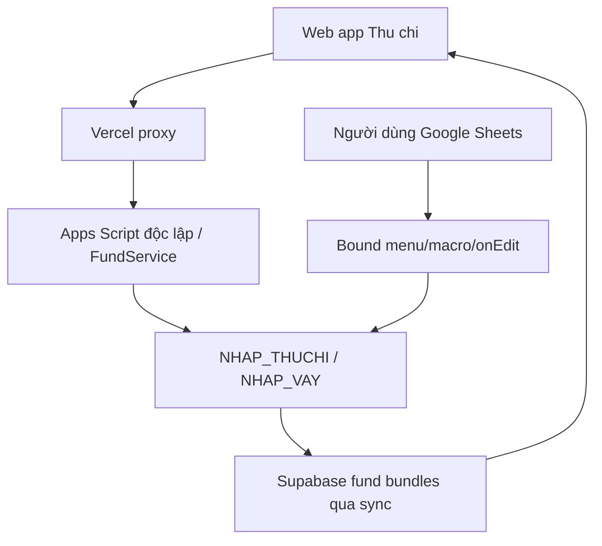

# THU_CHI_BOUND_SCRIPT

## 1. Mục đích và phạm vi

Tài liệu này mô tả Apps Script gắn trực tiếp với file Google Sheet Thu chi và phân biệt nó với Apps Script backend độc lập của web app Vận tải Đông Bắc.

Mục tiêu:

- xác định execution context của bound script;
- lập danh mục source snapshot trong repository;
- mô tả hành vi và sheet/range mà script phụ thuộc;
- chỉ rõ phần giao với `FundService` và frontend Thu chi;
- tránh copy hoặc sửa nhầm code giữa hai Apps Script project;
- ghi rõ nội dung nào đã quan sát được và nội dung nào chưa xác nhận với production live.

Tài liệu này không tuyên bố source snapshot chắc chắn đồng bộ với bound project production. Không sửa hoặc deploy bound script chỉ dựa vào snapshot nếu chưa kiểm tra project live.

## 2. Hai Apps Script project khác nhau

### 2.1. Web app Apps Script độc lập

Source chính ở root repository:

- `Router.gs`;
- `PublicApi.gs`;
- `FundService.gs`;
- `SheetService.gs`;
- `SupabaseService.gs`;
- các service `.gs` khác;
- frontend `.html` dùng chung khi render HtmlService.

Đặc điểm:

- là project độc lập trong My projects;
- không gắn cố định với một spreadsheet;
- mở file Vận tải/Thu chi bằng Spreadsheet ID;
- cung cấp HTTP API và worker;
- được đồng bộ/deploy bằng cấu hình clasp của repository;
- production frontend chủ yếu gọi qua Vercel proxy.

### 2.2. Thu chi bound script

Source snapshot:

```text
docs/source/thu_chi_bound_script/
```

Đặc điểm:

- gắn trực tiếp với file Google Sheet Thu chi;
- thao tác trên active spreadsheet/sheet/cell;
- chạy từ menu, macro, drawing/cell button hoặc `onEdit`;
- không phải backend HTTP của web app;
- không đi qua Vercel proxy, web RBAC hoặc Supabase write queue;
- có Apps Script manifest riêng trong thư mục snapshot.

## 3. Ranh giới bắt buộc

Không được:

- copy web app backend vào file Thu chi;
- copy bound script vào Apps Script độc lập mà giữ nguyên `getActiveSpreadsheet()`;
- coi source snapshot bound script là file được `clasp push` cùng web app;
- sửa range/cột trong Sheet Thu chi mà không kiểm tra bound script;
- giả định web app RBAC bảo vệ thao tác chạy trực tiếp trong Google Sheets;
- giả định queue/cache sẽ tự nhận mọi thay đổi bound script ngay lập tức;
- gộp `BOT_USERS` với Supabase `app_users`;
- deploy snapshot lên production bound project khi chưa xác nhận project ID và source live.

## 4. Source inventory

| File | Vai trò quan sát được |
| --- | --- |
| `appsscript.json` | Manifest, timezone, macro registrations |
| `menu.js` | Custom menu và entry point thao tác giao diện Sheet |
| `cellButtons.js` | Thiết lập/style/nút thao tác dựa trên cell |
| `macro.js` | Macro điều hướng, lọc và thao tác dashboard |
| `onEdit.js` | Xử lý edit/checkbox/form Thu chi, vay và in phiếu |
| `docso.js` | Chuyển số thành chữ phục vụ phiếu/chứng từ |
| `theme.js` | Theme trực tiếp cho `BC_THUCHI` và `BC_VAY` |

Đây là phân loại theo hành vi source, không phải ownership deployment đã được xác minh.

## 5. Manifest snapshot

Manifest bound script snapshot có:

- runtime V8;
- exception logging Stackdriver;
- timezone `America/New_York`;
- nhiều macro đăng ký theo menu name/function name.

### 5.1. Rủi ro timezone

Hệ thống chính dùng `Asia/Saigon`, trong khi manifest snapshot bound script dùng `America/New_York`.

Điều này có thể ảnh hưởng:

- timestamp;
- ngày giao dịch gần nửa đêm;
- voucher/mã sinh theo thời gian;
- filter hôm nay/hôm qua;
- trigger event date.

Chưa được phép tự đổi timezone. Phải kiểm tra timezone bound project live và tác động dữ liệu lịch sử trước.

### 5.2. Macro registrations

Manifest chứa nhiều macro legacy, gồm tên trùng hoặc chung chung như:

- `homnay`;
- `home`;
- `tatcasono`;
- `back`;
- `xemtatcavay`;
- `a`;
- `myFunction`, `myFunction1`, ...

Không đổi tên/xóa function chỉ vì tên khó hiểu. Drawing/macro trong Sheet có thể đang tham chiếu trực tiếp function name.

## 6. Execution entry points

### 6.1. Custom menu

`menu.js` tạo menu hoặc command để người dùng thao tác trực tiếp trong Google Sheets.

Contract:

- menu function chạy dưới context spreadsheet bound;
- có thể gọi macro/theme/helper khác;
- menu label và function name có thể được người dùng hoặc drawing tham chiếu;
- thay đổi menu không ảnh hưởng web navigation nhưng ảnh hưởng người dùng Sheet.

### 6.2. Macro/drawing/cell buttons

`macro.js` và `cellButtons.js` xử lý:

- điều hướng vùng báo cáo;
- đặt filter/checkbox;
- active sheet/range;
- style vùng nút;
- thao tác gắn với drawing hoặc cell.

Contract:

- phụ thuộc tên sheet và tọa độ;
- drawing assignment có thể không xuất hiện đầy đủ trong source/schema JSON;
- đổi function name cần reassign drawing thủ công nếu Google Sheets không tự cập nhật.

### 6.3. `onEdit`

`onEdit.js` phản ứng với active cell trong các sheet báo cáo/form.

Đây là entry point có side effect nghiệp vụ cao nhất vì có thể:

- validate form trong cell;
- tạo dòng vay/trả;
- clear/reset form;
- chuyển dữ liệu sang template in;
- thay validation/background của cell.

## 7. Sheet dependency

Bound script snapshot phụ thuộc trực tiếp các sheet:

| Sheet | Mục đích trong bound script |
| --- | --- |
| `BC_THUCHI` | Dashboard, filter, form/nút và chọn giao dịch để in |
| `BC_VAY` | Danh sách vay, form trả nợ/lãi và filter |
| `NHAP_THUCHI` | Dữ liệu giao dịch chuẩn của module Thu chi |
| `NHAP_VAY` | Dữ liệu vay/trả chuẩn |
| `INPHIEU` | Template phiếu thu/chi |
| `CAIDAT` | Danh mục, số dư và cấu hình/named ranges |

Các sheet bot có thể được automation khác sử dụng nhưng không phải trọng tâm của các file bound source đã khảo sát:

- `BOT_USERS`;
- `BOT_MEDIA`;
- `BOT_LOG`.

## 8. `onEdit` — Luồng Thu chi

### 8.1. Dashboard/form cell

`BC_THUCHI` chứa nhiều checkbox và vùng điều khiển. `onEdit` kiểm tra:

- tên active sheet;
- row/column của cell;
- giá trị checkbox hoặc text;
- các cell bắt buộc khác trong cùng row/form.

Hành vi có thể gồm:

- cảnh báo bằng toast;
- clear checkbox nếu form thiếu dữ liệu;
- copy dữ liệu giữa vùng form và sheet nguồn;
- reset màu/validation/content sau thao tác.

### 8.2. In phiếu

Khi người dùng chọn checkbox in tại vùng `BC_THUCHI`:

1. script lấy row đang chọn;
2. đọc ngày, người, nội dung, số tiền, nhân viên và mã phiếu từ các cột cố định;
3. phân biệt phiếu Thu hay Chi dựa trên cột category;
4. chuyển sang sheet `INPHIEU`;
5. ghi các cell cố định của template;
6. người dùng tiếp tục thao tác in trong Google Sheets.

Positional dependency quan sát được:

- checkbox ở cột 2, row từ 19;
- ngày ở cột 4;
- mã ở cột 3;
- số tiền ở cột 9;
- nhân viên/người/nội dung ở các cột 10–12;
- output ở các cell như `E5`, `B10`, `B12`, `G6`, `G7`, `E10`, `C12`, `C13` của `INPHIEU`.

Không thay layout hai sheet nếu chưa cập nhật và test toàn bộ mapping.

## 9. `onEdit` — Luồng khoản vay

### 9.1. Vùng form `BC_VAY`

Vùng form quan sát được ở row từ 6, các cột:

- I/cột 9: Ngày;
- J/cột 10: Loại;
- K/cột 11: Tất toán checkbox;
- L/cột 12: Số tiền;
- M/cột 13: Hình thức;
- N/cột 14: Xác nhận checkbox.

Thông tin khoản vay hiển thị được đọc từ các cột đầu row, gồm mã ẩn/ngày/đối tác/số tiền/nội dung.

### 9.2. Validation động

Khi người dùng nhập ngày/loại hoặc chọn form:

- script thêm/xóa checkbox validation;
- đổi background để chỉ cell cần nhập;
- clear field không áp dụng;
- yêu cầu đủ loại và số tiền/tất toán trước xác nhận.

Do validation được tạo động, migration không được chỉ copy value mà bỏ validation/background logic.

### 9.3. Trả lãi

Khi loại là `Trả lãi` và xác nhận:

1. lấy mã vay từ helper cột A hoặc fallback cột B;
2. lấy ngày/loại từ vùng form;
3. lấy số tiền;
4. lấy đối tác;
5. tạo nội dung có đối tác/mã vay;
6. append row vào `NHAP_VAY`;
7. ghi mã ở cột A;
8. ghi formula filter ở cột N;
9. reset form và toast thành công.

### 9.4. Trả nợ toàn bộ

Khi loại `Trả nợ` và checkbox tất toán true:

- số tiền lấy từ dư nợ hiển thị;
- append row trả nợ vào `NHAP_VAY`;
- giữ cùng mã khoản vay;
- tạo nội dung “Tất toán khoản vay”;
- ghi formula filter;
- reset form.

### 9.5. Trả nợ một phần

Khi loại `Trả nợ`, tất toán false và có số tiền:

- lấy số tiền từ form;
- append row trả một phần;
- dùng cùng mã vay;
- ghi nội dung và formula filter;
- reset form.

### 9.6. Mã vay helper

Helpers:

- `getVayLoanId_()` lấy giá trị cột A, fallback cột B;
- `getVayLoanIdDisplay_()` tương tự với display value.

Không xóa cột A “Mã ẩn” hoặc đổi fallback behavior mà chưa đối chiếu dữ liệu lịch sử và `FundService` loan reconciliation.

## 10. `NHAP_VAY` positional contract

Bound script append vào các cột:

| Cột | Ý nghĩa |
| --- | --- |
| A | Mã khoản vay |
| B | Ngày |
| C | Loại |
| E | Đối tác |
| F | Số tiền |
| K | Nội dung |
| N | Formula lọc |

Formula filter quan sát được nối các điều kiện từ `BC_VAY` với các cột A/C/E của row `NHAP_VAY`.

Contract:

- không chèn cột làm dịch mapping;
- không đổi vị trí vùng filter `BC_VAY` nếu chưa sửa formula string;
- không clear cột N khi web app update row;
- giữ data validation/formula của dòng template.

## 11. `macro.js`

Hành vi quan sát được thuộc các nhóm:

- chọn kỳ hôm nay/hôm qua/tuần/tháng/tất cả;
- chuyển giữa view Thu chi và Vay;
- điều khiển checkbox/filter;
- active sheet/range;
- reset hoặc chuẩn bị vùng báo cáo;
- các macro tên tự động `myFunction*`.

Rủi ro:

- phụ thuộc mạnh vào cell coordinates;
- tên function có thể được macro registry/drawing tham chiếu;
- nhiều function có thể là bản ghi macro lặp;
- code generated-by-macro thường khó đọc nhưng vẫn có side effect thật.

Không xóa function “không dùng” nếu chưa kiểm tra:

- manifest macro list;
- Extensions → Macros;
- drawing assigned script;
- custom menu;
- execution logs.

## 12. `cellButtons.js`

Vai trò quan sát được:

- tạo/style vùng cell đóng vai trò button;
- liên kết trải nghiệm click/edit trong `BC_THUCHI`/`BC_VAY`;
- phối hợp với theme.

Contract:

- cell button có thể dựa vào background, label, checkbox và data validation;
- theme có thể gọi helper style button nếu function tồn tại;
- Google Apps Script không recolor drawing content đầy đủ, nên một số style nằm ở cell nền;
- không coi vùng cell button là dữ liệu nghiệp vụ.

## 13. `theme.js`

### 13.1. Vai trò

Áp theme màu/font/alignment cho:

- `BC_THUCHI`;
- `BC_VAY`;
- vùng button/filter/dashboard.

### 13.2. Safety intent trong source

Source chủ động tránh:

- `clearFormat()`;
- copy format diện rộng;
- broad border update trong flow theme chính.

Mục tiêu là giữ:

- border;
- merge;
- formula;
- validation;
- number format.

### 13.3. Positional ranges

Theme dùng danh sách A1 ranges cố định. Nếu layout thay đổi, theme có thể tô nhầm vùng dữ liệu/số tiền.

Không chạy theme trên file production mới/migration layout khác trước khi review range list.

### 13.4. Border repair

`refreshPinterestThemeBorders()` là thao tác tùy chọn có thay border trong vùng cụ thể. Không gọi như một phần migration dữ liệu nếu không cần.

## 14. `docso.js`

Vai trò: chuyển số tiền thành chữ tiếng Việt cho chứng từ/phiếu.

Contract cần giữ:

- input number/string format;
- xử lý số 0, âm và đơn vị;
- output encoding tiếng Việt;
- không dùng kết quả text để thay số tiền numeric trong dữ liệu nguồn.

Khi thay đổi phải test các mốc:

- 0;
- hàng chục có số lẻ;
- hàng trăm có số 0 giữa;
- nghìn/triệu/tỷ;
- số tiền lớn;
- decimal nếu được hỗ trợ.

## 15. Giao với web app Thu chi

### 15.1. Dữ liệu dùng chung

Bound script và web app cùng có thể đọc/ghi:

- `NHAP_THUCHI`;
- `NHAP_VAY`;
- `CAIDAT`/named ranges.

Web app còn đọc/tổng hợp qua `FundService` và cache Supabase.

### 15.2. Hai đường ghi độc lập



Hai đường ghi không dùng chung transaction hoặc permission enforcement.

### 15.3. Cache consistency

Bound script không trực tiếp gọi `SupabaseService.syncFundAfterWrite()` trong snapshot.

Hệ quả:

- Sheet có thể đổi nhưng fund cache vẫn cũ;
- frontend có thể thấy dữ liệu cũ đến tick/backfill/force live read;
- không có `write_job` cho thao tác bound script;
- job/audit UI không thể hiện nguồn thay đổi này như một queued write.

Không thêm Supabase service role key vào bound script nếu chưa có thiết kế bảo mật/vận hành riêng.

## 16. Giao với file Vận tải

Giao dịch Thu chi được file Vận tải nhận qua `IMP_ThuChi`/`IMPORTRANGE` và công thức.

Luồng:

```text
Bound script hoặc web app
→ NHAP_THUCHI
→ IMP_ThuChi trong file Vận tải
→ XL_LuongNhanSu / BC_TongQuan / BC_TongHopXe
→ report bundle/cache
→ frontend
```

Do đó một thay đổi trong bound script có thể gián tiếp thay đổi:

- chi phí thực tế;
- lương/thực lĩnh;
- tổng hợp xe;
- lợi nhuận báo cáo.

Không tự sync report Vận tải ngay sau bound write nếu chưa đảm bảo `IMPORTRANGE` và công thức đã tính xong.

## 17. Giao với Auth/RBAC

Bound script chạy theo quyền Google account/trigger và Google Sheet sharing.

Không được bảo vệ bởi:

- Supabase Auth;
- `app_users`;
- shareholder API allowlist;
- Vercel proxy;
- `APP_PROXY_SECRET`.

Vì vậy phải quản trị riêng:

- ai có quyền edit file Thu chi;
- protected ranges;
- ai có quyền chạy/edit bound project;
- trigger owner;
- drawing/menu access.

Role `shareholder` của web app không tự động biến Google Drive permission thành view-only.

## 18. Giao với bot legacy

File Thu chi còn có:

- `BOT_USERS`;
- `BOT_MEDIA`;
- `BOT_LOG`.

Raw schema cho thấy từng có automation Telegram/bot append giao dịch và media.

Không được suy ra:

- bot còn chạy hay đã tắt;
- source bot có đầy đủ trong repository;
- `BOT_USERS` tương đương user web app;
- `BOT_LOG` tương đương Supabase write job log.

Trước thay đổi `NHAP_THUCHI` phải kiểm tra external automation/bot nếu vẫn tồn tại.

## 19. Source snapshot status

### 19.1. Đã biết

- Repository lưu đủ nhóm file menu, macro, onEdit, theme, cell buttons và đọc số.
- Source phụ thuộc tên sheet/range của file Thu chi 2026.
- Raw schema snapshot tồn tại cho cùng giai đoạn.
- Web app `FundService` đang làm việc với cùng các sheet dữ liệu chính.

### 19.2. Chưa xác nhận

- Bound project ID production.
- Commit/version tương ứng của snapshot.
- Source live có thay đổi sau ngày snapshot hay không.
- Trigger nào đang được cài.
- Drawing nào đang assigned function nào.
- Macro nào người dùng còn dùng.
- Bot/Telegram automation còn hoạt động hay không.
- Timezone live có thật sự là `America/New_York` hay snapshot cũ.
- Bound script có quyền gọi external service hiện tại hay không.

### 19.3. Nhãn sử dụng

Cho đến khi xác minh live, thư mục này phải được coi là:

```text
REFERENCE SNAPSHOT — KHÔNG TỰ ĐỘNG DEPLOY
```

## 20. Quy trình xác minh production bound project

Trước khi sửa bound script:

1. Mở đúng file Google Sheet Thu chi production.
2. Mở Extensions → Apps Script.
3. Ghi nhận Script ID/project URL.
4. Export/download source live mà không ghi đè snapshot cũ.
5. So sánh file/function với repository.
6. Kiểm tra manifest timezone/scopes/macros.
7. Kiểm tra Triggers.
8. Kiểm tra Executions gần đây.
9. Kiểm tra drawing assigned scripts và custom menu.
10. Kiểm tra external bot/webhook integration.
11. Xác định user nào dùng từng flow.
12. Chỉ sau đó mới lập kế hoạch thay đổi/deploy.

Không chỉnh source live trong lúc chỉ đang khảo sát.

## 21. Quy trình thay đổi an toàn

Nếu được phê duyệt sửa bound script:

1. Backup file Thu chi và source bound project.
2. Ghi rõ function/range/sheet bị ảnh hưởng.
3. Đối chiếu web app `FundService` cùng cấu trúc.
4. Kiểm tra `IMP_ThuChi` downstream.
5. Không đổi cột/named range trong cùng thay đổi code nếu chưa có migration riêng.
6. Test trên bản copy spreadsheet.
7. Test manual menu/macro/onEdit/drawing.
8. Test cả giao dịch Thu, Chi, Vay, Trả nợ, Trả lãi và In phiếu nếu liên quan.
9. Test formula/validation/protection còn nguyên.
10. Xác minh web app đọc cùng dữ liệu đúng.
11. Xác minh cache được refresh theo runbook.
12. Có rollback source và spreadsheet.

## 22. Những thay đổi rủi ro cao

- Chèn/xóa cột trong `BC_THUCHI`, `BC_VAY`, `NHAP_THUCHI`, `NHAP_VAY`.
- Đổi tên sheet.
- Đổi vị trí checkbox/form.
- Đổi mã vay/helper cột A.
- Đổi formula filter cột N.
- Đổi named range/range `CAIDAT`.
- Đổi timezone.
- Đổi voucher format.
- Xóa macro/function tên chung vì tưởng không dùng.
- Chuyển onEdit simple trigger thành installable trigger hoặc ngược lại.
- Thêm external request/service role secret.
- Cho bound script ghi Supabase trực tiếp.
- Tự động sync report Vận tải trước khi công thức import hoàn tất.

## 23. Điểm yếu quan sát được

- Logic phụ thuộc nhiều vào tọa độ cell.
- Function/macro có tên khó biểu đạt ý nghĩa.
- Nhiều thao tác UI và nghiệp vụ trộn trong `onEdit`.
- Có biến global sheet/range theo phong cách bound script legacy.
- Timezone snapshot không khớp hệ thống Việt Nam.
- Không có contract test tự động cho bound script.
- Source snapshot chưa gắn version/deployment ID.
- Hai đường ghi web app và Sheet trực tiếp không có event log thống nhất.
- Web RBAC không kiểm soát thao tác Google Sheets.
- Cache Supabase có thể trễ sau bound write.

Đây là nhận định khảo sát, không phải phê duyệt refactor.

## 24. Checklist khi lỗi phát sinh từ thao tác Sheet Thu chi

1. Xác định thao tác đến từ web app, bound script, macro hay bot.
2. Ghi lại sheet, cell/range và thời điểm.
3. Kiểm tra Apps Script Executions của bound project.
4. Kiểm tra row thực tế trong `NHAP_THUCHI`/`NHAP_VAY`.
5. Kiểm tra voucher/mã vay có trùng hoặc sai.
6. Kiểm tra formula/validation cột helper.
7. Kiểm tra `IMP_ThuChi` trong file Vận tải.
8. Kiểm tra fund/report cache timestamps.
9. Force read live trước khi kết luận cache sai.
10. Không retry bằng cả web app và Sheet nếu chưa đối soát row đã ghi.

## 25. Checklist review source bound script

- Function là entry point của menu/macro/drawing/onEdit hay helper?
- Có dùng `getActiveSpreadsheet()` hợp lệ vì bound context không?
- Tên sheet/range/cột nào bị hard-code?
- Có ghi vào dữ liệu nguồn hay chỉ UI cells?
- Có clear content/validation/format rộng không?
- Có append row dựa vào `getLastRow()` không?
- Có copy formula/template không?
- Có tạo voucher/mã vay không?
- Có thể chạy hai lần do checkbox/trigger không?
- Có tương tác với web app cùng lúc không?
- Thay đổi có làm cache/report Vận tải cũ không?
- Google Drive/protection permission có đủ hạn chế không?
- Source đã khớp production live chưa?

## 26. Trạng thái tài liệu

- Loại tài liệu: legacy/bound-script boundary và operational contract.
- Phạm vi: source snapshot trong `docs/source/thu_chi_bound_script/` và phần giao với Sheet/web app.
- Nguồn kiểm chứng: bound source snapshot, raw Thu chi schema, `FundService.gs` và kiến trúc hiện tại.
- Ngày xác nhận gần nhất: 2026-07-11.
- Trạng thái source: reference snapshot, chưa xác minh đồng bộ production bound project.
- Cần cập nhật khi: xác minh project live, thay trigger/macro/layout, đổi sheet/range, tích hợp bot hoặc thay ownership giữa bound script và web app.
