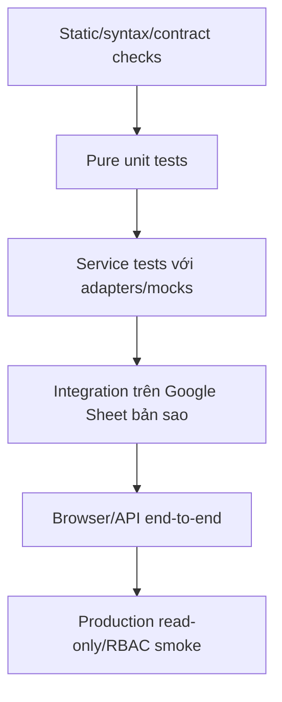

# TEST_STRATEGY

## 1. Mục đích và phạm vi

Tài liệu này định nghĩa chiến lược kiểm thử cho hệ thống Vận tải Đông Bắc nhằm bảo vệ dữ liệu, công thức, báo cáo, quyền truy cập và các luồng đồng bộ dài hạn.

Mục tiêu:

- chỉ rõ mức kiểm thử phù hợp với từng loại thay đổi;
- phân biệt test local, test trên bản sao Google Sheet và smoke test production;
- ưu tiên rủi ro mất/sai dữ liệu trước độ bao phủ hình thức;
- tạo contract chung cho Coding Agent khi sửa code trong tương lai;
- xác định khoảng trống kiểm thử hiện tại;
- cung cấp tiêu chí chấp nhận trước build/deploy/migration.

Tài liệu này không tạo test mới, không chạy production write và không phê duyệt refactor.

## 2. Nguyên tắc kiểm thử

1. Tính đúng dữ liệu và bảo toàn công thức quan trọng hơn số lượng test.
2. Không dùng production làm môi trường thử nghiệm destructive mặc định.
3. Mọi write test phải biết chính xác file/sheet/row sẽ bị ảnh hưởng.
4. Queue test phải kiểm tra cả accepted, processing, Sheet write và cache sync.
5. Lỗi response không chứng minh Google Sheet chưa ghi.
6. Báo cáo phải được đối chiếu với Google Sheet, không chỉ snapshot frontend.
7. RBAC phải test HTTP/API enforcement, không chỉ kiểm tra nút ẩn.
8. Regression test phải được thêm sau incident quan trọng khi có thể.
9. Test fixture không được chứa secret hoặc dữ liệu cá nhân không cần thiết.
10. Migration phải test trên bản sao/schema riêng trước production.
11. Build artifact phải được kiểm tra cùng source đã thay đổi.
12. Manual test cần có expected result rõ, không chỉ “mở thấy được”.

## 3. Mô hình test pyramid phù hợp dự án



Không cố đạt pyramid lý tưởng bằng cách mock toàn bộ Google Sheets. Một số invariant chỉ xác minh được trên Sheet thật/bản sao có formula, validation và protection.

## 4. Các tầng kiểm thử

### 4.1. Static và syntax checks

Mục đích:

- phát hiện JavaScript syntax lỗi;
- phát hiện template include/build lỗi;
- bảo vệ một số source contract quan trọng bằng pattern;
- phát hiện secret/artifact sai cơ bản.

Công cụ hiện có:

```bash
npm test
```

`tests/contracts.test.js` hiện kiểm tra:

- syntax `.gs`;
- syntax `api/app.js`;
- lint/typecheck/build source Next;
- atomic queue claim;
- cấm queued physical delete;
- stable fund voucher/queue flag;
- Auth migration/proxy allowlist;
- shareholder read-only/account admin;
- loan reconciliation;
- password policy.

Giới hạn:

- regex match không chứng minh runtime behavior;
- không gọi Google APIs;
- không kiểm tra DOM interaction;
- không kiểm tra SQL thực thi.

### 4.2. Pure unit tests

Mục tiêu tương lai:

- test function không cần Apps Script runtime;
- test normalize/parse/map/hash/filter;
- test business rules bằng fixture nhỏ.

Ứng viên:

- parse date/number/month;
- `ValidationService` row builders;
- category aggregation;
- loan reconciliation;
- stable stringify/hash sanitization;
- permission decision;
- cache key builders;
- pending row mapping/dedupe;
- report header matching.

Điều kiện: không refactor chỉ để test nếu chưa được phê duyệt; khi sửa vùng code có pure helper, ưu tiên thêm test tương ứng.

### 4.3. Service tests với fake adapters

Mục đích:

- test orchestration direct/queue;
- test write segmentation;
- test cache sync selection;
- test worker state transition.

Cần fake/stub có kiểm soát cho:

- `SpreadsheetApp`;
- `PropertiesService`;
- `CacheService`;
- `LockService`;
- `UrlFetchApp`;
- `ScriptApp` trigger;
- time/UUID.

Không fake toàn bộ Google Sheets formula engine. Formula behavior phải test bằng integration sheet.

### 4.4. Integration test trên Google Sheet bản sao

Mục đích:

- bảo toàn công thức/format/validation;
- xác minh header/column mapping;
- kiểm tra append/update/clear/delete;
- kiểm tra report controller/sheet tạm;
- kiểm tra trigger/event behavior.

Yêu cầu:

- dùng Spreadsheet ID bản sao riêng;
- gắn nhãn TEST rõ;
- không chứa production secret không cần thiết;
- fixture có row nhận diện được;
- cleanup sau test;
- đối chiếu formula trước/sau;
- không dùng `getActiveSpreadsheet()` trong web app backend tests.

### 4.5. Supabase integration tests

Mục đích:

- migration/schema/RLS;
- cache upsert/read;
- atomic RPC claim;
- job retry/idempotency constraints.

Nên dùng project/schema test riêng. Nếu buộc test production:

- chỉ read-only hoặc job test namespace riêng;
- không truncate bảng production;
- cleanup row test bằng service operation được phê duyệt;
- không log service role key.

### 4.6. Browser/API end-to-end tests

Mục đích:

- Auth/session;
- navigation/render;
- form validation;
- queue pending/poll/reload;
- responsive/mobile behavior;
- API fallback;
- export/report interaction.

Các môi trường:

- local Next build với test backend;
- Vercel preview;
- production smoke read-only.

### 4.7. Production smoke tests

Chỉ xác minh nhỏ, an toàn:

- health/auth;
- representative read actions;
- RBAC 401/403;
- cache/source status;
- build marker;
- worker idle status;
- direct Apps Script bị chặn.

Production write smoke chỉ chạy khi người dùng phê duyệt dữ liệu test và rollback/cleanup.

## 5. Môi trường kiểm thử

| Môi trường | Mục đích | Cho phép ghi |
| --- | --- | --- |
| Local Node | Syntax/unit/contract/build | Chỉ filesystem artifact khi được phép |
| Local browser | UI/static behavior | Không production data |
| Google Sheet bản sao | Formula/write/trigger integration | Có, trong fixture |
| Supabase test project/schema | Migration/RLS/queue | Có, test data |
| Vercel preview | End-to-end/auth/API | Chỉ test backend/data |
| Production | Smoke/verification | Mặc định read-only |

Không dùng local `.env` production trong test script nếu không có guard rõ.

## 6. Dữ liệu fixture

### 6.1. Nguyên tắc

- Dùng dữ liệu giả, không cần tên người thật.
- Biển số/project/person test có prefix dễ nhận biết.
- Date nằm trong kỳ test riêng hoặc bản sao.
- Voucher/job ID có prefix `TEST`.
- Amount nhỏ/dễ đối soát.
- Fixture phải nêu expected formula/report output.
- Không phụ thuộc thời gian hiện tại nếu có thể inject/freeze.

### 6.2. Fixture Vận tải tối thiểu

- 2 xe thuộc 2 chủ sở hữu;
- 2 dự án có km khác nhau;
- 2 mốc đơn giá có effective date;
- 2 tài xế;
- 1 row mỗi form `NL_*`;
- 1 trường hợp đối soát khớp;
- 1 thiếu chuyến;
- 1 thừa chuyến;
- 1 nghỉ làm giảm KPI;
- 1 phạt;
- 1 công thức số lít cộng tay;
- 1 row update đổi tháng.

### 6.3. Fixture Thu chi tối thiểu

- 1 giao dịch Thu;
- 1 giao dịch Chi;
- 1 batch 2 dòng;
- 1 voucher replay;
- 1 partial voucher conflict;
- 1 khoản vay;
- 1 trả nợ một phần;
- 1 tất toán;
- 1 trả lãi;
- 1 orphan payment reconcile an toàn;
- 1 orphan payment không duy nhất phải từ chối reconcile.

### 6.4. Fixture báo cáo golden

Golden dataset cần có expected value cho:

- doanh thu;
- dầu;
- chi phí lương;
- chi thực tế sau exclusions;
- lợi nhuận;
- bảng chi tiết;
- bảng lương;
- tổng hợp xe;
- các tháng riêng và `Tất cả`.

Golden output nên lưu dạng JSON/CSV nhỏ đã được người dùng xác nhận từ Google Sheet bản sao.

## 7. Kiểm thử build/frontend source

### 7.1. Build contract

Khi sửa frontend source:

```bash
npm test
npm run build
```

Sau build kiểm tra route manifest, server/client boundary, asset link/PWA manifest và không có source legacy/HtmlService quay trở lại.

### 7.2. Không commit artifact runtime

`.next/` là artifact build và không phải source chỉnh sửa. D1 gate phải phát hiện việc tái tạo `index.html`, `client_*.html`, React island bundle hoặc compatibility bridge.

### 7.3. DOM/load-order smoke

Mỗi build nên kiểm tra tối thiểu:

- auth gate render;
- app init không có console error;
- mọi nav view mở được;
- function global được gọi sau khi định nghĩa;
- DOM ID consumer dùng tồn tại;
- event handler không duplicate sau render.

### 7.4. Responsive smoke

Viewports đại diện:

- mobile 375×812;
- mobile rộng 430×932;
- tablet;
- desktop 1366×768.

Kiểm tra:

- không horizontal overflow ngoài bảng chủ động scroll;
- control mobile font ít nhất 16px nơi tránh iPhone zoom;
- CTA tối thiểu theo UX hiện hành;
- sticky header/tab không che nội dung;
- drawer có scroll và safe bottom padding;
- auth gate không overflow.

## 8. Kiểm thử API contract

### 8.1. Registry test

Mỗi action phải đối chiếu:

- frontend call site;
- proxy permission/method;
- Router/`invokeApi`;
- service handler;
- response consumer.

Nên có test tự động phát hiện action gọi từ frontend nhưng không có trong proxy/backend.

### 8.2. Method test

- Read action đúng GET.
- Write action đúng POST.
- `submitRowsGet` luôn bị từ chối.
- Account action sai method trả 405.
- Payload >1 MiB trả 413 tại proxy.

### 8.3. Error contract

Test:

- Apps Script `{ok:false}` → proxy HTTP 400;
- upstream non-2xx → 502;
- non-JSON upstream → 502;
- missing action → 400;
- missing proxy config → 503;
- browser nhận 401 thì reload về auth gate; server session endpoint clear cookie khi refresh token cũng không còn hợp lệ.

### 8.4. Next session continuity

- access token còn xa hạn không gọi refresh và không ghi lại cookie;
- access token nằm trong cửa sổ 25 phút gọi refresh đúng một lần, xác minh user bằng token mới và đặt lại hai cookie `HttpOnly`;
- refresh lỗi nhưng access token còn hợp lệ không làm mất phiên hiện tại;
- access và refresh đều không hợp lệ trả 401 và clear cookie;
- LoginGate thử recovery trước form đăng nhập; shared shell kiểm tra khi mount, heartbeat mỗi 40 phút và kiểm tra lại khi tab trở về foreground;
- smoke preview phải giữ nguyên route sau recovery và không thay đổi RBAC/allowlist.

### 8.5. Spreadsheet context test

- explicit `spreadsheetId` thắng year property;
- year property đúng;
- active/default fallback đúng;
- fund year mở file Thu chi, không file Vận tải;
- invalid/missing property fail rõ thay vì ghi file nhầm.

## 9. Kiểm thử Validation và row mapping Vận tải

Cho từng form:

- row trống bị bỏ qua hoặc lỗi đúng contract;
- field bắt buộc;
- date hợp lệ/không hợp lệ;
- number Việt Nam;
- positive number;
- catalog value tồn tại/không tồn tại;
- warning không làm mất row hợp lệ;
- output row đúng số cột;
- cột công thức được skip khi write.

Ma trận:

| Form | Cases đặc biệt |
| --- | --- |
| `vanChuyen` | date/vehicle/project/trips, số phiếu, duplicate/reconciliation |
| `taiXe` | driver suggestion/assignment, trips |
| `dau` | source, liters, price, formula cell preservation |
| `chamCong` | date range, inclusive days, leave type/group |
| `phat` | penalty lookup/content/amount |
| `nghiVanHanh` | hours, KPI flag/reduction |

## 10. Kiểm thử Google Sheet write preservation

### 10.1. Append

Trước/sau test ghi lại:

- formula strings row template;
- number formats;
- data validations;
- protections nếu đọc được;
- frozen rows/columns không đổi;
- sheet count/name/order không đổi.

Assert:

- đúng append row thực;
- không append vào vùng ARRAYFORMULA giả;
- công thức helper tồn tại;
- chỉ field nghiệp vụ đổi;
- Developer Metadata đúng job/range nếu queue.

### 10.2. Update

Assert:

- partial payload không clear field khác;
- formula không đổi;
- same-data replay không ghi lại ngoài ý muốn;
- expected row mismatch bị từ chối;
- update date đổi tháng sync cả tháng cũ/mới.

### 10.3. Clear/delete

Assert:

- clear chỉ đúng columns;
- helper/formula còn nguyên;
- header row không thể xóa;
- queued physical delete bị từ chối;
- direct physical delete thay row count đúng;
- UI reload row indexes.

### 10.4. Rollback partial batch

Tạo lỗi có kiểm soát giữa batch trên bản sao. Assert:

- không còn row nghiệp vụ nửa batch;
- row ngoài batch không bị clear;
- formula/validation template còn nguyên;
- response/job failed rõ.

## 11. Kiểm thử queue

### 11.1. Enqueue

- queue disabled trả behavior an toàn/direct theo contract;
- invalid module/action bị từ chối;
- non-`NL_*` không queue Vận tải;
- duplicate idempotency key trả cùng logical job;
- payload chứa stable identity;
- response có `accepted`, `queued`, `jobId`, `status`.

### 11.2. Atomic claim

- hai worker không claim cùng job;
- pending đến hạn được claim;
- future `next_run_at` không được claim;
- attempts max không được claim;
- stale processing được reclaim;
- recent processing không được reclaim;
- batch limit 1–20.

### 11.3. Worker state transitions

```text
pending -> processing -> synced
pending -> processing -> pending (retry)
pending -> processing -> failed
processing stale -> processing (reclaim) -> synced/failed
```

Assert timestamps, attempts, worker ID, result, last error và logs.

### 11.4. Transport idempotency

- execute append lần 1 ghi row/metadata;
- execute lại cùng job không thêm row;
- metadata chỉ đúng range;
- save replay khi row đã bằng dữ liệu mới;
- save từ chối row khác previous data;
- clear replay an toàn;
- physical delete payload bị từ chối.

### 11.5. Fund idempotency

- duplicate `clientRequestId` không tạo job mới;
- stable vouchers giữ qua retry;
- tất cả voucher tồn tại → replay success;
- một phần voucher tồn tại → conflict/failure;
- no voucher tồn tại → append đúng batch;
- pending không vào KPI;
- synced reload row thật.

### 11.6. Failure after Sheet write

Mô phỏng:

1. Sheet write thành công;
2. cache/job update lỗi;
3. worker retry.

Assert retry nhận biết write cũ và không duplicate.

## 12. Kiểm thử cache

### 12.1. Key parity

Backend/frontend phải tạo cùng key cho:

- report month;
- dashboard special key;
- catalogs form/display;
- fund form/catalog;
- manage `recent_500`/`month:*`;
- fund transaction `recent_500`/`month:*`.

### 12.2. Read/fallback

Cases:

- Supabase disabled;
- missing URL/key;
- missing bundle;
- HTTP 401/500;
- payload missing;
- payload `ok:false`;
- valid payload;
- stale browser session cache chứa lỗi.

Expected: live fallback khi phù hợp, không render cache lỗi.

### 12.3. Sync selection

Sau mỗi write assert đúng cache scope:

- manage recent;
- tháng liên quan;
- tháng cũ + mới khi update date;
- dashboard cho `NL_VanChuyen`;
- report month/`Tất cả`;
- fund latest/month;
- catalog/startup.

### 12.4. Audit

- identical normalized payload → ok;
- volatile timestamp khác → vẫn ok;
- business value khác → stale;
- missing cache → missing;
- live read error → error;
- quick 50 không tuyên bố deep 500.

## 13. Kiểm thử báo cáo

### 13.1. Golden comparison

Với mỗi kỳ fixture:

- `05/2026`;
- `06/2026`;
- `07/2026`;
- `Tất cả`;

So sánh:

- matrix headers;
- row labels;
- KPI numeric;
- detail rows;
- payroll;
- vehicle summary;
- currency/date display có ý nghĩa.

### 13.2. Header matching regression

Test cụ thể:

- `chi phí lương`/`tổng lương` match payroll;
- `khối lượng` không match payroll;
- dấu/hoa/thường không làm sai;
- duplicate/blank header có fallback xác định.

### 13.3. Controller tháng

Assert:

- `BC_TongQuan!B1` gốc không đổi trước/sau request;
- sheet tạm nhận đúng month;
- result đúng month;
- sheet tạm bị xóa khi thành công;
- cleanup xử lý tên copy default;
- concurrent requests không dùng cùng temp sheet name.

### 13.4. Report cache

- cache version/data version match → reuse;
- version mismatch → recompute;
- month key không lẫn tháng;
- `Tất cả` aggregate đúng;
- Supabase audit hash bỏ field volatile.

### 13.5. Frontend render

- render matrix trực tiếp;
- không tự đặt lại label;
- filter/search không làm subtotal sai;
- CSV/export giữ đúng cột;
- mobile sticky không che dữ liệu;
- image export không có pending/status label ngoài chủ ý.

## 14. Kiểm thử Thu chi

### 14.1. Transaction read

- Thu và Chi map đúng category column;
- date/month filter đúng;
- amount parse Việt Nam;
- limit/recent order;
- rowIndex/voucher giữ đúng;
- empty/helper rows bị bỏ.

### 14.2. Transaction write

- single/batch;
- unique voucher;
- same millisecond batch vẫn unique;
- formula/filter/debt columns preserved;
- data validation không mất;
- range metadata response đúng;
- rollback partial batch.

### 14.3. Fund overview

- Thu/Chi totals;
- balance;
- category grouping;
- filtered period vs cumulative/today semantics;
- pending excluded;
- empty month;
- latest vs month cache.

### 14.4. Loan rules

- Vay tạo state;
- trả nợ một phần;
- tất toán;
- trả lãi không giảm principal;
- exact code matching;
- orphan safe reconciliation;
- ambiguous orphan không reconcile;
- settlement before loan không reconcile;
- payment amount mismatch không reconcile;
- historical month outstanding;
- không cho thanh toán khoản hiện đã tất toán.

### 14.5. Fund catalogs

- đọc named/native/fallback sources;
- group normalize;
- encoded row index đúng group;
- out-of-bounds write bị chặn;
- append không tràn range;
- save/delete sync catalog/form cache.

## 15. Kiểm thử bound script Thu chi

Chỉ sau khi xác minh source live và trên bản sao Sheet.

### 15.1. Entry points

- custom menu load;
- macro assignments;
- drawing/cell button;
- onEdit checkbox;
- theme;
- số thành chữ.

### 15.2. Positional flows

- `BC_THUCHI` filter/form;
- in phiếu Thu;
- in phiếu Chi;
- `BC_VAY` trả lãi;
- trả nợ toàn bộ;
- trả nợ một phần;
- reset validation/background/form;
- helper mã cột A/fallback B;
- formula filter cột N.

### 15.3. Timezone

Test event gần 00:00 Việt Nam trước khi đổi manifest timezone. So sánh voucher/date/filter ở timezone live và `Asia/Saigon`.

### 15.4. Web app interoperability

Sau bound write:

- `FundService` đọc đúng;
- cache ban đầu có thể cũ;
- force live read thấy row;
- sync fund bundle rồi frontend thấy row;
- `IMP_ThuChi` và report Vận tải cập nhật đúng khi liên quan.

## 16. Kiểm thử RBAC

### 16.1. Unauthenticated

- health success;
- business API 401;
- anon Supabase read denied;
- direct Apps Script no-secret denied khi enforcement bật.

### 16.2. Inactive/outside allowlist

- Auth login có thể thành công;
- proxy 403;
- RLS denied;
- frontend không init.

### 16.3. Shareholder

Success read:

- startup;
- dashboard/report;
- manage data;
- fund transactions/overview/loans;
- own password.

403 write/admin/audit:

- submit/save/delete;
- fund writes;
- catalog admin reads/writes;
- write job/retry/process;
- sync/audit;
- account admin.

### 16.4. Operator

- nghiệp vụ read/write success;
- queue/audit theo contract success;
- account admin 403.

### 16.5. Admin

- account CRUD/reset;
- self-demotion/deactivation denied;
- create each allowed role;
- invalid role denied;
- password minimum enforced.

## 17. Kiểm thử migration Supabase

Trên test database:

1. Apply migrations theo thứ tự từ empty schema.
2. Apply lại migration idempotent nơi có `if exists/not exists`.
3. Insert representative bundle/job/user rows.
4. Test constraints/indexes.
5. Test RPC claim concurrent.
6. Test RLS anon/authenticated/inactive/service role.
7. Test role constraint gồm shareholder.
8. Test upgrade từ schema trước migration mới.
9. Test rollback plan bằng migration mới/feature flag.

Không chỉnh migration cũ chỉ để test pass nếu migration đó đã chạy production.

## 18. Kiểm thử trigger

### 18.1. Installers

- cài lần đầu tạo đúng trigger;
- cài lại không nhân đôi;
- handler/interval/file ID đúng;
- remove old handler có kiểm soát;
- permission error được báo rõ.

### 18.2. Transport edit

- edit `NL_*` sync recent/month;
- edit `NL_VanChuyen` sync dashboard;
- edit `DM_*` không bị transport handler xử lý;
- month extraction từ range đúng;
- lock/running guard hoạt động.

### 18.3. Transport change/delete

- known sheet path;
- unknown sheet fallback hẹp;
- không full sync mọi `NL_*` gây timeout;
- sync status key đúng.

### 18.4. Scheduled tick

- mỗi tick chỉ một group;
- rotation cursor tiến;
- concurrent tick bị skip;
- error một step không phá vĩnh viễn rotation;
- full sync không được trigger gọi.

## 19. Kiểm thử observability

- API timing log không chứa secret/payload nhạy cảm;
- sync status upsert đúng key/module/status/time;
- job logs append đúng transition;
- last error rõ nhưng không lộ key/token;
- UI phân nhóm cache/queue/audit;
- default status load không chạy heavy audit;
- quick/deep/all audit buttons gọi đúng params;
- timestamp/age hiển thị đúng timezone.

## 20. Kiểm thử fallback và rollback

### 20.1. Tắt Supabase read

Với `VITE_SUPABASE_REPORTS_ENABLED=false`:

- startup mở được;
- dashboard/report mở được;
- manage/catalog mở được;
- fund mở được;
- API đi Apps Script;
- không có lỗi do missing Supabase config.

### 20.2. Supabase outage

- read cache timeout nhanh;
- fallback live;
- không treo loader;
- toast/source badge hợp lý;
- write queue action báo lỗi rõ nếu không enqueue được, không giả success.

### 20.3. Auth rollback

Chỉ test theo runbook và môi trường kiểm soát:

- enforcement false behavior;
- frontend auth flag false;
- direct API exposure được hiểu/giới hạn;
- khôi phục Auth không mất `app_users`.

### 20.4. Cache delete/backfill

- xóa bundle không ảnh hưởng Sheet;
- frontend fallback;
- sync hẹp tái tạo đúng key;
- audit trở lại ok.

## 21. Ma trận test theo loại thay đổi

| Loại thay đổi | Test tối thiểu |
| --- | --- |
| Docs only | Link/path review, `git diff --check` |
| Pure helper | Syntax + unit cases + consumer regression |
| Frontend UI | `npm test`, build, desktop/mobile smoke, console errors |
| API action | Contract/method/error/RBAC + service test |
| Vận tải row mapping | Validation unit + Sheet copy append/update/formula preservation |
| Queue worker | Migration/RPC + idempotency + state transition + pending UI |
| Cache key/payload | Backend/frontend parity + fallback + audit + consumer render |
| Báo cáo | Golden months + controller invariant + cache audit + UI export |
| Thu chi transaction | Batch/voucher/rollback + overview/cache |
| Khoản vay | Full loan rule matrix + historical UI |
| RBAC | 401/403/success theo 3 role + RLS |
| Supabase migration | Fresh apply + upgrade + RLS + rollback plan |
| Trigger | Install/idempotency/event/scope/timeout |
| Bound script | Live-source verify + Sheet copy positional/manual flows |
| Year cutover | Full integration hai file/cache/trigger/report |

Loan characterization baseline hiện có tại `tests/fund-loan-characterization.test.js`, khóa các contract:

- current và historical month metrics/outstanding;
- exact match, safe orphan exact-balance match, ambiguous và amount-mismatch rejection;
- partial/full principal settlement và interest behavior;
- type variants, terms/rate/first-interest mapping và history order;
- add loan/payment A:K, format B/F, helper formula N, row growth, lock, response và validation.

## 22. Tiêu chí chấp nhận trước deploy

### 22.1. Mọi thay đổi code

- `git status --short` đã review;
- không ghi đè thay đổi người dùng;
- diff đúng phạm vi;
- không có secret;
- `npm test` pass;
- test liên quan pass;
- rollback rõ.

### 22.2. Frontend

- build pass;
- artifact được cập nhật;
- Auth gate/app init pass;
- view liên quan pass desktop/mobile;
- không console error;
- role UI pass.

### 22.3. Backend/Sheet

- test trên bản sao hoặc read-only verification phù hợp;
- formula/validation/header/order không đổi ngoài kế hoạch;
- API response contract giữ;
- direct/queue path đúng;
- cache sync đúng phạm vi.

### 22.4. Queue

- migration đã apply trước worker code;
- atomic claim hoạt động;
- double execution không duplicate;
- pending/synced/failed UI đúng;
- worker idle test an toàn;
- feature flag rollout/rollback rõ.

### 22.5. Báo cáo

- golden/manual Sheet comparison cho kỳ ảnh hưởng;
- `B1` gốc không đổi;
- temp sheet cleanup;
- report audit ok sau sync;
- không deploy tối ưu nếu số liệu chưa xác nhận.

### 22.6. RBAC

- unauthenticated blocked;
- shareholder write 403;
- operator account admin 403;
- admin required actions success;
- anon Supabase blocked;
- direct Apps Script blocked.

## 23. Báo cáo kết quả test

Handoff phải ghi:

- command/test đã chạy;
- môi trường;
- file/Spreadsheet ID test đã ẩn bớt khi cần;
- cases pass/fail;
- expected/actual cho failure;
- test chưa chạy và lý do;
- dữ liệu test đã cleanup chưa;
- có thay production state không;
- bước manual user cần xác nhận.

Không chỉ ghi “đã test OK”.

## 24. Khoảng trống ưu tiên bổ sung

Theo rủi ro hiện tại, thứ tự ưu tiên hợp lý:

1. Golden report fixtures và regression test.
2. Row mapping/formula preservation trên Sheet bản sao.
3. Queue worker/idempotency runtime tests.
4. Cache key parity và sync-scope tests.
5. API action registry/RBAC matrix automated check.
6. Frontend interaction smoke cho Next server/client boundary.
7. Fund transaction batch/voucher/rollback tests.
8. Trigger installer/event tests.
9. Bound script source verification và manual regression suite.
10. Year-cutover test plan.

Thứ tự này không tự động cho phép triển khai test infrastructure hoặc refactor; cần task/phê duyệt riêng.

## 25. Quy tắc regression sau incident

Sau incident:

1. Viết lại điều kiện tái hiện tối thiểu.
2. Xác định tầng test thấp nhất có thể bắt lỗi.
3. Thêm regression test trước/cùng fix khi được phê duyệt.
4. Nếu chưa tự động hóa được, thêm manual case rõ vào checklist.
5. Xác minh test fail trên behavior cũ nếu có thể.
6. Xác minh pass sau fix.
7. Cập nhật `KNOWN_RISKS.md` và tài liệu contract liên quan.

Không dùng comment trong code làm thay thế regression test.

## 26. Trạng thái tài liệu

- Loại tài liệu: chiến lược kiểm thử.
- Phạm vi: frontend, Vercel proxy, Apps Script, Google Sheets, Supabase, queue, Auth/RBAC và bound script Thu chi.
- Nguồn kiểm chứng: source repository, tests hiện có, schema/contracts và risk register.
- Ngày xác nhận gần nhất: 2026-07-11.
- Cần cập nhật khi: thêm test framework/environment, thêm module/action/role/queue, thay deployment workflow hoặc có incident mới tạo regression requirement.
